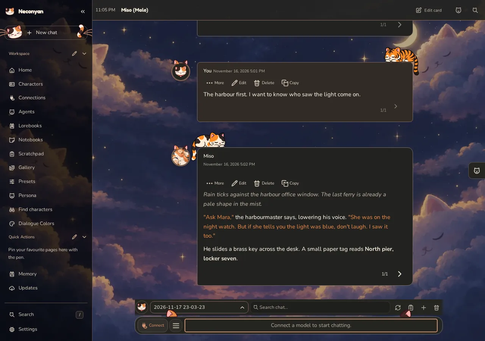

<!-- Translated from README.md at commit 31d628fa (Neconyan 1.5.5). Keep the structure in step with the English README. -->

# Neconyan~

Die neueste Version ist [1.5.5](https://github.com/platberlitz/Neconyan/releases/tag/v1.5.5).

**In deiner Sprache lesen:** [English](../README.md) · [Español](readme-es_es.md) · [Français](readme-fr_fr.md) · [Italiano](readme-it_it.md) · [Nederlands](readme-nl_nl.md) · [Português](readme-pt_pt.md) · [Íslenska](readme-is_is.md) · [Русский](readme-ru_ru.md) · [Українська](readme-uk_ua.md) · [العربية](readme-ar_sa.md) · [ไทย](readme-th_th.md) · [Tiếng Việt](readme-vi_vn.md) · [日本語](readme-ja_jp.md) · [한국어](readme-ko_kr.md) · [简体中文](readme-zh_cn.md) · [繁體中文](readme-zh_tw.md)

Diese Übersetzung kann dem Original hinterherhinken. Die [englische README](../README.md) ist aktuell.

<p align="center">
  
</p>

Hallo und herzlich willkommen! Neconyan ist mein Fork von [SillyTavern](https://github.com/SillyTavern/SillyTavern) und [SillyBunny](https://github.com/SillyBunnyTeam/SillyBunny) im Katzen-Look, zum Chatten und für Rollenspiele mit KI-Charakteren, am Computer oder auf dem Handy. Ich habe es gebaut, weil ich ein Frontend wollte, das sich gemütlich anfühlt, auf dem Handy richtig funktioniert und auf fast jeder Seite eine Katze hat. Einen API-Schlüssel oder ein lokales Modell bringst du selbst mit; die App enthält weder Modellzugang noch Guthaben.

**[Neconyan herunterladen](https://github.com/platberlitz/Neconyan/releases/latest)** · **[Das Handbuch lesen](https://platberlitz.github.io/neconyan-docs/)** · **[Hilfe holen](https://platberlitz.github.io/neconyan-docs/help/troubleshooting/)**

> Der gesamte Code hier wurde von LLMs geschrieben oder mit ihrer Hilfe erstellt. Jeder Prompt und jeder Agent, der mit Neconyan ausgeliefert wird, stammt von Menschen.

## Was steckt drin?

<p align="center">
  
</p>

- **Vier Arten zu chatten:** klassisches Rollenspiel, Konversation im Messenger-Stil, ein Social-Media-Feed namens Meower und der Story-Modus für durchgehenden Fließtext. Such dir aus, was gerade zu deiner Stimmung passt.
- **Ein Layout, das fürs Handy gemacht ist**, mit beschrifteten Bedienelementen, einer Chatleiste unten und einem Schiebemenü. Schluss mit dem Augenzusammenkneifen vor winzigen Desktop-Knöpfen auf dem kleinen Bildschirm.
- **[Einfacher Modus](#einfacher-modus)**, für alle, die einfach nur Rollenspiel machen wollen, ohne ein ganzes Cockpit voller Knöpfe. Mehr dazu weiter unten, denn auf den bin ich richtig stolz.
- **Mewmory** merkt sich Ereignisse und Charaktere der Geschichte, damit dein Gegenüber die wichtigen Dinge nicht vergisst. **Agenten** können Tracker führen, eine Antwort prüfen oder eine separate Begleiternotiz schreiben.
- **Catelier** hilft dir beim Schreiben von Charakterkarten und Lorebooks. **Notizbücher** halten deine Notizen griffbereit, und **Scratchpad** gibt dir einen separaten Chat, um Ideen durchzusprechen.
- **Miso, Taro und Nori** sind die hauseigenen Assistenten. Sie helfen dir, Dinge zu finden, und können mit deiner Erlaubnis unterstützte Änderungen vornehmen.
- **Geräte-Sync** überträgt ausgewählte Daten zwischen getrennten Installationen, per verschlüsselten Dateien, WebDAV, geheimen GitHub Gists oder direkter Kopplung. Übertragungen laufen nur, wenn du sie anstößt.
- **Themes, Akzentfarben und Katzen.** Ziemlich viele Katzen. Du kannst sie ausblenden, auch wenn ich mir nicht vorstellen kann, warum du das wollen würdest.

Deine Charakterkarten, Chats, Lorebooks und Voreinstellungen nutzen vertraute SillyTavern-Formate, du kannst sie also einfach mitnehmen. Es gibt keine Telemetrie. Manche Funktionen und Erweiterungen aus dem Original verhalten sich hier anders; ich übernehme nur die Teile, die ich haben will. Die [Liste der enthaltenen Tools](../docs/neconyan-native-tools.md) würdigt die Projekte, die mit Neconyan ausgeliefert werden.

## Einfacher Modus

<p align="center">
  
</p>

Kein Fan von Power-User-Kram? Keine Lust, dich durch Unmengen von Knöpfen zu wühlen, nur um ein bisschen Rollenspiel zu machen und Spaß zu haben? Mensch, hab ich da den passenden Modus für dich!

**Einfacher Modus** ist Neconyan für alle, die einfach nur RP machen wollen. Du behältst alles, was Neconyan zu *Neconyan* macht: die Katzen, das handyfreundliche Layout, Miso, Taro und Nori, das Gedächtnis, das deine Geschichte im Blick behält, und deine Agenten, die im Hintergrund weiterarbeiten. Weg ist nur der ganze Kram drumherum: Sampler, Prompt-Formatierung, Token-Zähler, Erweiterungsmenüs und all die anderen Regler, die die meisten Leute nie anfassen.

Und jetzt kommt das Beste: Nichts wird gelöscht oder abgeschaltet. Jedes ausgeblendete Bedienelement wird nur weggeräumt, nicht weggeworfen, und ist sofort wieder da, sobald du es haben willst.

### Einfacher geht's nicht

Gleich bei deinem allerersten Besuch stellt Nori dir eine einzige Frage: **Want to keep things simple?** Drück auf **Yes, keep it simple**, und eine Tour in drei Schritten führt dich durchs Verbinden eines Modells, das Kennenlernen eines Charakters und das erste Hallo. Das war's. Das ist schon die ganze Einrichtung.

Du nutzt schon das volle Layout? Schalte ihn jederzeit unter **Einstellungen → Darstellung → Einfacher Modus** ein.

<table><tr>
  <td width="72%"></td>
  <td width="28%"></td>
</tr></table>

### Dein Chat im Mittelpunkt

Der Chat und das Eingabefeld bekommen den Platz, und die Seitenleiste zeigt nur eine kurze Liste der Seiten, die du wirklich öffnest: Charaktere, Verbindungen, Agenten, Lorebooks, Notizbücher, Scratchpad, Galerie, Voreinstellungen, Persona und Dialogfarben. Obendrauf gibt's drei praktische Knöpfe:

- **Find characters** sucht nach neuen Karten. Such dir eine aus, und ihr Chat öffnet sich sofort, startklar.
- **Gedächtnis** öffnet **Story so far**, mit einem einzigen Schalter, einem Knopf **Summarise now** und der neuesten Zusammenfassung deines Chats.
- **Updates** sucht nach einer neuen Version und installiert sie, ohne dass du den Einfachen Modus verlassen musst.

<table><tr>
  <td width="72%"></td>
  <td width="28%"></td>
</tr></table>

### Verbinden ohne Hausaufgaben

Verbindungen zeigt nur den Anbieter, deinen Schlüssel, das Modell, **Verbinden** und **Testnachricht**. Alles andere wartet hinter **More connection options**, für den Tag, an dem du neugierig wirst.

<table><tr>
  <td width="72%"></td>
  <td width="28%"></td>
</tr></table>

### Doch anders entschieden? Kein Problem

Drück **Alle Funktionen anzeigen** in der Seitenleiste oder schalte ihn unter **Einstellungen → Darstellung** aus, und jeder Knopf ist sofort wieder genau da, wo du ihn gelassen hast. Deine Chats, Charaktere, Lore und Agenten merken davon überhaupt nichts.

[Der Einfache Modus im Handbuch](https://platberlitz.github.io/neconyan-docs/workspace/#keep-the-sidebar-simple)

## Schau mal rein

<p align="center">
  
</p>

Und hier kommt der Rest der Tour! Diese Screenshots vom Desktop und vom Handy habe ich am 17. November 2026 aufgenommen, mit Demo-Chats, Demo-Notizen und den mitgelieferten Assistenten, den Standardfarben von Calico Dark und **Sichtbarkeit des Hintergrunds auf 0 %**.

### Startseite

Wähle einen Charakter, verbinde ein Modell oder sag einem der Assistenten Hallo. Die Katzen werden sich riesig freuen, dich zu sehen.

<table><tr>
  <td width="72%"></td>
  <td width="28%"></td>
</tr></table>

### Rollenspiel

Schreib eine Szene, probier eine andere Antwort aus oder setz einen alten Chat genau da fort, wo du aufgehört hast.

<table><tr>
  <td width="72%"></td>
  <td width="28%"></td>
</tr></table>

### Catelier

Arbeite an einem Charakterentwurf, lass dir beim Schreiben helfen und prüfe die Änderungen, bevor du sie in deiner Bibliothek speicherst.

<table><tr>
  <td width="72%"></td>
  <td width="28%"></td>
</tr></table>

### Agenten

Wähle einen Helfer, lege fest, wann er läuft, und gib ihm eine Verbindung. Ich würde mit einem anfangen, statt gleich die halbe Bibliothek auf einmal einzuschalten.

<table><tr>
  <td width="72%"></td>
  <td width="28%"></td>
</tr></table>

### Proofreader nach der Generierung

Proofreader prüft eine Antwort, nachdem sie angekommen ist. Er kann Prosa und Formatierung glätten, ohne dass das Hauptmodell die Szene neu schreiben muss. Öffne **Agent-Änderungen**, um die Bearbeitung zu vergleichen und rückgängig zu machen, falls dir das Original lieber ist.

<table><tr>
  <td width="72%"></td>
  <td width="28%"></td>
</tr></table>

Dieses gestellte Beispiel führt den echten Agenten-Workflow mit einer festen Beispielantwort aus. Dein verbundenes Modell schreibt die Änderungen im normalen Betrieb, und jeder Durchgang kann eine weitere Anfrage kosten. [Agenten und Begleiter im Handbuch](https://platberlitz.github.io/neconyan-docs/helpers/agents/).

<details>
<summary><b>Weitere Screenshots: Konversation, Meower, Story-Modus, Notizbücher, Scratchpad und Geräte-Sync</b></summary>

### Konversation

Schreib deinen Charakteren Nachrichten, erstelle Gruppenchats und lass sie beschäftigt oder offline sein, ganz wie echte Freunde.

<table><tr>
  <td width="72%"></td>
  <td width="28%"></td>
</tr></table>

### Meower

Ein Social-Media-Feed, in dem deine Charaktere posten, antworten und Umfragen starten. Da geht es ganz schön chaotisch zu, und zwar auf die allerbeste Art.

<table><tr>
  <td width="72%"></td>
  <td width="28%"></td>
</tr></table>

### Story-Modus

Lies deinen Chat als durchgehenden Fließtext, wie ein Buch, das ihr zusammen geschrieben habt.

<table><tr>
  <td width="72%"></td>
  <td width="28%"></td>
</tr></table>

### Notizbücher

Bewahre Szenenpläne, Orte und Sitzungstagebücher direkt neben deinen Chats auf.

<table><tr>
  <td width="72%"></td>
  <td width="28%"></td>
</tr></table>

### Scratchpad

Sprich die Geschichte mit einem Assistenten oder an einem runden Tisch mit mehreren Charakteren durch, ohne dass deren Diskussion im Hauptchat landet.

<table><tr>
  <td width="72%"></td>
  <td width="28%"></td>
</tr></table>

### Geräte-Sync

Übertrage ausgewählte Bibliotheken zwischen getrennten Installationen. Wähle verschlüsselte Dateien, WebDAV, einen geheimen GitHub Gist oder direkte Kopplung; Übertragungen starten, wenn du sie anstößt. [Einrichtung und Wiederherstellung im Handbuch](https://platberlitz.github.io/neconyan-docs/help/device-sync/).

<table><tr>
  <td width="72%"></td>
  <td width="28%"></td>
</tr></table>

</details>

## Loslegen

<p align="center">
  
</p>

Lust, es auszuprobieren? Such dir einfach das Gerät aus, das du benutzen möchtest.

### Auf dem Computer

1. Lade die Datei mit der Endung **-source.zip** aus dem [neuesten Release](https://github.com/platberlitz/Neconyan/releases/latest) herunter. Entpacke sie zuerst; unter Windows klickst du sie mit der rechten Maustaste an und wählst **Alle extrahieren**.
2. Öffne den Ordner. Führe unter Windows **Start.bat** aus, unter macOS **Start.command** oder unter Linux in einem Terminal **bash start.sh**.
3. Gib dem ersten Start ein paar Minuten, um zu installieren, was er braucht. Lass das Terminalfenster offen, solange du Neconyan benutzt.
4. Dein Browser sollte sich von selbst öffnen. Falls nicht, ruf **http://127.0.0.1:4433/** auf.
5. Öffne **Verbindungen**, wähle deinen Anbieter und dein Modell und gib deinen API-Schlüssel oder die Adresse deines lokalen Modells ein. Öffne danach auf der Startseite einen Charakter oder einen Assistenten, und los geht's!

Beim nächsten Mal startest du dasselbe Startskript. Um Neconyan zu beenden, drückst du **Strg+C** in seinem Terminal.

Lieber mit Git? Klone das Repository und nutze dann dasselbe Startskript:

```sh
git clone https://github.com/platberlitz/Neconyan.git
```

[Einrichtung am Computer und häufige Startprobleme](https://platberlitz.github.io/neconyan-docs/start/computer/)

### Android-App

Lade die **-android-arm64.apk** aus dem [neuesten Release](https://github.com/platberlitz/Neconyan/releases/latest) herunter und öffne sie. Erlaube die Installation aus deinem Browser, falls Android danach fragt. Du brauchst **Android 11 oder neuer**, **Android System WebView 124 oder neuer** und etwa **2 GiB** freien Speicherplatz.

Die App läuft direkt auf dem Handy selbst, ohne Termux und ohne Computer. Gib ihr beim ersten Öffnen Zeit zum Entpacken und richte dann **Verbindungen** ein. Installiere Updates über die vorhandene Version, damit deine Chats erhalten bleiben.

[Android-Einrichtung](https://platberlitz.github.io/neconyan-docs/start/android/) · [Build-Anleitung](../android/README.md)

### iPhone-App

Lade die **-ios-unsigned.ipa** aus dem [neuesten Release](https://github.com/platberlitz/Neconyan/releases/latest) herunter und installiere sie dann mit einem Sideloading-Tool wie [iloader](https://github.com/nab138/iloader). Du brauchst **iOS 17 oder neuer**. Der Server und die Chats der App liegen auf dem Handy; sie ist nicht im App Store.

Mit einem kostenlosen Apple-Account musst du die App alle sieben Tage neu signieren, und es sind drei Apps per Sideloading erlaubt. Installiere Updates mit demselben Apple-Account über die vorhandene Version. **Wenn du die App löschst, löschst du auch ihre Daten**, exportiere also vorher ein Backup.

[Einrichtung und Einschränkungen für das iPhone](../ios/README.md)

### Andere Wege, dein Handy zu nutzen

- **Android mit Termux:** Folge der [Termux-Anleitung](https://platberlitz.github.io/neconyan-docs/start/android/#prefer-termux), wenn du lieber ein Terminal nutzt oder ein älteres Handy hast.
- **Die Installation auf einem Computer nutzen:** Folge der [Anleitung für dasselbe WLAN](https://platberlitz.github.io/neconyan-docs/start/phone/). Beide Geräte nutzen dieselben gespeicherten Chats; lass den Computer laufen.

## Updates, Backups und das Umziehen deiner Chats

Öffne **Server → Updates & Neustart → Nach Updates suchen**. Bei Git-Installationen und unterstützten Quell-ZIP-Installationen gibt es **Aktualisieren & neu starten**. Unter Android gibt es **Update APK**, und du wirst gebeten, die Installation zu bestätigen. Im Einfachen Modus bringt dich der Knopf **Updates** in der Seitenleiste an genau dieselbe Stelle. Ältere ZIP-Kopien ohne Updater brauchen einen [manuellen Umzug in den neueren Ordner](https://platberlitz.github.io/neconyan-docs/help/backups/#update-a-zip-installation).

Git-Installationen suchen auch beim Start nach Updates. Änderungen, die du an den eigenen Dateien der App vorgenommen hast, können ein automatisches Update verhindern; deine Chats und Einstellungen zählen nicht dazu.

Du kommst von SillyTavern oder SillyBunny? Willkommen! **Erstelle zuerst ein Backup**, gib Neconyan einen eigenen Datenordner und folge dann der Anleitung [Deine Daten importieren](https://platberlitz.github.io/neconyan-docs/start/imports/). Prüfe deine Charaktere und Chats, bevor du irgendetwas löschst. Manche Erweiterungen müssen vielleicht angepasst werden.

[Backups und Wiederherstellung](https://platberlitz.github.io/neconyan-docs/help/backups/) · [Daten zwischen Geräten umziehen](../docs/data-portability.md)

## Brauchst du Hilfe?

Ich würde mit dem [Handbuch](https://platberlitz.github.io/neconyan-docs/) anfangen oder Miso, Taro oder Nori auf der Startseite fragen; die drei helfen dir jederzeit gern. Sie können sich allerdings irren, prüfe ihre Ratschläge also, bevor du etwas änderst, das sich nicht rückgängig machen lässt.

Wenn du eine Einstellung nicht findest, probier **Suchen** in der Seitenleiste. Bei Fehlern nimm die [Anleitung zur Fehlerbehebung](https://platberlitz.github.io/neconyan-docs/help/troubleshooting/) oder [eröffne ein Issue](https://github.com/platberlitz/Neconyan/issues) und beschreibe, was du gerade gemacht hast und welcher Fehler angezeigt wurde.

## Danksagung

<p align="center">
  
</p>

Neconyan baut auf der Arbeit aller auf, die hinter SillyTavern und SillyBunny stehen; ohne sie gäbe es nichts davon. Die [Liste der enthaltenen Tools](../docs/neconyan-native-tools.md) führt ihre ursprünglichen Autorinnen und Autoren auf.

Mit Liebe gemacht von [Platberlitz](https://github.com/platberlitz). Lizenziert unter [GNU AGPL v3](../LICENSE). Wenn du es weiterverbreitest, behalte die Hinweise und Lizenzen bei.

Ein besonderer Dank geht an **El Topo**, meinen wichtigsten Helfer und Mitwirkenden. Ich weiß all die Arbeit, die du in Neconyan gesteckt hast, wirklich zu schätzen.

Viel Spaß, und grüß die Katzen von mir!
