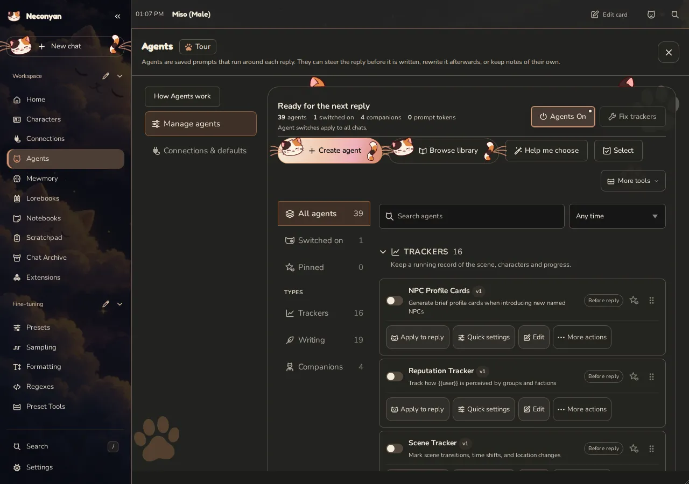
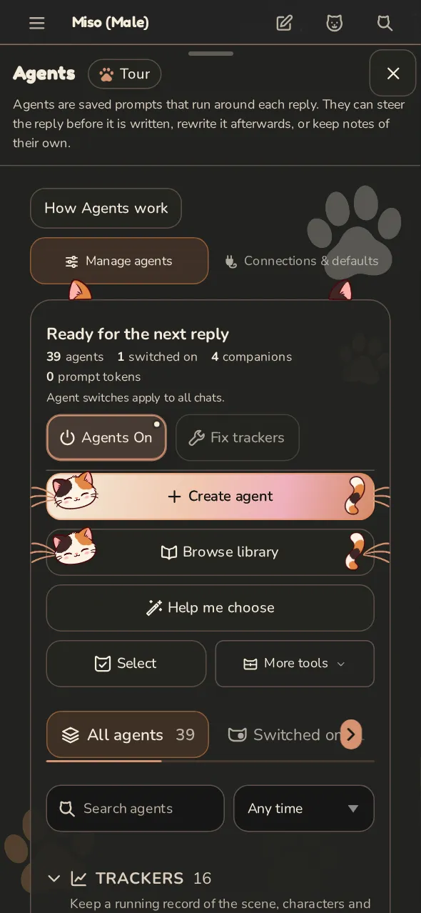
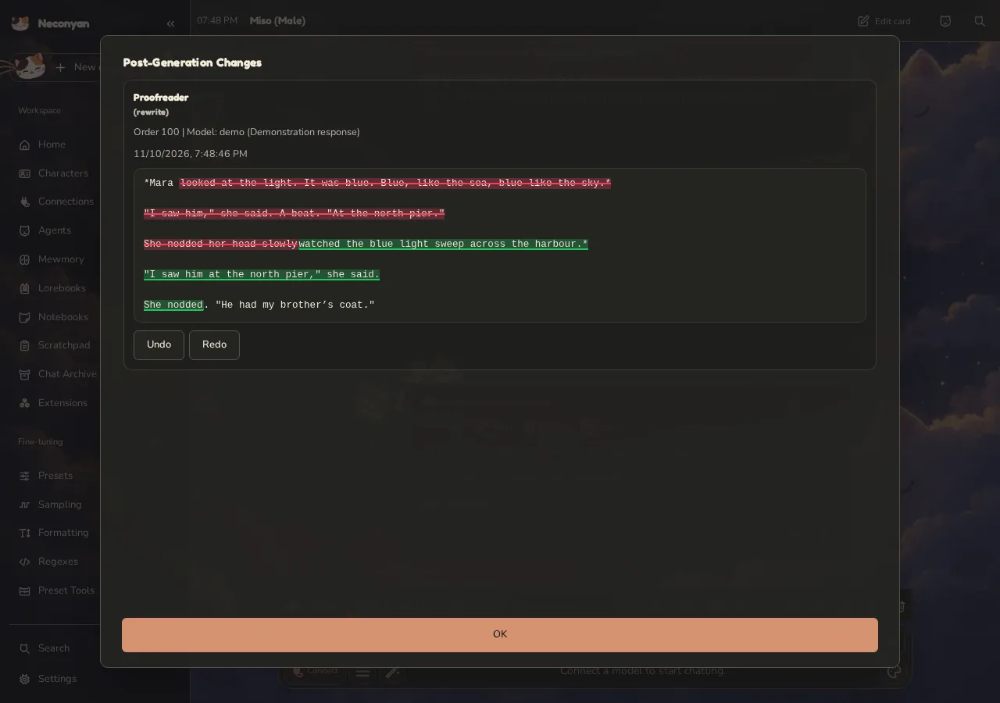
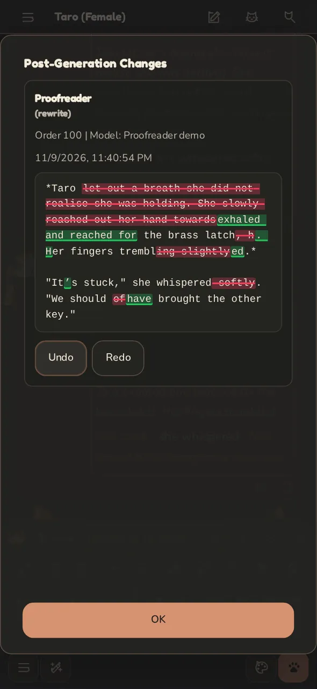
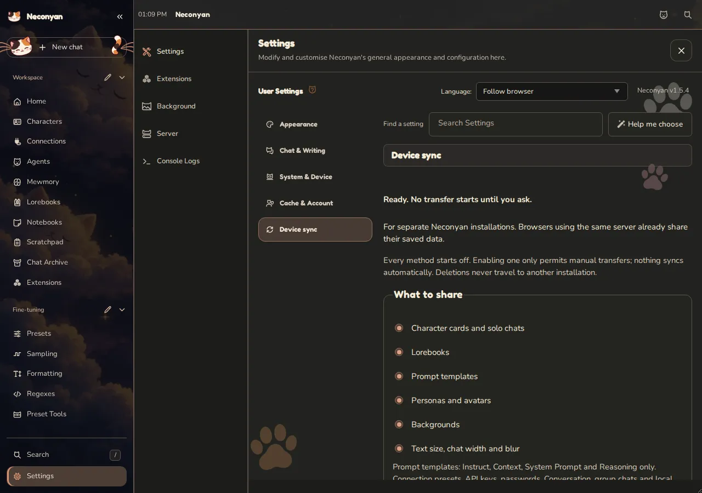
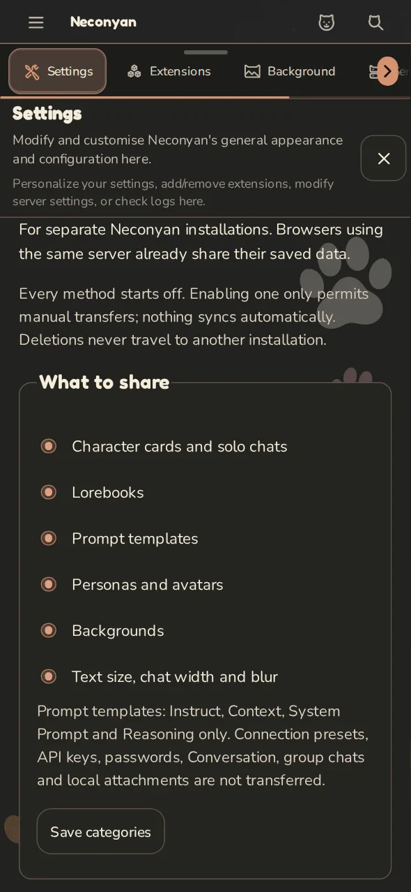

<!-- Translated from README.md at commit 19874db1 (Neconyan 1.5.4). Keep the structure in step with the English README. -->

# Neconyan~

Die neueste Version ist [1.5.4](https://github.com/platberlitz/Neconyan/releases/tag/v1.5.4).

**In deiner Sprache lesen:** [English](../README.md) · [Español](readme-es_es.md) · [Français](readme-fr_fr.md) · [Italiano](readme-it_it.md) · [Nederlands](readme-nl_nl.md) · [Português](readme-pt_pt.md) · [Íslenska](readme-is_is.md) · [Русский](readme-ru_ru.md) · [Українська](readme-uk_ua.md) · [العربية](readme-ar_sa.md) · [ไทย](readme-th_th.md) · [Tiếng Việt](readme-vi_vn.md) · [日本語](readme-ja_jp.md) · [한국어](readme-ko_kr.md) · [简体中文](readme-zh_cn.md) · [繁體中文](readme-zh_tw.md)

Diese Übersetzung kann dem Original hinterherhinken. Die [englische README](../README.md) ist aktuell.

<p align="center">
  
</p>

Neconyan ist mein Fork von [SillyTavern](https://github.com/SillyTavern/SillyTavern) und [SillyBunny](https://github.com/SillyBunnyTeam/SillyBunny) im Katzen-Look, zum Chatten und für Rollenspiele mit KI-Charakteren, am Computer oder auf dem Handy. Einen API-Schlüssel oder ein lokales Modell bringst du selbst mit; die App enthält weder Modellzugang noch Guthaben.

**[Neconyan herunterladen](https://github.com/platberlitz/Neconyan/releases/latest)** · **[Das Handbuch lesen](https://platberlitz.github.io/neconyan-docs/)** · **[Hilfe holen](https://platberlitz.github.io/neconyan-docs/help/troubleshooting/)**

> Der gesamte Code hier wurde von LLMs geschrieben oder mit ihrer Hilfe erstellt. Jeder Prompt und jeder Agent, der mit Neconyan ausgeliefert wird, stammt von Menschen.

## Was steckt drin?

<p align="center">
  
</p>

- **Vier Arten zu chatten:** klassisches Rollenspiel, Konversation im Messenger-Stil, ein Social-Media-Feed namens Meower und der Story-Modus für durchgehenden Fließtext.
- **Ein Layout, das fürs Handy gemacht ist**, mit beschrifteten Bedienelementen, einer Chatleiste unten und einem Schiebemenü. **Simple Mode** blendet die seltener genutzten Bedienelemente aus, bis du sie brauchst.
- **Mewmory** merkt sich Ereignisse und Charaktere der Geschichte. **Agenten** können Tracker führen, eine Antwort prüfen oder eine separate Begleiternotiz schreiben.
- **Catelier** hilft dir beim Schreiben von Charakterkarten und Lorebooks. **Notizbücher** halten deine Notizen griffbereit, und **Scratchpad** gibt dir einen separaten Chat, um Ideen durchzusprechen.
- **Miso, Taro und Nori** helfen dir, Dinge zu finden, und können mit deiner Erlaubnis unterstützte Änderungen vornehmen.
- **Device sync** überträgt ausgewählte Daten zwischen getrennten Installationen, per verschlüsselten Dateien, WebDAV, geheimen GitHub Gists oder direkter Kopplung. Übertragungen laufen nur, wenn du sie anstößt.
- **Themes, Akzentfarben und Katzen.** Ziemlich viele Katzen. Du kannst sie ausblenden, auch wenn ich mir nicht vorstellen kann, warum du das wollen würdest.

Deine Charakterkarten, Chats, Lorebooks und Voreinstellungen nutzen vertraute SillyTavern-Formate. Es gibt keine Telemetrie. Manche Funktionen und Erweiterungen aus dem Original verhalten sich hier anders; ich übernehme nur die Teile, die ich haben will. Die [Liste der enthaltenen Tools](../docs/neconyan-native-tools.md) würdigt die Projekte, die mit Neconyan ausgeliefert werden.

## Schau mal rein

<p align="center">
  
</p>

Screenshots vom Desktop und vom Handy aus Version 1.5.4, aufgenommen mit Demo-Chats, Demo-Notizen und den mitgelieferten Assistenten.

### Startseite

Wähle einen Charakter, verbinde ein Modell oder sag einem der Assistenten Hallo.

<table><tr>
  <td width="72%"></td>
  <td width="28%"></td>
</tr></table>

### Rollenspiel

Schreib eine Szene, probier eine andere Antwort aus oder setz einen alten Chat fort.

<table><tr>
  <td width="72%"></td>
  <td width="28%"></td>
</tr></table>

### Catelier

Arbeite an einem Charakterentwurf, lass dir beim Schreiben helfen und prüfe die Änderungen, bevor du sie in deiner Bibliothek speicherst.

<table><tr>
  <td width="72%"></td>
  <td width="28%"></td>
</tr></table>

### Agenten

Wähle einen Helfer, lege fest, wann er läuft, und gib ihm eine Verbindung. Ich würde mit einem anfangen, statt gleich die halbe Bibliothek auf einmal einzuschalten.

<table><tr>
  <td width="72%"></td>
  <td width="28%"></td>
</tr></table>

### Proofreader nach der Generierung

Proofreader prüft eine Antwort, nachdem sie angekommen ist. Er kann Prosa und Formatierung glätten, ohne dass das Hauptmodell die Szene neu schreiben muss. Öffne **Agenten-Änderungen**, um die Bearbeitung zu vergleichen und rückgängig zu machen, falls dir das Original lieber ist.

<table><tr>
  <td width="72%"></td>
  <td width="28%"></td>
</tr></table>

Dieses gestellte Beispiel führt den echten Agenten-Workflow mit einer festen Beispielantwort aus. Dein verbundenes Modell schreibt die Änderungen im normalen Betrieb, und jeder Durchgang kann eine weitere Anfrage kosten. [Agenten und Begleiter im Handbuch](https://platberlitz.github.io/neconyan-docs/helpers/agents/).

<details>
<summary><b>Weitere Screenshots: Simple Mode, Konversation, Meower, Story-Modus, Notizbücher, Scratchpad und Device sync</b></summary>

### Simple Mode

Weniger Bedienelemente, solange du dich eingewöhnst. **Show all features** in der Seitenleiste holt sie zurück; nichts wird abgeschaltet.

<table><tr>
  <td width="72%"></td>
  <td width="28%"></td>
</tr></table>

### Konversation

Schreib deinen Charakteren Nachrichten, erstelle Gruppenchats und lass sie beschäftigt oder offline sein.

<table><tr>
  <td width="72%"></td>
  <td width="28%"></td>
</tr></table>

### Meower

Ein Social-Media-Feed, in dem deine Charaktere posten, antworten und Umfragen starten.

<table><tr>
  <td width="72%"></td>
  <td width="28%"></td>
</tr></table>

### Story-Modus

Lies deinen Chat als durchgehenden Fließtext.

<table><tr>
  <td width="72%"></td>
  <td width="28%"></td>
</tr></table>

### Notizbücher

Bewahre Szenenpläne, Orte und Sitzungstagebücher direkt neben deinen Chats auf.

<table><tr>
  <td width="72%"></td>
  <td width="28%"></td>
</tr></table>

### Scratchpad

Sprich die Geschichte mit einem Assistenten oder an einem runden Tisch mit mehreren Charakteren durch, ohne dass deren Diskussion im Hauptchat landet.

<table><tr>
  <td width="72%"></td>
  <td width="28%"></td>
</tr></table>

### Device sync

Übertrage ausgewählte Bibliotheken zwischen getrennten Installationen. Wähle verschlüsselte Dateien, WebDAV, einen geheimen GitHub Gist oder direkte Kopplung; Übertragungen starten, wenn du sie anstößt. [Einrichtung und Wiederherstellung im Handbuch](https://platberlitz.github.io/neconyan-docs/help/device-sync/).

<table><tr>
  <td width="72%"></td>
  <td width="28%"></td>
</tr></table>

</details>

## Loslegen

<p align="center">
  
</p>

### Auf dem Computer

1. Lade die Datei mit der Endung **-source.zip** aus dem [neuesten Release](https://github.com/platberlitz/Neconyan/releases/latest) herunter. Entpacke sie zuerst; unter Windows klickst du sie mit der rechten Maustaste an und wählst **Alle extrahieren**.
2. Öffne den Ordner. Führe unter Windows **Start.bat** aus, unter macOS **Start.command** oder unter Linux in einem Terminal **bash start.sh**.
3. Gib dem ersten Start ein paar Minuten, um zu installieren, was er braucht. Lass das Terminalfenster offen, solange du Neconyan benutzt.
4. Dein Browser sollte sich von selbst öffnen. Falls nicht, ruf **http://127.0.0.1:4433/** auf.
5. Öffne **Verbindungen**, wähle deinen Anbieter und dein Modell und gib deinen API-Schlüssel oder die Adresse deines lokalen Modells ein. Öffne danach auf der Startseite einen Charakter oder einen Assistenten.

Beim nächsten Mal startest du dasselbe Startskript. Um Neconyan zu beenden, drückst du **Strg+C** in seinem Terminal.

Lieber mit Git? Klone das Repository und nutze dann dasselbe Startskript:

```sh
git clone https://github.com/platberlitz/Neconyan.git
```

[Einrichtung am Computer und häufige Startprobleme](https://platberlitz.github.io/neconyan-docs/start/computer/)

### Android-App

Lade die **-android-arm64.apk** aus dem [neuesten Release](https://github.com/platberlitz/Neconyan/releases/latest) herunter und öffne sie. Erlaube die Installation aus deinem Browser, falls Android danach fragt. Du brauchst **Android 11 oder neuer**, **Android System WebView 124 oder neuer** und etwa **2 GiB** freien Speicherplatz.

Die App läuft auf dem Handy, ohne Termux und ohne Computer. Gib ihr beim ersten Öffnen Zeit zum Entpacken und richte dann **Verbindungen** ein. Installiere Updates über die vorhandene Version, damit deine Chats erhalten bleiben.

[Android-Einrichtung](https://platberlitz.github.io/neconyan-docs/start/android/) · [Build-Anleitung](../android/README.md)

### iPhone-App

Lade die **-ios-unsigned.ipa** aus dem [neuesten Release](https://github.com/platberlitz/Neconyan/releases/latest) herunter und installiere sie dann mit einem Sideloading-Tool wie [iloader](https://github.com/nab138/iloader). Du brauchst **iOS 17 oder neuer**. Der Server und die Chats der App liegen auf dem Handy; sie ist nicht im App Store.

Mit einem kostenlosen Apple-Account musst du die App alle sieben Tage neu signieren, und es sind drei Apps per Sideloading erlaubt. Installiere Updates mit demselben Apple-Account über die vorhandene Version. **Wenn du die App löschst, löschst du auch ihre Daten**, exportiere also vorher ein Backup.

[Einrichtung und Einschränkungen für das iPhone](../ios/README.md)

### Andere Wege, dein Handy zu nutzen

- **Android mit Termux:** Folge der [Termux-Anleitung](https://platberlitz.github.io/neconyan-docs/start/android/#prefer-termux), wenn du lieber ein Terminal nutzt oder ein älteres Handy hast.
- **Die Installation auf einem Computer nutzen:** Folge der [Anleitung für dasselbe WLAN](https://platberlitz.github.io/neconyan-docs/start/phone/). Beide Geräte nutzen dieselben gespeicherten Chats; lass den Computer laufen.

## Updates, Backups und das Umziehen deiner Chats

Öffne **Server → Updates & Neustart → Nach Updates suchen**. Bei Git-Installationen und unterstützten Quell-ZIP-Installationen gibt es **Aktualisieren & neu starten**. Unter Android gibt es **Update APK**, und du wirst gebeten, die Installation zu bestätigen. Ältere ZIP-Kopien ohne Updater brauchen einen [manuellen Umzug in den neueren Ordner](https://platberlitz.github.io/neconyan-docs/help/backups/#update-a-zip-installation).

Git-Installationen suchen auch beim Start nach Updates. Änderungen, die du an den eigenen Dateien der App vorgenommen hast, können ein automatisches Update verhindern; deine Chats und Einstellungen zählen nicht dazu.

Du kommst von SillyTavern oder SillyBunny? **Erstelle zuerst ein Backup**, gib Neconyan einen eigenen Datenordner und folge dann der Anleitung [Deine Daten importieren](https://platberlitz.github.io/neconyan-docs/start/imports/). Prüfe deine Charaktere und Chats, bevor du irgendetwas löschst. Manche Erweiterungen müssen vielleicht angepasst werden.

[Backups und Wiederherstellung](https://platberlitz.github.io/neconyan-docs/help/backups/) · [Daten zwischen Geräten umziehen](../docs/data-portability.md)

## Brauchst du Hilfe?

Ich würde mit dem [Handbuch](https://platberlitz.github.io/neconyan-docs/) anfangen oder Miso, Taro oder Nori auf der Startseite fragen. Die drei können sich irren, prüfe ihre Ratschläge also, bevor du etwas änderst, das sich nicht rückgängig machen lässt.

Wenn du eine Einstellung nicht findest, probier **Suchen** in der Seitenleiste. Bei Fehlern nimm die [Anleitung zur Fehlerbehebung](https://platberlitz.github.io/neconyan-docs/help/troubleshooting/) oder [eröffne ein Issue](https://github.com/platberlitz/Neconyan/issues) und beschreibe, was du gerade gemacht hast und welcher Fehler angezeigt wurde.

## Danksagung

<p align="center">
  
</p>

Neconyan baut auf der Arbeit aller auf, die hinter SillyTavern und SillyBunny stehen; ohne sie gäbe es nichts davon. Die [Liste der enthaltenen Tools](../docs/neconyan-native-tools.md) führt ihre ursprünglichen Autorinnen und Autoren auf.

Gemacht von [Platberlitz](https://github.com/platberlitz). Lizenziert unter [GNU AGPL v3](../LICENSE). Wenn du es weiterverbreitest, behalte die Hinweise und Lizenzen bei.

Ein besonderer Dank geht an **El Topo**, meinen wichtigsten Helfer und Mitwirkenden. Ich weiß all die Arbeit, die du in Neconyan gesteckt hast, wirklich zu schätzen.
