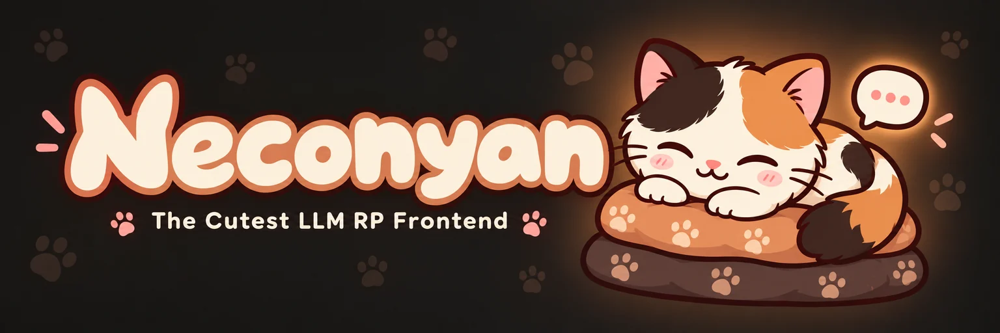
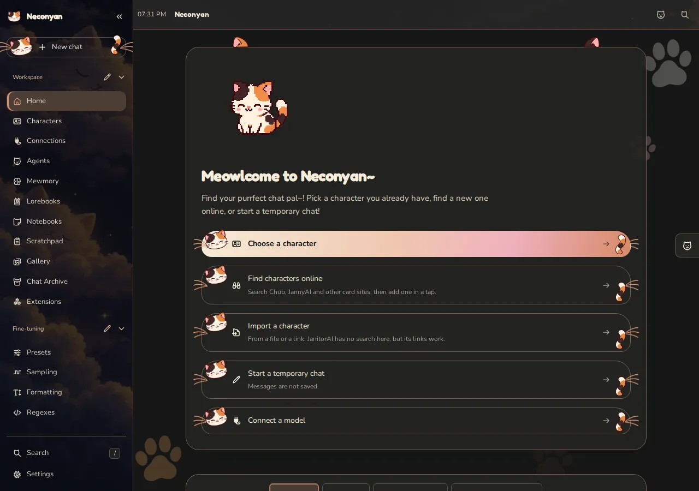
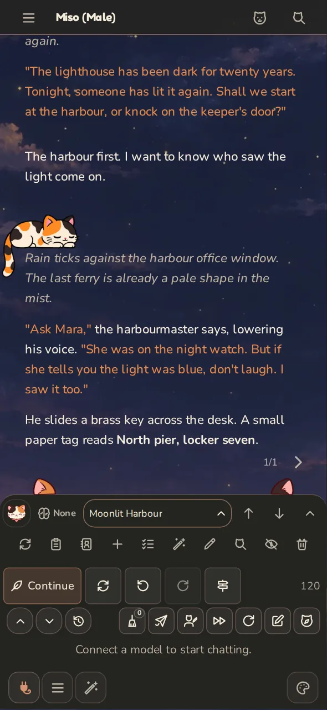

<!-- Translated from README.md at commit 31d628fa (Neconyan 1.5.5). Keep the structure in step with the English README. -->

# Neconyan~

La última versión es la [1.5.5](https://github.com/platberlitz/Neconyan/releases/tag/v1.5.5).

**Léelo en tu idioma:** [English](../README.md) · [Deutsch](readme-de_de.md) · [Français](readme-fr_fr.md) · [Italiano](readme-it_it.md) · [Nederlands](readme-nl_nl.md) · [Português](readme-pt_pt.md) · [Íslenska](readme-is_is.md) · [Русский](readme-ru_ru.md) · [Українська](readme-uk_ua.md) · [العربية](readme-ar_sa.md) · [ไทย](readme-th_th.md) · [Tiếng Việt](readme-vi_vn.md) · [日本語](readme-ja_jp.md) · [한국어](readme-ko_kr.md) · [简体中文](readme-zh_cn.md) · [繁體中文](readme-zh_tw.md)

Es posible que esta traducción se quede desfasada. El [README en inglés](../README.md) es el que está al día.

<p align="center">
  
</p>

¡Hola, pasa, pasa! Neconyan es mi fork con temática gatuna de [SillyTavern](https://github.com/SillyTavern/SillyTavern) y [SillyBunny](https://github.com/SillyBunnyTeam/SillyBunny) para chatear y hacer rol con personajes de IA, en el ordenador o en el móvil. Lo hice porque quería un frontend acogedor, que funcionara de verdad en el móvil y que tuviera un gato en casi cada página. La clave API o el modelo local los pones tú; la app no incluye acceso a ningún modelo ni créditos.

**[Descargar Neconyan](https://github.com/platberlitz/Neconyan/releases/latest)** · **[Leer el manual](https://platberlitz.github.io/neconyan-docs/)** · **[Obtener ayuda](https://platberlitz.github.io/neconyan-docs/help/troubleshooting/)**

> Todo el código de aquí lo ha generado un LLM o se ha hecho con ayuda de uno. Cada prompt y cada agente que incluye Neconyan lo ha hecho una persona.

## ¿Qué hay aquí dentro?

<p align="center">
  
</p>

- **Cuatro formas de chatear:** el Juego de rol clásico, Conversación al estilo de una app de mensajería, una red social llamada Meower y el Modo historia para escribir en prosa continua. Elige la que te pida el cuerpo.
- **Un diseño hecho para el móvil**, con controles etiquetados, una barra de chat abajo y un menú deslizante. Se acabó entornar los ojos ante botoncitos de escritorio en una pantalla pequeña.
- **[Modo simple](#modo-simple)**, para cuando solo quieres hacer rol sin una cabina de avión llena de botones. Te lo cuento más abajo, porque me encanta cómo ha quedado.
- **Mewmory** recuerda los acontecimientos y los personajes de la historia, para que tu compañero de rol no se olvide de lo importante. Los **Agentes** pueden llevar rastreadores, revisar una respuesta o escribir una Nota del acompañante aparte.
- **Catelier** te ayuda a escribir fichas de personaje y lorebooks. **Cuadernos** te tiene las notas a mano, y **Scratchpad** te da un chat aparte para comentar ideas.
- **Miso, Taro y Nori** son los asistentes de la casa. Te ayudan a encontrar cosas y, con tu permiso, pueden hacer las ediciones que admiten.
- **Sincronización entre dispositivos** traslada datos seleccionados entre instalaciones distintas con archivos cifrados, WebDAV, Gists secretos de GitHub o emparejamiento directo. Las transferencias se ejecutan cuando tú lo pides.
- **Temas, colores de acento y gatos.** Bastantes gatos. Puedes ocultarlos, aunque no se me ocurre por qué querrías hacerlo.

Tus fichas de personaje, chats, lorebooks y preajustes usan los formatos habituales de SillyTavern, así que se vienen contigo. No hay telemetría. Algunas funciones y extensiones del proyecto original se comportan de otra manera aquí; yo solo incorporo las partes que me interesan. La [lista de herramientas incluidas](../docs/neconyan-native-tools.md) reconoce los proyectos que vienen con Neconyan.

## Modo simple

<p align="center">
  
</p>

¿No te va eso de ser usuario avanzado? ¿No te apetece pelearte con montones de botones solo para hacer rol y pasarlo bien? ¡Pues no busques más, que tengo el modo perfecto para ti!

El **Modo simple** es Neconyan para quien solo quiere hacer rol. Conservas todo lo que hace que Neconyan sea *Neconyan*: los gatos, el diseño pensado para el móvil, Miso, Taro y Nori, la Memoria siguiéndole la pista a tu historia y tus Agentes trabajando en segundo plano. Lo que desaparece es el desorden: samplers, formato del prompt, contadores de tokens, menús de extensiones y todos esos otros ajustes que casi nadie toca.

Y ahora viene lo mejor: no se borra ni se desactiva nada. Cada control oculto está guardado, no tirado, y vuelve al instante en cuanto lo quieras.

### ¡Más fácil, imposible!

En tu primerísima visita, Nori te hace una sola pregunta: **Want to keep things simple?** Pulsa **Yes, keep it simple** y un recorrido de tres pasos te guía para conectar un modelo, conocer a un personaje y saludar. Ya está. Esa es toda la configuración.

¿Ya usas el diseño completo? Actívalo cuando quieras en **Ajustes → Apariencia → Modo simple**.

<table><tr>
  <td width="72%"></td>
  <td width="28%"></td>
</tr></table>

### Tu chat, en primer plano

El chat y el cuadro de mensaje se llevan todo el espacio, y la barra lateral se queda con una lista corta de páginas que de verdad vas a abrir: Personajes, Conexiones, Agentes, Lorebooks, Cuadernos, Scratchpad, Galería, Preajustes, Persona y Colores de diálogo. Y encima te llevas tres botones muy prácticos:

- **Find characters** busca fichas nuevas. Elige una y su chat se abre al momento, listo para empezar.
- **Memoria** abre **Story so far**, con un interruptor, un botón **Summarise now** y el resumen más reciente de tu chat.
- **Updates** busca una versión nueva y la instala sin salir del Modo simple.

<table><tr>
  <td width="72%"></td>
  <td width="28%"></td>
</tr></table>

### Conectar sin deberes

Conexiones muestra solo el proveedor, tu clave, el modelo, **Conectar** y **Mensaje de prueba**. Todo lo demás espera detrás de **More connection options**, para el día que te pique la curiosidad.

<table><tr>
  <td width="72%"></td>
  <td width="28%"></td>
</tr></table>

### ¿Has cambiado de idea? Sin problema

Pulsa **Mostrar todas las funciones** en la barra lateral, o desactívalo en **Ajustes → Apariencia**, y cada botón vuelve justo donde lo dejaste. Tus chats, personajes, lore y Agentes ni se enteran.

[El Modo simple en el manual](https://platberlitz.github.io/neconyan-docs/workspace/#keep-the-sidebar-simple)

## Echa un vistazo

<p align="center">
  
</p>

¡Aquí tienes el resto del recorrido! Hice estas capturas del ordenador y del móvil el 17 de noviembre de 2026, con chats y notas de demostración, los asistentes incluidos, los colores por defecto de Calico Dark y la **Visibilidad del fondo al 0 %**.

### Inicio

Elige un personaje, conecta un modelo o saluda a un asistente. Los gatos se van a poner contentísimos de verte.

<table><tr>
  <td width="72%"></td>
  <td width="28%"></td>
</tr></table>

### Juego de rol

Escribe una escena, prueba otra respuesta o retoma un chat antiguo justo donde lo dejaste.

<table><tr>
  <td width="72%"></td>
  <td width="28%"></td>
</tr></table>

### Catelier

Trabaja en el borrador de un personaje, pide ayuda para escribir y revisa los cambios antes de guardarlos en tu biblioteca.

<table><tr>
  <td width="72%"></td>
  <td width="28%"></td>
</tr></table>

### Agentes

Elige un ayudante, decide cuándo se ejecuta y dale una conexión. Yo empezaría con uno solo en lugar de activar media biblioteca de golpe.

<table><tr>
  <td width="72%"></td>
  <td width="28%"></td>
</tr></table>

### Proofreader posterior a la generación

Proofreader revisa una respuesta después de que llegue. Puede pulir la prosa y el formato sin pedirle al modelo principal que vuelva a escribir la escena. Abre **Cambios de agente** para comparar la edición y deshacerla si prefieres el original.

<table><tr>
  <td width="72%"></td>
  <td width="28%"></td>
</tr></table>

Este ejemplo de demostración ejecuta el flujo de trabajo real de los Agentes con una respuesta de muestra fija. En el uso normal, tu modelo conectado escribe las ediciones, y cada pasada puede costar otra solicitud. [Agentes y compañeros en el manual](https://platberlitz.github.io/neconyan-docs/helpers/agents/).

<details>
<summary><b>Más capturas: Conversación, Meower, Modo historia, Cuadernos, Scratchpad y Sincronización entre dispositivos</b></summary>

### Conversación

Mándales mensajes a tus personajes, crea chats grupales y deja que estén ocupados o desconectados, como amigos de verdad.

<table><tr>
  <td width="72%"></td>
  <td width="28%"></td>
</tr></table>

### Meower

Una red social donde tus personajes publican, responden y hacen encuestas. Aquello se convierte en un caos, del bueno.

<table><tr>
  <td width="72%"></td>
  <td width="28%"></td>
</tr></table>

### Modo historia

Lee tu chat como prosa continua, como un libro que habéis escrito a medias.

<table><tr>
  <td width="72%"></td>
  <td width="28%"></td>
</tr></table>

### Cuadernos

Guarda planes de escenas, lugares y diarios de sesión junto a tus chats.

<table><tr>
  <td width="72%"></td>
  <td width="28%"></td>
</tr></table>

### Scratchpad

Comenta la historia con un asistente o con una mesa redonda de personajes, sin que esa charla se añada al chat principal.

<table><tr>
  <td width="72%"></td>
  <td width="28%"></td>
</tr></table>

### Sincronización entre dispositivos

Traslada bibliotecas seleccionadas entre instalaciones distintas. Elige archivos cifrados, WebDAV, un Gist secreto de GitHub o emparejamiento directo; las transferencias empiezan cuando tú lo pides. [Configuración y recuperación en el manual](https://platberlitz.github.io/neconyan-docs/help/device-sync/).

<table><tr>
  <td width="72%"></td>
  <td width="28%"></td>
</tr></table>

</details>

## Primeros pasos

<p align="center">
  
</p>

¿Te animas a probarlo? Elige el dispositivo que prefieras.

### En un ordenador

1. Descarga el archivo que termina en **-source.zip** de la [última versión](https://github.com/platberlitz/Neconyan/releases/latest). Antes tienes que descomprimirlo; en Windows, haz clic derecho y elige **Extraer todo**.
2. Abre la carpeta. Ejecuta **Start.bat** en Windows, **Start.command** en macOS o **bash start.sh** en una terminal en Linux.
3. Dale unos minutos al primer arranque para que instale lo que necesita. Deja abierta la ventana de la terminal mientras uses Neconyan.
4. El navegador debería abrirse solo. Si no, ve a **http://127.0.0.1:4433/**.
5. Abre **Conexiones**, elige tu proveedor y tu modelo, e introduce tu clave API o la dirección de tu modelo local. Después, abre un personaje o un asistente en Inicio, ¡y a jugar!

La próxima vez, ejecuta el mismo lanzador. Para detener Neconyan, pulsa **Ctrl+C** en su terminal.

¿Prefieres Git? Clona el repositorio y usa después el mismo lanzador:

```sh
git clone https://github.com/platberlitz/Neconyan.git
```

[Instalación en el ordenador y problemas habituales al arrancar](https://platberlitz.github.io/neconyan-docs/start/computer/)

### App para Android

Descarga el **-android-arm64.apk** de la [última versión](https://github.com/platberlitz/Neconyan/releases/latest) y ábrelo. Si Android te lo pide, permite la instalación desde tu navegador. Necesitas **Android 11 o posterior**, **Android System WebView 124 o posterior** y unos **2 GiB** libres.

La app funciona en el propio móvil, sin Termux ni ordenador. Dale tiempo la primera vez que la abras para que se descomprima y luego configura **Conexiones**. Instala las actualizaciones encima de la app que ya tienes para conservar tus chats.

[Instalación en Android](https://platberlitz.github.io/neconyan-docs/start/android/) · [Instrucciones de compilación](../android/README.md)

### App para iPhone

Descarga el **-ios-unsigned.ipa** de la [última versión](https://github.com/platberlitz/Neconyan/releases/latest) e instálalo con una herramienta de sideloading como [iloader](https://github.com/nab138/iloader). Necesitas **iOS 17 o posterior**. El servidor y los chats de la app se quedan en el móvil; no está en la App Store.

Una cuenta de Apple gratuita obliga a volver a firmar la app cada siete días y permite tres apps instaladas por sideloading. Actualiza instalando encima de la app que ya tienes, con la misma cuenta de Apple. **Si borras la app, se borran sus datos**, así que exporta antes una copia de seguridad.

[Instalación en iPhone y límites](../ios/README.md)

### Otras formas de usar el móvil

- **Android con Termux:** sigue la [guía de Termux](https://platberlitz.github.io/neconyan-docs/start/android/#prefer-termux) si prefieres una terminal o tienes un móvil más antiguo.
- **Usar la instalación de un ordenador:** sigue la [guía para conectarte desde la misma wifi](https://platberlitz.github.io/neconyan-docs/start/phone/). Los dos dispositivos usan los mismos chats guardados; deja el ordenador encendido.

## Actualizaciones, copias de seguridad y traslado de tus chats

Abre **Servidor → Actualizaciones y reinicio → Buscar actualizaciones**. Las instalaciones con Git y las de ZIP de código fuente compatibles ofrecen **Actualizar y reiniciar**. Android ofrece **Update APK** y te pide que apruebes la instalación. En el Modo simple, el botón **Updates** de la barra lateral te lleva al mismo sitio. Las copias en ZIP más antiguas que no tienen actualizador necesitan un [traslado manual a la carpeta más reciente](https://platberlitz.github.io/neconyan-docs/help/backups/#update-a-zip-installation).

Las instalaciones con Git también buscan actualizaciones al arrancar. Los cambios que hayas hecho en los archivos propios de la app pueden impedir una actualización automática; tus chats y tus ajustes no cuentan.

¿Vienes de SillyTavern o SillyBunny? ¡Qué alegría tenerte por aquí! **Haz antes una copia de seguridad**, dale a Neconyan su propia carpeta de datos y sigue después [Importar tus datos](https://platberlitz.github.io/neconyan-docs/start/imports/). Comprueba tus personajes y chats antes de borrar nada. Puede que haya que ajustar algunas extensiones.

[Copias de seguridad y restauración](https://platberlitz.github.io/neconyan-docs/help/backups/) · [Mover datos entre dispositivos](../docs/data-portability.md)

## ¿Necesitas una mano?

Yo empezaría por el [manual](https://platberlitz.github.io/neconyan-docs/) o le preguntaría a Miso, Taro o Nori en Inicio; siempre están encantados de echar una mano. Eso sí, pueden equivocarse, así que comprueba lo que te aconsejen antes de hacer un cambio que no se pueda deshacer.

Si echas en falta algún ajuste, prueba **Buscar** en la barra lateral. Si hay errores, usa la [guía de solución de problemas](https://platberlitz.github.io/neconyan-docs/help/troubleshooting/) o [abre una incidencia](https://github.com/platberlitz/Neconyan/issues) con lo que estabas haciendo y el error que aparece.

## Créditos

<p align="center">
  
</p>

Neconyan se apoya en el trabajo de todas las personas que hay detrás de SillyTavern y SillyBunny; nada de esto existiría sin ellas. La [lista de herramientas incluidas](../docs/neconyan-native-tools.md) reconoce a sus autores originales.

Hecho con cariño por [Platberlitz](https://github.com/platberlitz). Con licencia [GNU AGPL v3](../LICENSE). Si lo redistribuyes, mantén los avisos y las licencias.

Un agradecimiento especial a **El Topo**, mi principal ayudante y colaborador. De verdad te agradezco todo el trabajo que has dedicado a Neconyan.

¡Pásalo genial y saluda a los gatos de mi parte!
