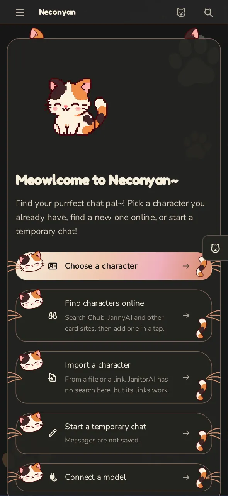
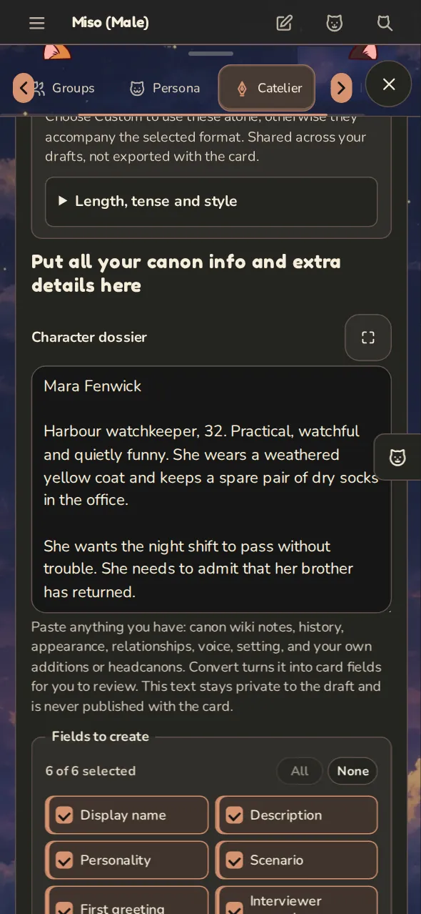

<!-- Translated from README.md at commit 31d628fa (Neconyan 1.5.5). Keep the structure in step with the English README. -->

# Neconyan~

La dernière version est la [1.5.5](https://github.com/platberlitz/Neconyan/releases/tag/v1.5.5).

**Lire dans ta langue :** [English](../README.md) · [Deutsch](readme-de_de.md) · [Español](readme-es_es.md) · [Italiano](readme-it_it.md) · [Nederlands](readme-nl_nl.md) · [Português](readme-pt_pt.md) · [Íslenska](readme-is_is.md) · [Türkçe](readme-tr_tr.md) · [Русский](readme-ru_ru.md) · [Українська](readme-uk_ua.md) · [العربية](readme-ar_sa.md) · [ไทย](readme-th_th.md) · [Tiếng Việt](readme-vi_vn.md) · [日本語](readme-ja_jp.md) · [한국어](readme-ko_kr.md) · [简体中文](readme-zh_cn.md) · [繁體中文](readme-zh_tw.md)

Cette traduction peut avoir du retard. Le [README anglais](../README.md) est à jour.

<p align="center">
  
</p>

Salut, entre donc ! Neconyan, c'est mon fork félin de [SillyTavern](https://github.com/SillyTavern/SillyTavern) et de [SillyBunny](https://github.com/SillyBunnyTeam/SillyBunny), pour discuter et faire du jeu de rôle avec des personnages IA, sur ordinateur ou sur ton téléphone. Je l'ai créé parce que je voulais une interface douillette, qui marche vraiment bien sur téléphone et qui a un chat sur presque chaque page. Tu apportes ta propre clé API ou ton propre modèle local : l'appli n'inclut ni accès à un modèle ni crédits.

**[Télécharger Neconyan](https://github.com/platberlitz/Neconyan/releases/latest)** · **[Lire le manuel](https://platberlitz.github.io/neconyan-docs/)** · **[Obtenir de l'aide](https://platberlitz.github.io/neconyan-docs/help/troubleshooting/)**

> Tout le code ici est généré par un LLM ou écrit avec l'aide d'un LLM. Tous les prompts et tous les agents livrés avec Neconyan sont écrits par des humains.

## Qu'y a-t-il dedans ?

<p align="center">
  
</p>

- **Quatre façons de discuter :** le Jeu de rôle classique, Conversation façon messagerie, un fil social appelé Meower, et le Mode histoire pour la prose continue. Choisis selon ton humeur.
- **Une mise en page pensée pour le téléphone**, avec des commandes qui portent un intitulé, une barre de discussion en bas de l'écran et un menu coulissant. Fini de plisser les yeux devant de minuscules boutons d'ordinateur sur un petit écran.
- **[Mode simple](#mode-simple)**, pour quand tu veux juste faire du jeu de rôle sans un cockpit entier de boutons. J'en parle plus bas, parce que c'est ma grande fierté.
- **Mewmory** retient les événements et les personnages de l'histoire, pour que ton partenaire n'oublie pas les détails importants. Les **Agents** peuvent tenir des suivis à jour, vérifier une réponse ou rédiger à part une Note du compagnon.
- **Catelier** t'aide à écrire des cartes de personnage et des lorebooks. Les **Carnets** gardent tes notes à portée de main, et **Scratchpad** te donne une discussion à part pour parler de tes idées.
- **Miso, Taro et Nori** sont les assistants de la maison. Ils t'aident à retrouver des choses et peuvent effectuer les modifications prises en charge, avec ta permission.
- **Synchronisation** déplace des données choisies entre des installations distinctes, avec des fichiers chiffrés, WebDAV, des GitHub Gists secrets ou un appairage direct. Les transferts ne se lancent que quand tu le demandes.
- **Des thèmes, des couleurs d'accent et des chats.** Pas mal de chats. Tu peux les masquer, même si je ne vois pas pourquoi tu voudrais faire ça.

Tes cartes de personnage, tes discussions, tes lorebooks et tes préréglages utilisent les formats familiers de SillyTavern, tu peux donc les emporter avec toi. Il n'y a aucune télémétrie. Certaines fonctions et extensions du projet d'origine se comportent différemment ici ; je ne reprends que ce qui m'intéresse. La [liste des outils inclus](../docs/neconyan-native-tools.md) crédite les projets fournis avec Neconyan.

## Mode simple

<p align="center">
  
</p>

Pas fan des réglages pour utilisateurs avancés ? Pas envie de te frayer un chemin à travers des tonnes de boutons juste pour faire du jeu de rôle et passer un bon moment ? Alors là, j'ai exactement le mode qu'il te faut !

Le **Mode simple**, c'est Neconyan pour celles et ceux qui veulent juste faire du RP. Tu gardes tout ce qui fait de Neconyan *Neconyan* : les chats, la mise en page pensée pour le téléphone, Miso, Taro et Nori, la Mémoire qui suit ton histoire, et tes Agents qui continuent leur travail en arrière-plan. Ce qui disparaît, c'est le fouillis : les samplers, le formatage des prompts, les compteurs de tokens, les menus d'extensions et tous ces autres boutons que la plupart des gens ne touchent jamais.

Et le meilleur dans tout ça : rien n'est supprimé ni désactivé. Chaque commande masquée est simplement rangée, pas jetée, et revient dès que tu en as envie.

### Difficile de faire plus simple

Dès ta toute première visite, Nori te pose une seule question : **Want to keep things simple?** Appuie sur **Yes, keep it simple** et une visite guidée en trois étapes t'accompagne pour connecter un modèle, rencontrer un personnage et dire bonjour. C'est tout. C'est toute la configuration.

Tu utilises déjà la mise en page complète ? Active-le quand tu veux dans **Paramètres → Apparence → Mode simple**.

<table><tr>
  <td width="72%"></td>
  <td width="28%"></td>
</tr></table>

### Ta discussion au premier plan

La discussion et la zone de saisie prennent toute la place, et la barre latérale ne garde qu'une courte liste des pages que tu ouvres vraiment : Personnages, Connexions, Agents, Lorebooks, Carnets, Scratchpad, Galerie, Préréglages, Persona et Couleurs de dialogue. En prime, tu as trois boutons bien pratiques :

- **Find characters** cherche de nouvelles cartes. Choisis-en une et sa discussion s'ouvre aussitôt, prête à démarrer.
- **Mémoire** ouvre **Story so far**, avec un seul interrupteur, un bouton **Summarise now** et le dernier résumé de ta discussion.
- **Updates** vérifie s'il y a une nouvelle version et l'installe sans quitter le Mode simple.

<table><tr>
  <td width="72%"></td>
  <td width="28%"></td>
</tr></table>

### Se connecter sans faire ses devoirs

Connexions n'affiche que le fournisseur, ta clé, le modèle, **Connection** et **Message de test**. Tout le reste attend derrière **More connection options**, pour le jour où la curiosité te prendra.

<table><tr>
  <td width="72%"></td>
  <td width="28%"></td>
</tr></table>

### Changé d'avis ? Pas de souci

Appuie sur **Toutes les fonctionnalités** dans la barre latérale, ou désactive-le dans **Paramètres → Apparence**, et chaque bouton revient exactement là où tu l'avais laissé. Tes discussions, tes personnages, ton lore et tes Agents n'y verront que du feu.

[Le Mode simple dans le manuel](https://platberlitz.github.io/neconyan-docs/workspace/#keep-the-sidebar-simple)

## Jette un œil

<p align="center">
  
</p>

Et voici la suite de la visite ! J'ai pris ces captures d'écran sur ordinateur et sur téléphone le 17 novembre 2026, avec des discussions et des notes de démo, les assistants inclus, les couleurs Calico Dark par défaut et **Visibilité de l'arrière-plan à 0 %**.

### Accueil

Choisis un personnage, connecte un modèle ou dis bonjour à un assistant. Les chats seront ravis de te voir.

<table><tr>
  <td width="72%"></td>
  <td width="28%"></td>
</tr></table>

### Jeu de rôle

Écris une scène, essaie une autre réponse ou reprends une ancienne discussion pile là où tu l'avais laissée.

<table><tr>
  <td width="72%"></td>
  <td width="28%"></td>
</tr></table>

### Catelier

Travaille sur un brouillon de personnage, demande de l'aide pour écrire et relis les changements avant de l'enregistrer dans ta bibliothèque.

<table><tr>
  <td width="72%"></td>
  <td width="28%"></td>
</tr></table>

### Agents

Choisis un agent, décide quand il s'exécute et donne-lui une connexion. Je commencerais par un seul plutôt que d'activer la moitié de la bibliothèque d'un coup.

<table><tr>
  <td width="72%"></td>
  <td width="28%"></td>
</tr></table>

### Proofreader post-génération

Proofreader vérifie une réponse après son arrivée. Il peut peaufiner la prose et la mise en forme sans demander au modèle principal de réécrire la scène. Ouvre **Modifications de l'agent** pour comparer la modification et l'annuler si tu préfères l'original.

<table><tr>
  <td width="72%"></td>
  <td width="28%"></td>
</tr></table>

Cet exemple mis en scène fait passer une réponse type fixe par le vrai processus des Agents. En usage normal, c'est ton modèle connecté qui écrit les modifications, et chaque passage peut coûter une requête de plus. [Agents et Compagnons dans le manuel](https://platberlitz.github.io/neconyan-docs/helpers/agents/).

<details>
<summary><b>Plus de captures d'écran : Conversation, Meower, Mode histoire, Carnets, Scratchpad et Synchronisation</b></summary>

### Conversation

Envoie des messages à tes personnages, crée des discussions de groupe et laisse-les être occupés ou hors ligne, comme de vrais amis.

<table><tr>
  <td width="72%"></td>
  <td width="28%"></td>
</tr></table>

### Meower

Un fil social où tes personnages publient, répondent et lancent des sondages. Ça devient vite le chaos là-dedans, mais le meilleur des chaos.

<table><tr>
  <td width="72%"></td>
  <td width="28%"></td>
</tr></table>

### Mode histoire

Lis ta discussion sous forme de prose continue, comme un livre que vous avez écrit ensemble.

<table><tr>
  <td width="72%"></td>
  <td width="28%"></td>
</tr></table>

### Carnets

Garde des plans de scène, des lieux et des journaux de session à côté de tes discussions.

<table><tr>
  <td width="72%"></td>
  <td width="28%"></td>
</tr></table>

### Scratchpad

Parle de l'histoire avec un assistant ou avec une table ronde de personnages, sans verser leur échange dans la discussion principale.

<table><tr>
  <td width="72%"></td>
  <td width="28%"></td>
</tr></table>

### Synchronisation

Déplace des bibliothèques choisies entre des installations distinctes. Choisis des fichiers chiffrés, WebDAV, un GitHub Gist secret ou un appairage direct ; les transferts démarrent quand tu le demandes. [Configuration et récupération dans le manuel](https://platberlitz.github.io/neconyan-docs/help/device-sync/).

<table><tr>
  <td width="72%"></td>
  <td width="28%"></td>
</tr></table>

</details>

## Pour commencer

<p align="center">
  
</p>

Envie d'essayer ? Choisis simplement l'appareil que tu veux utiliser.

### Sur un ordinateur

1. Télécharge le fichier qui se termine par **-source.zip** depuis la [dernière version](https://github.com/platberlitz/Neconyan/releases/latest). Décompresse-le d'abord ; sous Windows, fais un clic droit et choisis **Extraire tout**.
2. Ouvre le dossier. Lance **Start.bat** sous Windows, **Start.command** sous macOS, ou **bash start.sh** dans un terminal sous Linux.
3. Laisse quelques minutes au premier démarrage pour installer ce dont il a besoin. Garde la fenêtre du terminal ouverte tant que tu utilises Neconyan.
4. Ton navigateur devrait s'ouvrir tout seul. Sinon, va sur **http://127.0.0.1:4433/**.
5. Ouvre **Connexions**, choisis ton fournisseur et ton modèle, puis saisis ta clé API ou l'adresse de ton modèle local. Ensuite, ouvre un personnage ou un assistant sur l'Accueil, et c'est parti !

La prochaine fois, relance le même lanceur. Pour arrêter Neconyan, appuie sur **Ctrl+C** dans son terminal.

Tu préfères Git ? Clone le dépôt, puis utilise le même lanceur :

```sh
git clone https://github.com/platberlitz/Neconyan.git
```

[Installation sur ordinateur et problèmes de démarrage courants](https://platberlitz.github.io/neconyan-docs/start/computer/)

### Application Android

Télécharge le fichier **-android-arm64.apk** depuis la [dernière version](https://github.com/platberlitz/Neconyan/releases/latest) et ouvre-le. Autorise l'installation depuis ton navigateur si Android te le demande. Il te faut **Android 11 ou plus récent**, **Android System WebView 124 ou plus récent** et environ **2 GiB** d'espace libre.

L'application tourne directement sur le téléphone, sans Termux ni ordinateur. Laisse-lui le temps de tout décompresser à la première ouverture, puis configure **Connexions**. Installe les mises à jour par-dessus l'application existante pour garder tes discussions.

[Installation sur Android](https://platberlitz.github.io/neconyan-docs/start/android/) · [Instructions de compilation](../android/README.md)

### Application iPhone

Télécharge le fichier **-ios-unsigned.ipa** depuis la [dernière version](https://github.com/platberlitz/Neconyan/releases/latest), puis installe-le avec un outil de sideloading comme [iloader](https://github.com/nab138/iloader). Il te faut **iOS 17 ou plus récent**. L'application garde son serveur et tes discussions sur le téléphone ; elle n'est pas sur l'App Store.

Avec un compte Apple gratuit, il faut signer à nouveau l'application tous les sept jours, et tu ne peux installer que trois applications par sideloading. Installe les mises à jour par-dessus l'application existante en utilisant le même compte Apple. **Supprimer l'application supprime ses données**, alors exporte d'abord une sauvegarde.

[Installation sur iPhone et limites](../ios/README.md)

### Autres façons d'utiliser ton téléphone

- **Android avec Termux :** suis le [guide Termux](https://platberlitz.github.io/neconyan-docs/start/android/#prefer-termux) si tu préfères un terminal ou si ton téléphone est plus ancien.
- **Utiliser l'installation d'un ordinateur :** suis le [guide pour le même Wi-Fi](https://platberlitz.github.io/neconyan-docs/start/phone/). Les deux appareils utilisent les mêmes discussions enregistrées ; garde l'ordinateur allumé.

## Mises à jour, sauvegardes et déplacement de tes discussions

Ouvre **Serveur → Mises à jour et redémarrage → Vérifier les mises à jour**. Les installations Git et celles par ZIP source prises en charge proposent **Mettre à jour et redémarrer**. Android propose **Update APK** et te demande d'approuver l'installation. En Mode simple, le bouton **Updates** de la barre latérale t'emmène au même endroit. Les anciennes copies ZIP sans outil de mise à jour demandent un [déplacement manuel vers le dossier plus récent](https://platberlitz.github.io/neconyan-docs/help/backups/#update-a-zip-installation).

Les installations Git cherchent aussi des mises à jour au lancement. Les modifications que tu as apportées aux fichiers de l'application elle-même peuvent bloquer une mise à jour automatique ; tes discussions et tes réglages ne comptent pas.

Tu viens de SillyTavern ou de SillyBunny ? Bienvenue ! **Fais d'abord une sauvegarde**, donne à Neconyan son propre dossier de données, puis suis [Importer tes données](https://platberlitz.github.io/neconyan-docs/start/imports/). Vérifie tes personnages et tes discussions avant de supprimer quoi que ce soit. Certaines extensions pourraient avoir besoin d'être ajustées.

[Sauvegardes et restauration](https://platberlitz.github.io/neconyan-docs/help/backups/) · [Déplacer ses données d'un appareil à l'autre](../docs/data-portability.md)

## Besoin d'un coup de main ?

Je commencerais par le [manuel](https://platberlitz.github.io/neconyan-docs/), ou je demanderais à Miso, Taro ou Nori sur l'Accueil ; ils sont toujours ravis de donner un coup de patte. Ils peuvent quand même se tromper, alors vérifie leurs conseils avant de faire une modification que tu ne pourras pas annuler.

Si tu ne trouves pas un réglage, essaie **Recherche** dans la barre latérale. En cas d'erreur, utilise le [guide de dépannage](https://platberlitz.github.io/neconyan-docs/help/troubleshooting/) ou [ouvre un ticket](https://github.com/platberlitz/Neconyan/issues) en indiquant ce que tu étais en train de faire et l'erreur affichée.

## Crédits

<p align="center">
  
</p>

Neconyan repose sur le travail de toutes les personnes derrière SillyTavern et SillyBunny ; rien de tout ça n'existerait sans elles. La [liste des outils inclus](../docs/neconyan-native-tools.md) crédite leurs auteurs d'origine.

Créé avec amour par [Platberlitz](https://github.com/platberlitz). Sous licence [GNU AGPL v3](../LICENSE). Conserve les mentions et les licences si tu le redistribues.

Un remerciement tout spécial à **El Topo**, mon principal soutien et contributeur. J'apprécie vraiment tout le travail que tu as consacré à Neconyan.

Amuse-toi bien, et passe le bonjour aux chats de ma part !
