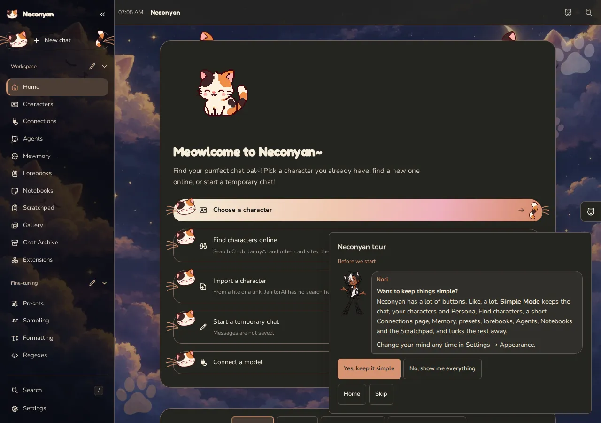
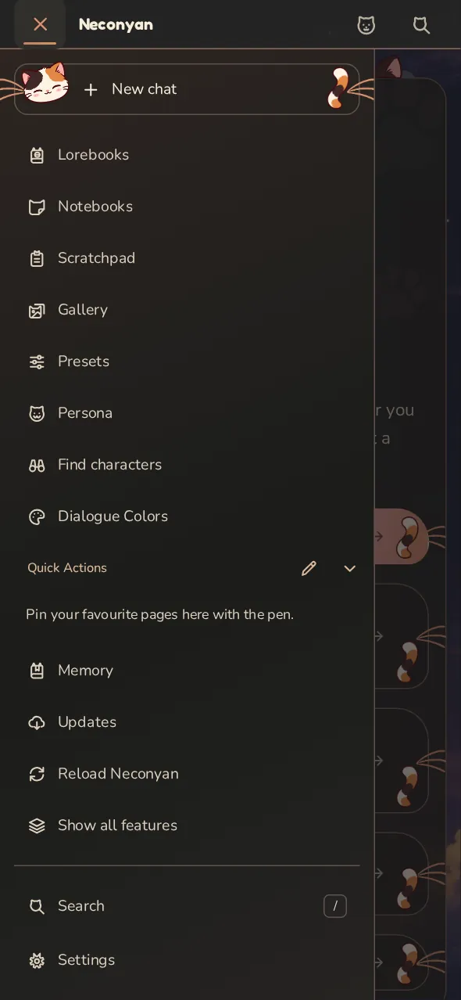
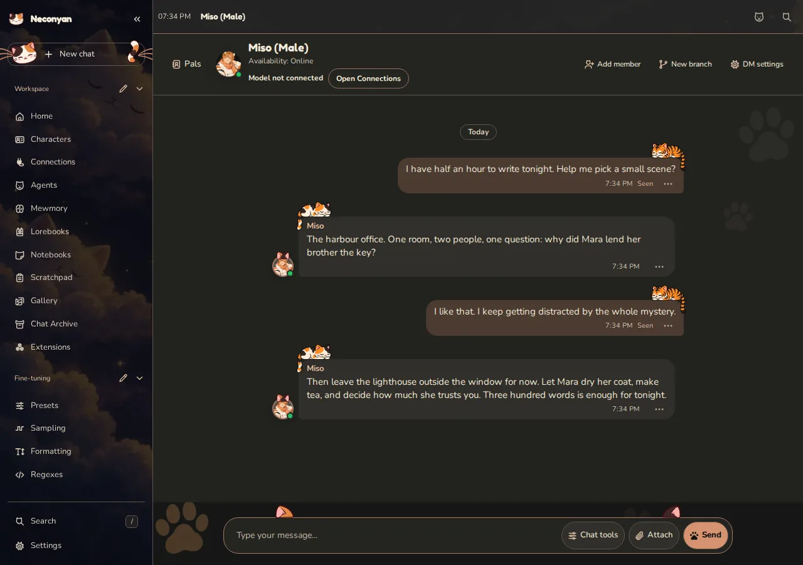

<!-- Translated from README.md at commit 31d628fa (Neconyan 1.5.5). Keep the structure in step with the English README. -->

# Neconyan~

L'ultima versione è la [1.5.5](https://github.com/platberlitz/Neconyan/releases/tag/v1.5.5).

**Leggi nella tua lingua:** [English](../README.md) · [Deutsch](readme-de_de.md) · [Español](readme-es_es.md) · [Français](readme-fr_fr.md) · [Nederlands](readme-nl_nl.md) · [Português](readme-pt_pt.md) · [Íslenska](readme-is_is.md) · [Русский](readme-ru_ru.md) · [Українська](readme-uk_ua.md) · [العربية](readme-ar_sa.md) · [ไทย](readme-th_th.md) · [Tiếng Việt](readme-vi_vn.md) · [日本語](readme-ja_jp.md) · [한국어](readme-ko_kr.md) · [简体中文](readme-zh_cn.md) · [繁體中文](readme-zh_tw.md)

Questa traduzione potrebbe non essere aggiornata. Il [README in inglese](../README.md) è quello aggiornato.

<p align="center">
  
</p>

Ciao, entra pure! Neconyan è il mio fork a tema gatti di [SillyTavern](https://github.com/SillyTavern/SillyTavern) e [SillyBunny](https://github.com/SillyBunnyTeam/SillyBunny) per chattare e fare roleplay con personaggi IA, dal computer o dal telefono. L'ho creato perché volevo un frontend accogliente, che funzionasse davvero bene sul telefono e con un gatto in quasi ogni pagina. La chiave API o il modello locale li porti tu: l'app non include né l'accesso a un modello né crediti.

**[Scarica Neconyan](https://github.com/platberlitz/Neconyan/releases/latest)** · **[Leggi il manuale](https://platberlitz.github.io/neconyan-docs/)** · **[Chiedi aiuto](https://platberlitz.github.io/neconyan-docs/help/troubleshooting/)**

> Tutto il codice qui è generato da un LLM o scritto con il suo aiuto. Ogni prompt e ogni agente incluso in Neconyan è opera umana.

## Cosa c'è qui dentro?

<p align="center">
  
</p>

- **Quattro modi di chattare:** il classico Roleplay, Conversazione in stile app di messaggistica, una timeline social chiamata Meower e la Modalità storia per una prosa continua. Scegli quello che ti ispira di più.
- **Un layout pensato per i telefoni**, con controlli dotati di etichetta, una barra della chat in basso e un menu a scomparsa. Basta strizzare gli occhi davanti a minuscoli pulsanti da desktop su uno schermo piccolo.
- **[Modalità semplice](#modalità-semplice)**, per quando vuoi solo fare roleplay senza una cabina di pilotaggio piena di pulsanti. Te ne parlo più sotto, perché ci tengo tantissimo.
- **Mewmory** ricorda gli eventi e i personaggi della storia, così il tuo partner non dimentica le cose importanti. Gli **Agenti** possono tenere dei tracker, controllare una risposta o scrivere una Nota del companion a parte.
- **Catelier** ti aiuta a scrivere schede personaggio e lorebook. **Taccuini** tiene le tue note a portata di mano, e **Scratchpad** ti dà una chat separata per ragionare sulle idee.
- **Miso, Taro e Nori** sono gli assistenti di casa. Ti aiutano a trovare le cose e possono fare le modifiche supportate se glielo permetti.
- **Sincronizzazione** sposta dati selezionati tra installazioni separate con file cifrati, WebDAV, Gist GitHub segreti o abbinamento diretto. I trasferimenti partono quando lo chiedi.
- **Temi, colori d'accento e gatti.** Un bel po' di gatti. Puoi nasconderli, anche se non riesco a immaginare perché vorresti farlo.

Le tue schede personaggio, chat, lorebook e preset usano i formati di SillyTavern che già conosci, quindi vengono via con te. Non c'è telemetria. Alcune funzioni ed estensioni del progetto originale qui si comportano in modo diverso: porto qui solo le parti che mi interessano. L'[elenco degli strumenti inclusi](../docs/neconyan-native-tools.md) dà il giusto credito ai progetti distribuiti con Neconyan.

## Modalità semplice

<p align="center">
  
</p>

Le cose da power user non fanno per te? Non ti va di farti strada tra montagne di pulsanti solo per fare roleplay e divertirti? Allora ho proprio la modalità che fa per te!

La **Modalità semplice** è Neconyan per chi vuole solo fare RP. Tieni tutto quello che rende Neconyan *Neconyan*: i gatti, il layout comodo sul telefono, Miso, Taro e Nori, la Memoria che tiene il filo della tua storia e i tuoi Agenti che continuano a lavorare dietro le quinte. Sparisce solo il superfluo: sampler, formattazione dei prompt, contatori di token, menu delle estensioni e tutte le altre manopole che quasi nessuno tocca mai.

E adesso il bello: non viene eliminato né disattivato niente. Ogni controllo nascosto è messo da parte, non buttato via, e torna subito appena lo vuoi.

### Più facile di così non si può

Alla tua primissima visita, Nori ti fa una sola domanda: **Want to keep things simple?** Premi **Yes, keep it simple** e un tour in tre passaggi ti accompagna a collegare un modello, conoscere un personaggio e salutarlo. Fatto. Questa è tutta la configurazione.

Usi già il layout completo? Attivala quando vuoi da **Impostazioni → Aspetto → Modalità semplice**.

<table><tr>
  <td width="72%"></td>
  <td width="28%"></td>
</tr></table>

### La tua chat al centro della scena

La chat e la casella di scrittura si prendono tutto lo spazio, e la barra laterale tiene solo un breve elenco di pagine che aprirai davvero: Personaggi, Connessioni, Agenti, Lorebook, Taccuini, Scratchpad, Galleria, Preset, Persona e Colori del dialogo. E in più hai tre pulsanti comodissimi:

- **Find characters** cerca nuove schede. Scegline una e la sua chat si apre subito, pronta all'uso.
- **Memoria** apre **Story so far**, con un solo interruttore, un pulsante **Summarise now** e l'ultimo riassunto della tua chat.
- **Updates** controlla se c'è una nuova versione e la installa senza uscire dalla Modalità semplice.

<table><tr>
  <td width="72%"></td>
  <td width="28%"></td>
</tr></table>

### Collegarsi senza fare i compiti

Connessioni mostra solo il provider, la tua chiave, il modello, **Collega** e **Messaggio di prova**. Tutto il resto aspetta dietro **More connection options**, per il giorno in cui ti verrà la curiosità.

<table><tr>
  <td width="72%"></td>
  <td width="28%"></td>
</tr></table>

### Hai cambiato idea? Nessun problema

Premi **Mostra tutte le funzioni** nella barra laterale, oppure disattivala da **Impostazioni → Aspetto**, e ogni pulsante torna esattamente dove l'avevi lasciato. Le tue chat, i personaggi, il lore e gli Agenti non si accorgono di nulla.

[La Modalità semplice nel manuale](https://platberlitz.github.io/neconyan-docs/workspace/#keep-the-sidebar-simple)

## Dai un'occhiata

<p align="center">
  
</p>

Ecco il resto del tour! Ho fatto questi screenshot di desktop e telefono il 17 novembre 2026, con chat e note dimostrative, gli assistenti inclusi, i colori predefiniti di Calico Dark e la **Visibilità dello sfondo allo 0%**.

### Home

Scegli un personaggio, collega un modello o saluta uno degli assistenti. I gatti saranno felicissimi di vederti.

<table><tr>
  <td width="72%"></td>
  <td width="28%"></td>
</tr></table>

### Roleplay

Scrivi una scena, prova un'altra risposta o riprendi una vecchia chat esattamente da dove l'avevi lasciata.

<table><tr>
  <td width="72%"></td>
  <td width="28%"></td>
</tr></table>

### Catelier

Lavora a una bozza di personaggio, chiedi aiuto per la scrittura e controlla le modifiche prima di salvarle nella tua libreria.

<table><tr>
  <td width="72%"></td>
  <td width="28%"></td>
</tr></table>

### Agenti

Scegli un aiutante, decidi quando entra in azione e dagli una connessione. Io comincerei con uno solo, invece di attivare mezza libreria in un colpo.

<table><tr>
  <td width="72%"></td>
  <td width="28%"></td>
</tr></table>

### Proofreader post-generazione

Proofreader controlla una risposta dopo che è arrivata. Può sistemare prosa e formattazione senza chiedere al modello principale di riscrivere la scena. Apri **Modifiche all'agente** per confrontare la modifica e annullarla se preferisci l'originale.

<table><tr>
  <td width="72%"></td>
  <td width="28%"></td>
</tr></table>

Questo esempio allestito esegue il vero flusso di lavoro degli Agenti con una risposta di esempio fissa. Nell'uso normale le modifiche le scrive il tuo modello collegato, e ogni passaggio può costare un'altra richiesta. [Agenti e Companion nel manuale](https://platberlitz.github.io/neconyan-docs/helpers/agents/).

<details>
<summary><b>Altri screenshot: Conversazione, Meower, Modalità storia, Taccuini, Scratchpad e Sincronizzazione</b></summary>

### Conversazione

Scrivi ai tuoi personaggi, crea chat di gruppo e lascia che siano occupati oppure offline, proprio come veri amici.

<table><tr>
  <td width="72%"></td>
  <td width="28%"></td>
</tr></table>

### Meower

Una timeline social dove i tuoi personaggi pubblicano post, rispondono e lanciano sondaggi. Lì dentro si scatena il caos, nel senso migliore del termine.

<table><tr>
  <td width="72%"></td>
  <td width="28%"></td>
</tr></table>

### Modalità storia

Leggi la tua chat come prosa continua, come un libro scritto a quattro mani.

<table><tr>
  <td width="72%"></td>
  <td width="28%"></td>
</tr></table>

### Taccuini

Tieni piani delle scene, luoghi e diari delle sessioni accanto alle tue chat.

<table><tr>
  <td width="72%"></td>
  <td width="28%"></td>
</tr></table>

### Scratchpad

Parla della storia con un assistente o con una tavola rotonda di personaggi, senza che la loro discussione finisca nella chat principale.

<table><tr>
  <td width="72%"></td>
  <td width="28%"></td>
</tr></table>

### Sincronizzazione

Sposta raccolte selezionate tra installazioni separate. Scegli file cifrati, WebDAV, un Gist GitHub segreto o l'abbinamento diretto; i trasferimenti partono quando lo chiedi. [Configurazione e ripristino nel manuale](https://platberlitz.github.io/neconyan-docs/help/device-sync/).

<table><tr>
  <td width="72%"></td>
  <td width="28%"></td>
</tr></table>

</details>

## Per iniziare

<p align="center">
  
</p>

Hai voglia di provarlo? Scegli il dispositivo che preferisci.

### Su un computer

1. Scarica il file che termina con **-source.zip** dall'[ultima release](https://github.com/platberlitz/Neconyan/releases/latest). Prima decomprimilo; su Windows fai clic destro e scegli **Estrai tutto**.
2. Apri la cartella. Esegui **Start.bat** su Windows, **Start.command** su macOS oppure **bash start.sh** in un terminale su Linux.
3. Dai al primo avvio qualche minuto per installare quello che gli serve. Tieni aperta la finestra del terminale mentre usi Neconyan.
4. Il browser dovrebbe aprirsi da solo. Se non succede, vai su **http://127.0.0.1:4433/**.
5. Apri **Connessioni**, scegli il provider e il modello, poi inserisci la tua chiave API o l'indirizzo del tuo modello locale. Dopodiché apri un personaggio o un assistente nella Home, e si parte!

La prossima volta, esegui di nuovo lo stesso script di avvio. Per fermare Neconyan, premi **Ctrl+C** nel suo terminale.

Preferisci Git? Clona il repository, poi usa lo stesso script di avvio:

```sh
git clone https://github.com/platberlitz/Neconyan.git
```

[Configurazione sul computer e problemi comuni all'avvio](https://platberlitz.github.io/neconyan-docs/start/computer/)

### App Android

Scarica il file **-android-arm64.apk** dall'[ultima release](https://github.com/platberlitz/Neconyan/releases/latest) e aprilo. Se Android te lo chiede, consenti l'installazione dal browser. Ti servono **Android 11 o successivo**, **Android System WebView 124 o successivo** e circa **2 GiB** liberi.

L'app gira direttamente sul telefono, senza Termux e senza un computer. Dai alla prima apertura il tempo di scompattare tutto, poi configura **Connessioni**. Per conservare le chat, installa gli aggiornamenti sopra l'app esistente.

[Configurazione Android](https://platberlitz.github.io/neconyan-docs/start/android/) · [Istruzioni per la compilazione](../android/README.md)

### App per iPhone

Scarica il file **-ios-unsigned.ipa** dall'[ultima release](https://github.com/platberlitz/Neconyan/releases/latest), poi installalo con uno strumento di sideloading come [iloader](https://github.com/nab138/iloader). Ti serve **iOS 17 o successivo**. L'app tiene il suo server e le tue chat sul telefono; non è sull'App Store.

Con un account Apple gratuito devi rifirmare l'app ogni sette giorni e puoi installare in sideloading al massimo tre app. Per aggiornare, installa la nuova versione sopra l'app esistente con lo stesso account Apple. **Eliminare l'app elimina anche i suoi dati**, quindi esporta prima un backup.

[Configurazione e limiti per iPhone](../ios/README.md)

### Altri modi per usare il telefono

- **Android con Termux:** segui la [guida a Termux](https://platberlitz.github.io/neconyan-docs/start/android/#prefer-termux) se preferisci un terminale o hai un telefono più vecchio.
- **Usa l'installazione di un computer:** segui la [guida per la stessa rete Wi-Fi](https://platberlitz.github.io/neconyan-docs/start/phone/). I due dispositivi usano le stesse chat salvate; lascia acceso il computer.

## Aggiornamenti, backup e come spostare le chat

Apri **Server → Aggiornamenti e riavvio → Verifica aggiornamenti**. Le installazioni Git e quelle da ZIP del sorgente supportate offrono **Aggiorna e riavvia**. Android offre **Update APK** e ti chiede di approvare l'installazione. In Modalità semplice, il pulsante **Updates** nella barra laterale ti porta nello stesso punto. Le copie ZIP più vecchie senza un sistema di aggiornamento richiedono uno [spostamento manuale nella cartella più recente](https://platberlitz.github.io/neconyan-docs/help/backups/#update-a-zip-installation).

Le installazioni Git cercano gli aggiornamenti anche all'avvio. Le modifiche che hai fatto ai file dell'app stessa possono bloccare un aggiornamento automatico; le tue chat e le tue impostazioni non contano.

Arrivi da SillyTavern o SillyBunny? Che bello averti qui! **Prima fai un backup**, dai a Neconyan una cartella dati tutta sua, poi segui la guida [Importare i tuoi dati](https://platberlitz.github.io/neconyan-docs/start/imports/). Controlla i tuoi personaggi e le tue chat prima di eliminare qualsiasi cosa. Alcune estensioni potrebbero richiedere qualche aggiustamento.

[Backup e ripristino](https://platberlitz.github.io/neconyan-docs/help/backups/) · [Spostare i dati tra dispositivi](../docs/data-portability.md)

## Serve una mano?

Io partirei dal [manuale](https://platberlitz.github.io/neconyan-docs/) o chiederei a Miso, Taro o Nori nella Home; sono sempre felici di darti una mano. Però possono sbagliarsi, quindi controlla i loro consigli prima di fare una modifica che non puoi annullare.

Per le impostazioni che non trovi, prova **Ricerca** nella barra laterale. Per gli errori, usa la [guida alla risoluzione dei problemi](https://platberlitz.github.io/neconyan-docs/help/troubleshooting/) oppure [apri una issue](https://github.com/platberlitz/Neconyan/issues) indicando cosa stavi facendo e l'errore mostrato.

## Riconoscimenti

<p align="center">
  
</p>

Neconyan è costruito sul lavoro di tutte le persone dietro SillyTavern e SillyBunny; senza di loro niente di tutto questo esisterebbe. L'[elenco degli strumenti inclusi](../docs/neconyan-native-tools.md) riconosce il merito dei loro autori originali.

Creato con amore da [Platberlitz](https://github.com/platberlitz). Distribuito con licenza [GNU AGPL v3](../LICENSE). Se lo ridistribuisci, conserva gli avvisi e le licenze.

Un ringraziamento speciale a **El Topo**, il mio principale aiutante e collaboratore. Apprezzo davvero tutto il lavoro che hai messo in Neconyan.

Divertiti, e salutami i gatti!
