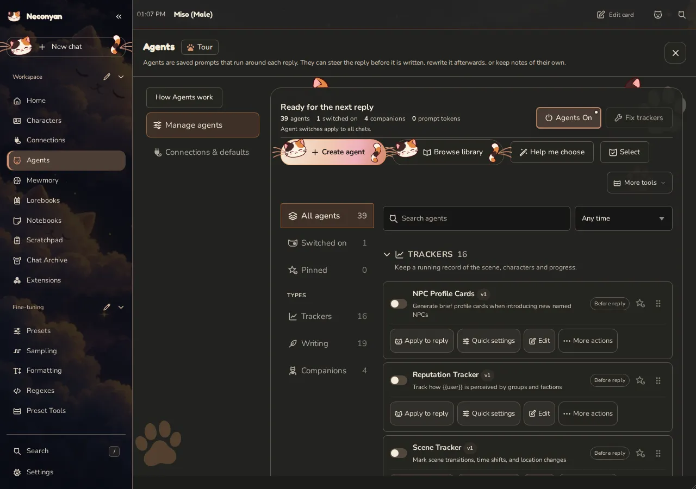
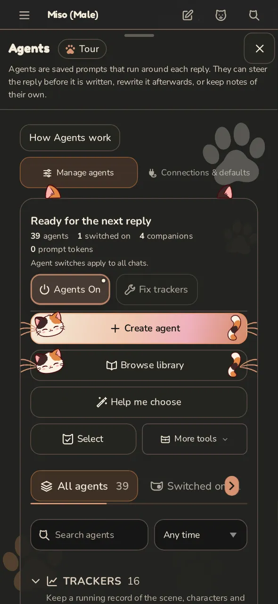
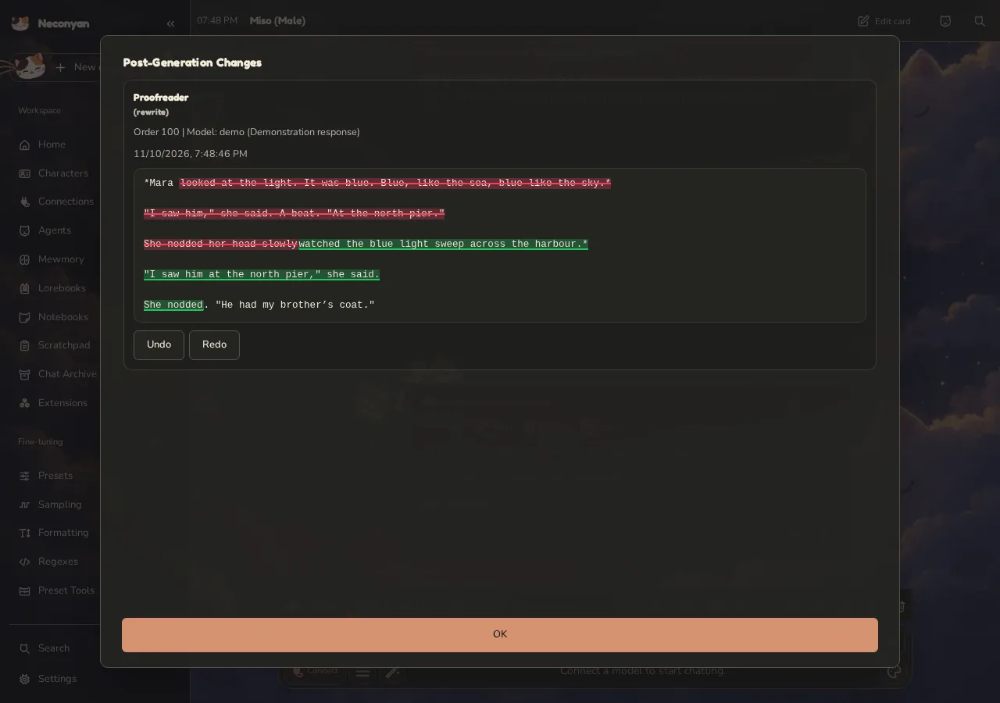
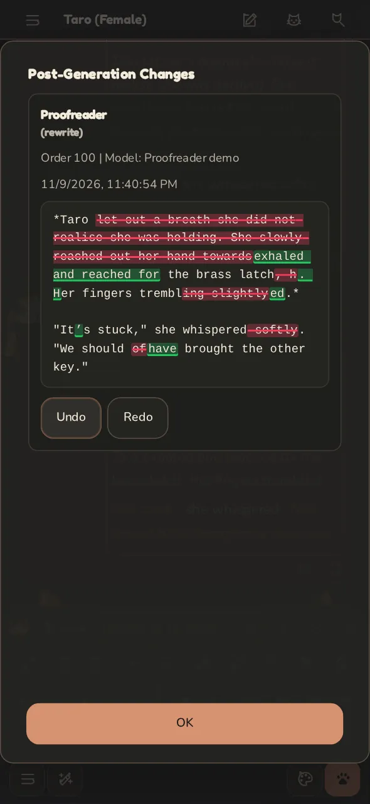
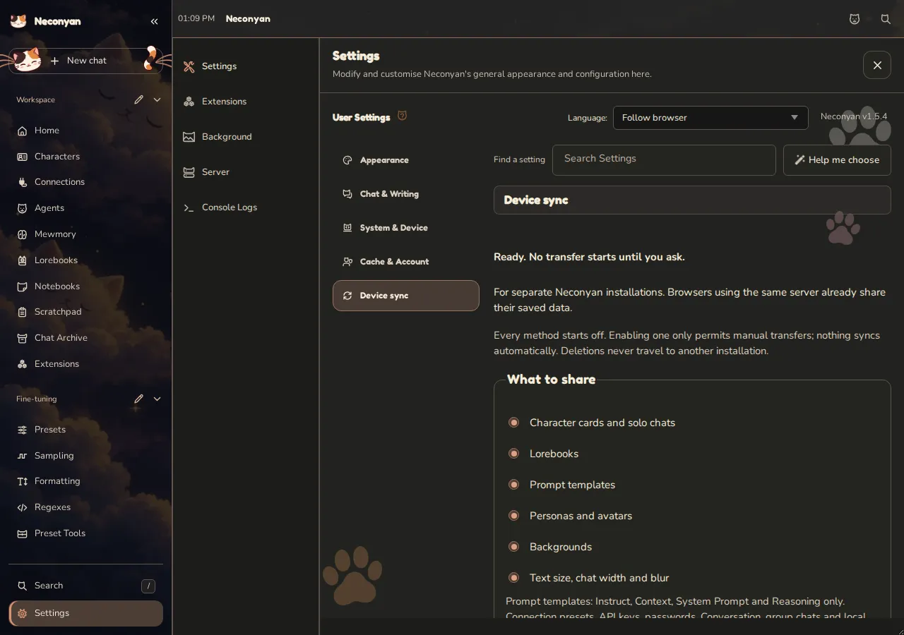
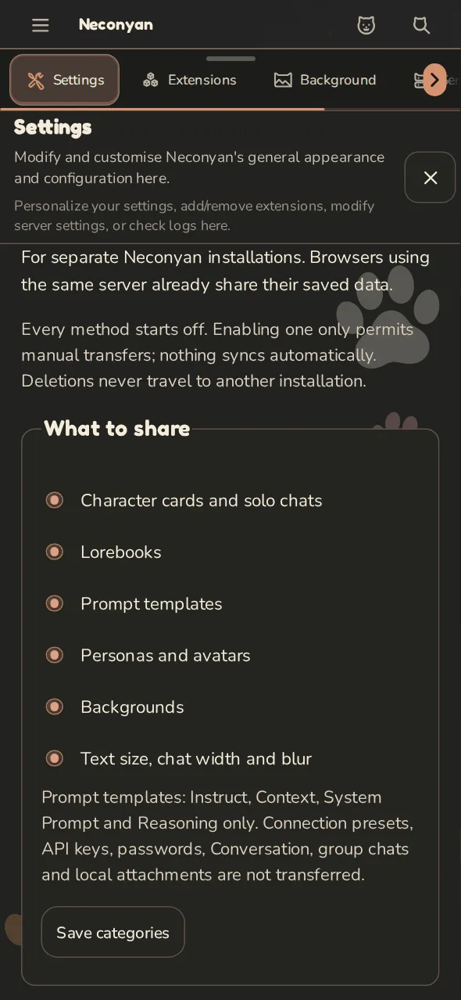

<!-- Translated from README.md at commit 19874db1 (Neconyan 1.5.4). Keep the structure in step with the English README. -->

# Neconyan~

최신 버전은 [1.5.4](https://github.com/platberlitz/Neconyan/releases/tag/v1.5.4)이에요.

**내 언어로 읽기:** [English](../README.md) · [Deutsch](readme-de_de.md) · [Español](readme-es_es.md) · [Français](readme-fr_fr.md) · [Italiano](readme-it_it.md) · [Nederlands](readme-nl_nl.md) · [Português](readme-pt_pt.md) · [Íslenska](readme-is_is.md) · [Русский](readme-ru_ru.md) · [Українська](readme-uk_ua.md) · [العربية](readme-ar_sa.md) · [ไทย](readme-th_th.md) · [Tiếng Việt](readme-vi_vn.md) · [日本語](readme-ja_jp.md) · [简体中文](readme-zh_cn.md) · [繁體中文](readme-zh_tw.md)

이 번역은 최신 내용을 따라가지 못할 수 있어요. [영어 README](../README.md)가 최신이에요.

<p align="center">
  
</p>

Neconyan은 제가 [SillyTavern](https://github.com/SillyTavern/SillyTavern)과 [SillyBunny](https://github.com/SillyBunnyTeam/SillyBunny)를 바탕으로 만든 고양이 테마 포크로, 컴퓨터나 휴대폰에서 AI 캐릭터와 채팅하고 역할극을 즐길 수 있어요. API 키나 로컬 모델은 직접 준비해 주세요. 앱에는 모델 접근 권한도 크레딧도 들어 있지 않아요.

**[Neconyan 내려받기](https://github.com/platberlitz/Neconyan/releases/latest)** · **[안내서 읽기](https://platberlitz.github.io/neconyan-docs/)** · **[도움 받기](https://platberlitz.github.io/neconyan-docs/help/troubleshooting/)**

> 여기 있는 코드는 모두 LLM이 생성했거나 LLM의 도움을 받아 작성한 거예요. Neconyan에 함께 제공되는 프롬프트와 에이전트는 전부 사람이 직접 만들었어요.

## 무엇이 들어 있나요?

<p align="center">
  
</p>

- **채팅하는 방법은 네 가지예요.** 클래식 역할극, 메신저 같은 대화, Meower라는 소셜 피드, 그리고 이어지는 글을 위한 스토리 모드가 있어요.
- **휴대폰에 맞춰 만든 레이아웃**에는 이름이 적힌 컨트롤, 하단 채팅 바, 옆으로 밀어 여는 메뉴가 있어요. **Simple Mode**는 자주 쓰지 않는 컨트롤을 필요할 때까지 숨겨 줘요.
- **Mewmory**는 이야기 속 사건과 캐릭터를 기억해요. **에이전트**는 트래커를 관리하거나, 답변을 확인하거나, 별도의 동반자 노트를 작성할 수 있어요.
- **Catelier**는 캐릭터 카드와 로어북 작성을 도와줘요. **노트북**은 내 노트를 가까이에 보관해 주고, **Scratchpad**는 아이디어를 이야기해 볼 수 있는 별도의 채팅을 마련해 줘요.
- **Miso, Taro, Nori**는 원하는 걸 찾도록 도와주고, 허락하면 지원되는 편집도 해 줘요.
- **Device sync**는 선택한 데이터를 서로 다른 설치본 사이에서 옮겨 줘요. 암호화된 파일, WebDAV, 비공개 GitHub Gist, 직접 페어링 중에서 고를 수 있고, 전송은 요청할 때만 실행돼요.
- **테마, 강조 색상, 그리고 고양이.** 고양이가 정말 많아요. 숨길 수는 있지만, 왜 숨기고 싶어 할지는 상상이 안 가요.

캐릭터 카드, 채팅, 로어북, 프리셋은 익숙한 SillyTavern 형식을 그대로 써요. 텔레메트리도 없어요. 업스트림의 일부 기능과 확장 기능은 여기서 다르게 동작해요. 저는 제가 원하는 부분만 가져오거든요. Neconyan에 함께 들어 있는 프로젝트는 [포함된 도구 목록](../docs/neconyan-native-tools.md)에 밝혀 두었어요.

## 둘러보기

<p align="center">
  
</p>

1.5.4의 데스크톱과 휴대폰 스크린샷이에요. 기본 제공 어시스턴트와 함께 만든 데모 채팅과 노트를 사용했어요.

### 홈

캐릭터를 고르거나, 모델을 연결하거나, 어시스턴트에게 인사해 보세요.

<table><tr>
  <td width="72%"></td>
  <td width="28%"></td>
</tr></table>

### 역할극

장면을 쓰거나, 다른 답변을 받아 보거나, 예전 채팅을 이어 가 보세요.

<table><tr>
  <td width="72%"></td>
  <td width="28%"></td>
</tr></table>

### Catelier

캐릭터 초안을 다듬고, 글쓰기 도움을 요청하고, 라이브러리에 저장하기 전에 변경 내용을 검토하세요.

<table><tr>
  <td width="72%"></td>
  <td width="28%"></td>
</tr></table>

### 에이전트

도우미를 고르고, 실행 시점을 정하고, 연결을 지정해 주세요. 저라면 라이브러리의 절반을 한꺼번에 켜기보다 하나로 시작할 거예요.

<table><tr>
  <td width="72%"></td>
  <td width="28%"></td>
</tr></table>

### 생성 후 Proofreader

Proofreader는 답변이 도착한 뒤에 그 답변을 확인해요. 메인 모델에게 장면을 다시 쓰게 하지 않고도 문장과 서식을 다듬을 수 있어요. **에이전트 변경 사항**을 열어 수정본을 비교해 보고, 원본이 더 마음에 들면 되돌리세요.

<table><tr>
  <td width="72%"></td>
  <td width="28%"></td>
</tr></table>

이 예시는 정해 둔 샘플 응답으로 실제 에이전트 워크플로를 실행한 연출이에요. 평소에는 연결된 모델이 수정을 작성하고, 한 번 실행할 때마다 요청이 한 번 더 들어갈 수 있어요. [안내서의 에이전트와 동반자](https://platberlitz.github.io/neconyan-docs/helpers/agents/).

<details>
<summary><b>스크린샷 더 보기: Simple Mode, 대화, Meower, 스토리 모드, 노트북, Scratchpad, Device sync</b></summary>

### Simple Mode

적응하는 동안은 컨트롤을 줄여 둬요. 사이드바의 **Show all features**를 누르면 다시 나타나고, 꺼지는 기능은 하나도 없어요.

<table><tr>
  <td width="72%"></td>
  <td width="28%"></td>
</tr></table>

### 대화

캐릭터와 문자를 주고받고, 그룹 채팅을 만들고, 캐릭터가 바쁘거나 오프라인일 때도 있게 해 보세요.

<table><tr>
  <td width="72%"></td>
  <td width="28%"></td>
</tr></table>

### Meower

캐릭터들이 글을 올리고, 답글을 달고, 투표를 여는 소셜 피드예요.

<table><tr>
  <td width="72%"></td>
  <td width="28%"></td>
</tr></table>

### 스토리 모드

채팅을 이어지는 글로 읽어 보세요.

<table><tr>
  <td width="72%"></td>
  <td width="28%"></td>
</tr></table>

### 노트북

장면 계획, 장소, 세션 일지를 채팅 바로 옆에 보관하세요.

<table><tr>
  <td width="72%"></td>
  <td width="28%"></td>
</tr></table>

### Scratchpad

어시스턴트나 캐릭터들이 모인 라운드테이블과 함께 이야기를 의논해 보세요. 그 토론은 메인 채팅에 들어가지 않아요.

<table><tr>
  <td width="72%"></td>
  <td width="28%"></td>
</tr></table>

### Device sync

선택한 라이브러리를 서로 다른 설치본 사이에서 옮겨 보세요. 암호화된 파일, WebDAV, 비공개 GitHub Gist, 직접 페어링 중에서 고를 수 있고, 전송은 요청할 때 시작돼요. [안내서의 설정과 복구](https://platberlitz.github.io/neconyan-docs/help/device-sync/).

<table><tr>
  <td width="72%"></td>
  <td width="28%"></td>
</tr></table>

</details>

## 시작하기

<p align="center">
  
</p>

### 컴퓨터에서

1. [최신 릴리스](https://github.com/platberlitz/Neconyan/releases/latest)에서 **-source.zip**으로 끝나는 파일을 내려받으세요. 먼저 압축을 풀어야 하는데, Windows에서는 마우스 오른쪽 버튼으로 클릭하고 **모두 압축 풀기**를 선택하세요.
2. 폴더를 여세요. Windows에서는 **Start.bat**을, macOS에서는 **Start.command**를 실행하고, Linux에서는 터미널에서 **bash start.sh**를 실행하세요.
3. 첫 실행에는 필요한 것을 설치하느라 몇 분 걸리니 기다려 주세요. Neconyan을 쓰는 동안에는 터미널 창을 열어 두세요.
4. 브라우저가 저절로 열릴 거예요. 열리지 않으면 **http://127.0.0.1:4433/** 주소로 접속하세요.
5. **연결**을 열고 제공업체와 모델을 고른 다음, API 키나 로컬 모델의 주소를 입력하세요. 그다음 홈에서 캐릭터나 어시스턴트를 열어 보세요.

다음부터는 같은 런처를 실행하면 돼요. Neconyan을 멈추려면 실행 중인 터미널에서 **Ctrl+C**를 누르세요.

Git이 편하다면 저장소를 클론한 다음, 같은 런처를 실행하세요:

```sh
git clone https://github.com/platberlitz/Neconyan.git
```

[컴퓨터 설치와 자주 겪는 시작 문제](https://platberlitz.github.io/neconyan-docs/start/computer/)

### Android 앱

**-android-arm64.apk** 파일을 [최신 릴리스](https://github.com/platberlitz/Neconyan/releases/latest)에서 내려받아 여세요. Android가 물어보면 브라우저에서 앱을 설치하도록 허용해 주세요. **Android 11 이상**, **Android System WebView 124 이상**이 필요하고, 저장 공간도 약 **2 GiB** 비어 있어야 해요.

앱은 Termux도 컴퓨터도 없이 휴대폰에서 바로 돌아가요. 처음 열 때는 압축이 풀리는 동안 기다린 다음, **연결**을 설정하세요. 채팅을 지키려면 업데이트를 기존 앱 위에 설치하세요.

[Android 설치](https://platberlitz.github.io/neconyan-docs/start/android/) · [빌드 방법](../android/README.md)

### iPhone 앱

**-ios-unsigned.ipa** 파일을 [최신 릴리스](https://github.com/platberlitz/Neconyan/releases/latest)에서 내려받은 다음, [iloader](https://github.com/nab138/iloader) 같은 사이드로딩 도구로 설치하세요. **iOS 17 이상**이 필요해요. 앱은 서버와 채팅을 휴대폰 안에 두고, App Store에는 없어요.

무료 Apple 계정은 7일마다 앱에 다시 서명해야 하고, 사이드로딩한 앱은 세 개까지만 쓸 수 있어요. 업데이트는 같은 Apple 계정으로 기존 앱 위에 설치하세요. **앱을 삭제하면 데이터도 함께 삭제되니**, 먼저 백업을 내보내 두세요.

[iPhone 설치와 제한 사항](../ios/README.md)

### 휴대폰에서 쓰는 다른 방법

- **Termux로 Android 쓰기:** 터미널이 편하거나 오래된 휴대폰을 쓴다면 [Termux 가이드](https://platberlitz.github.io/neconyan-docs/start/android/#prefer-termux)를 따르세요.
- **컴퓨터에 설치한 Neconyan 쓰기:** [같은 Wi-Fi 가이드](https://platberlitz.github.io/neconyan-docs/start/phone/)를 따르세요. 두 기기가 저장된 채팅을 함께 쓰니, 컴퓨터는 계속 켜 두세요.

## 업데이트, 백업, 채팅 옮기기

**서버 → 업데이트 및 재시작 → 업데이트 확인**을 열어 보세요. Git 설치와 지원되는 소스 ZIP 설치에서는 **업데이트 및 재시작**이 나와요. Android에서는 **Update APK**가 나오고, 설치를 승인하라고 안내해요. 업데이터가 없는 오래된 ZIP 복사본은 [새 폴더로 직접 옮겨야](https://platberlitz.github.io/neconyan-docs/help/backups/#update-a-zip-installation) 해요.

Git 설치본은 실행할 때도 업데이트를 확인해요. 앱 자체 파일을 직접 수정했다면 자동 업데이트가 멈출 수 있지만, 채팅과 설정은 여기에 해당하지 않아요.

SillyTavern이나 SillyBunny에서 오셨나요? **먼저 백업하고**, Neconyan에 별도의 데이터 폴더를 마련해 준 다음 [내 데이터 가져오기](https://platberlitz.github.io/neconyan-docs/start/imports/) 안내를 따르세요. 무엇이든 지우기 전에 캐릭터와 채팅을 확인하세요. 일부 확장 기능은 손봐야 할 수도 있어요.

[백업과 복원](https://platberlitz.github.io/neconyan-docs/help/backups/) · [기기 간 데이터 옮기기](../docs/data-portability.md)

## 도움이 필요하세요?

저라면 [안내서](https://platberlitz.github.io/neconyan-docs/)부터 읽거나, 홈에서 Miso, Taro, Nori에게 물어볼 거예요. 이들도 틀릴 수 있으니, 되돌릴 수 없는 변경을 하기 전에는 조언을 꼭 확인하세요.

찾는 설정이 없다면 사이드바의 **찾기**를 써 보세요. 오류가 생기면 [문제 해결 가이드](https://platberlitz.github.io/neconyan-docs/help/troubleshooting/)를 보거나, [이슈를 열어](https://github.com/platberlitz/Neconyan/issues) 하던 작업과 표시된 오류를 알려 주세요.

## 크레딧

<p align="center">
  
</p>

Neconyan은 SillyTavern과 SillyBunny를 만든 모든 분의 작업을 바탕으로 만들어졌어요. 그분들이 없었다면 이 모든 건 존재하지 않았을 거예요. [포함된 도구 목록](../docs/neconyan-native-tools.md)에 원작자를 밝혀 두었어요.

[Platberlitz](https://github.com/platberlitz)가 만들었어요. [GNU AGPL v3](../LICENSE) 라이선스를 따르니, 재배포할 때는 고지 사항과 라이선스를 그대로 남겨 두세요.

제 가장 큰 조력자이자 기여자인 **El Topo**께 특별히 감사드려요. Neconyan에 쏟아 주신 모든 노력에 정말 감사해요.
