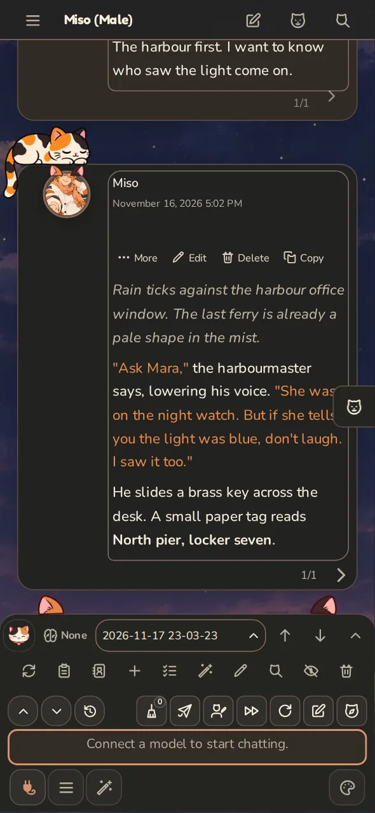
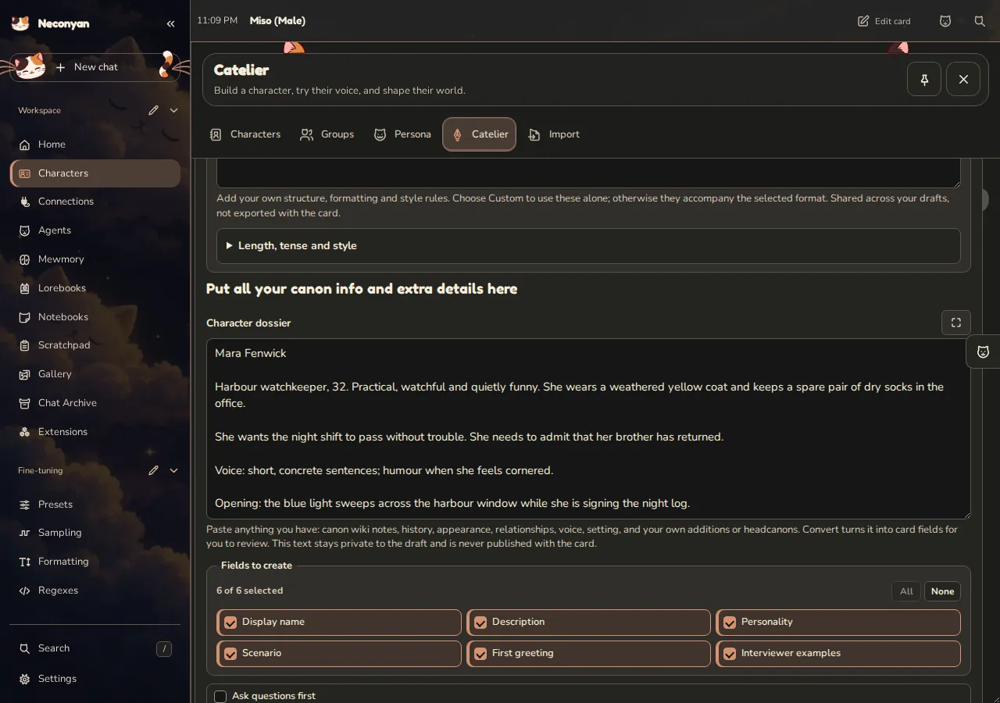
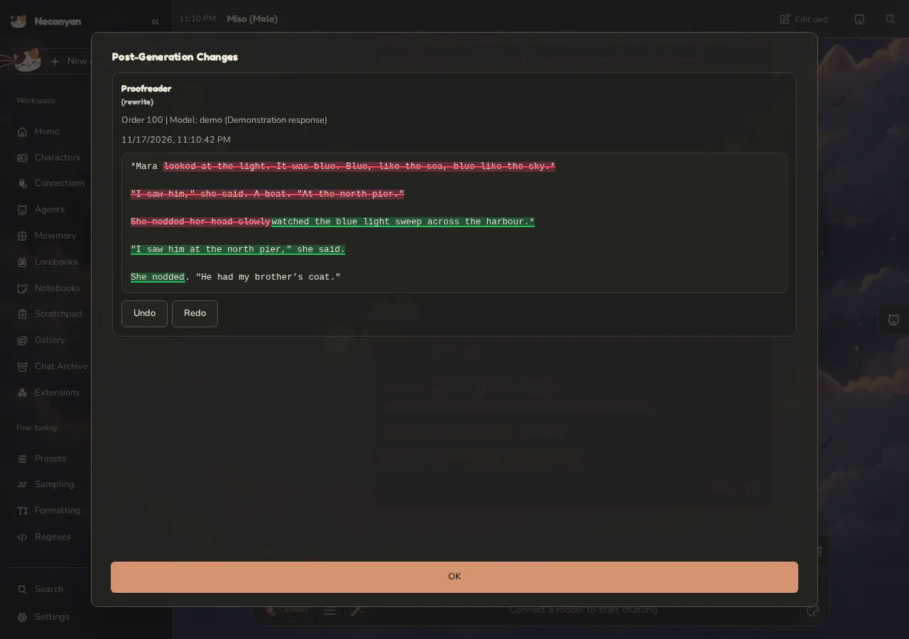
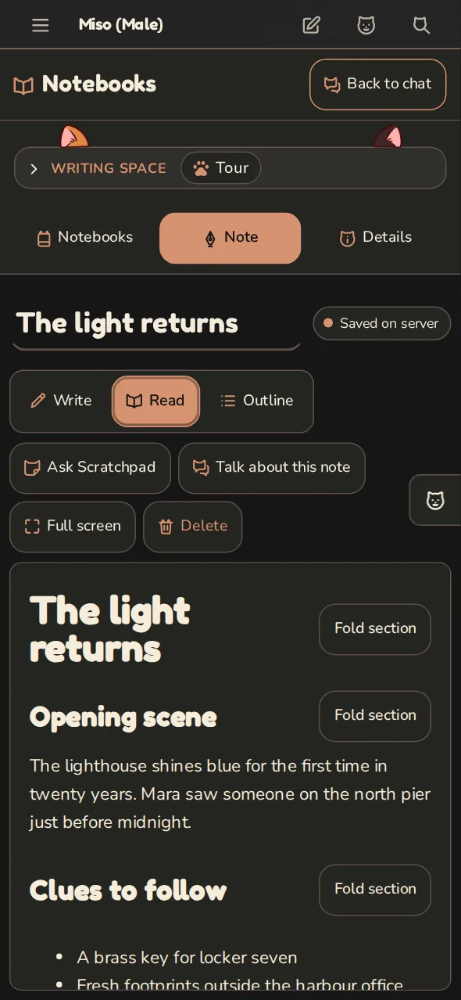

<!-- Translated from README.md at commit 31d628fa (Neconyan 1.5.5). Keep the structure in step with the English README. -->

# Neconyan~

De nieuwste versie is [1.5.5](https://github.com/platberlitz/Neconyan/releases/tag/v1.5.5).

**Lees in je eigen taal:** [English](../README.md) · [Deutsch](readme-de_de.md) · [Español](readme-es_es.md) · [Français](readme-fr_fr.md) · [Italiano](readme-it_it.md) · [Português](readme-pt_pt.md) · [Íslenska](readme-is_is.md) · [Русский](readme-ru_ru.md) · [Українська](readme-uk_ua.md) · [العربية](readme-ar_sa.md) · [ไทย](readme-th_th.md) · [Tiếng Việt](readme-vi_vn.md) · [日本語](readme-ja_jp.md) · [한국어](readme-ko_kr.md) · [简体中文](readme-zh_cn.md) · [繁體中文](readme-zh_tw.md)

Deze vertaling kan achterlopen. De [Engelse README](../README.md) is actueel.

<p align="center">
  
</p>

Hoi, kom binnen! Neconyan is mijn fork met kattenthema van [SillyTavern](https://github.com/SillyTavern/SillyTavern) en [SillyBunny](https://github.com/SillyBunnyTeam/SillyBunny), om te chatten en te roleplayen met AI-personages, op je computer of op je telefoon. Ik heb het gemaakt omdat ik een frontend wilde die gezellig aanvoelt, echt goed werkt op een telefoon en op bijna elke pagina een kat heeft. Een API-sleutel of lokaal model neem je zelf mee; de app bevat geen toegang tot een model en geen tegoed.

**[Neconyan downloaden](https://github.com/platberlitz/Neconyan/releases/latest)** · **[Het handboek lezen](https://platberlitz.github.io/neconyan-docs/)** · **[Hulp krijgen](https://platberlitz.github.io/neconyan-docs/help/troubleshooting/)**

> Alle code hier is door een LLM gegenereerd of met hulp van een LLM geschreven. Elke prompt en elke agent die met Neconyan wordt meegeleverd, is door mensen gemaakt.

## Wat zit er allemaal in?

<p align="center">
  
</p>

- **Vier manieren om te chatten:** klassieke Roleplay, Gesprek in de stijl van een berichtenapp, een sociale tijdlijn genaamd Meower en Story Mode voor doorlopend proza. Kies gewoon wat bij je stemming past.
- **Een indeling die voor telefoons is gemaakt**, met gelabelde bedieningselementen, een chatbalk onderin en een uitschuifmenu. Nooit meer turen naar piepkleine desktopknopjes op een klein scherm.
- **[Eenvoudige modus](#eenvoudige-modus)**, voor als je gewoon wilt roleplayen zonder een hele cockpit vol knoppen. Verderop vertel ik er meer over, want daar ben ik echt trots op.
- **Mewmory** onthoudt gebeurtenissen en personages uit je verhaal, zodat je partner de belangrijke dingen niet vergeet. **Agents** kunnen trackers bijhouden, een antwoord controleren of een aparte Metgezel-notitie schrijven.
- **Catelier** helpt je bij het schrijven van personagekaarten en lorebooks. **Notitieboeken** houdt je notities binnen handbereik, en **Scratchpad** geeft je een aparte chat om ideeën door te praten.
- **Miso, Taro en Nori** zijn de vaste assistenten in huis. Ze helpen je dingen te vinden en kunnen met jouw toestemming ondersteunde bewerkingen uitvoeren.
- **Synchronisatie tussen apparaten** verplaatst geselecteerde gegevens tussen afzonderlijke installaties, met versleutelde bestanden, WebDAV, geheime GitHub Gists of direct koppelen. Overdrachten starten pas als jij erom vraagt.
- **Thema's, accentkleuren en katten.** Best veel katten. Je kunt ze verbergen, al kan ik me niet voorstellen waarom je dat zou willen.

Je personagekaarten, chats, lorebooks en voorinstellingen gebruiken vertrouwde SillyTavern-formaten, dus je neemt ze gewoon mee. Er is geen telemetrie. Sommige functies en extensies van upstream werken hier anders; ik neem alleen de onderdelen over die ik wil hebben. De [lijst met meegeleverde tools](../docs/neconyan-native-tools.md) bevat de bronvermelding voor de projecten die met Neconyan worden meegeleverd.

## Eenvoudige modus

<p align="center">
  
</p>

Niet zo van de poweruser-dingen? Geen zin om door bergen knoppen te ploeteren, alleen maar om lekker te roleplayen en een leuke tijd te hebben? Nou, dan heb ik dé modus voor jou!

**Eenvoudige modus** is Neconyan voor mensen die gewoon willen RP'en. Je houdt alles wat Neconyan *Neconyan* maakt: de katten, de telefoonvriendelijke indeling, Miso, Taro en Nori, het Geheugen dat je verhaal bijhoudt, en je Agents die op de achtergrond gewoon doorwerken. Wat verdwijnt, is de rommel: samplers, promptopmaak, tokentellers, extensiemenu's en al die andere knoppen waar de meeste mensen nooit aankomen.

En nu het mooiste: er wordt niets verwijderd of uitgezet. Elk verborgen bedieningselement is alleen opgeborgen, niet weggegooid, en komt meteen terug zodra je het wilt.

### Makkelijker kan het niet

Bij je allereerste bezoek stelt Nori je één vraag: **Want to keep things simple?** Druk op **Yes, keep it simple** en een rondleiding van drie stappen neemt je mee door het verbinden van een model, kennismaken met een personage en hallo zeggen. Dat is het. Dat is de hele installatie.

Gebruik je de volledige indeling al? Zet hem op elk moment aan via **Instellingen → Weergave → Eenvoudige modus**.

<table><tr>
  <td width="72%"></td>
  <td width="28%"></td>
</tr></table>

### Je chat staat centraal

De chat en het invoerveld krijgen de ruimte, en de zijbalk houdt een korte lijst bij van de pagina's die je echt opent: Personages, Verbindingen, Agents, Lorebooks, Notitieboeken, Scratchpad, Galerij, Voorinstellingen, Persona en Dialoogkleuren. Daar bovenop krijg je drie handige knoppen:

- **Find characters** zoekt naar nieuwe kaarten. Kies er een en de chat gaat meteen open, klaar om te beginnen.
- **Geheugen** opent **Story so far**, met één schakelaar, een knop **Summarise now** en de nieuwste samenvatting van je chat.
- **Updates** controleert of er een nieuwe versie is en installeert die, zonder dat je Eenvoudige modus hoeft te verlaten.

<table><tr>
  <td width="72%"></td>
  <td width="28%"></td>
</tr></table>

### Verbinden zonder huiswerk

Verbindingen toont alleen de aanbieder, je sleutel, het model, **Verbinden** en **Testbericht**. Al het andere wacht achter **More connection options**, voor de dag dat je nieuwsgierig wordt.

<table><tr>
  <td width="72%"></td>
  <td width="28%"></td>
</tr></table>

### Toch van gedachten veranderd? Geen probleem

Druk op **Alle functies tonen** in de zijbalk of zet hem uit via **Instellingen → Weergave**, en elke knop staat meteen weer precies waar je hem had gelaten. Je chats, personages, lore en Agents merken er helemaal niets van.

[Eenvoudige modus in het handboek](https://platberlitz.github.io/neconyan-docs/workspace/#keep-the-sidebar-simple)

## Neem een kijkje

<p align="center">
  
</p>

En hier is de rest van de rondleiding! Ik heb deze screenshots van de computer en de telefoon op 17 november 2026 gemaakt, met demochats, notities en de meegeleverde assistenten, de standaardkleuren van Calico Dark en **Zichtbaarheid achtergrond op 0%**.

### Startpagina

Kies een personage, verbind een model of zeg hallo tegen een assistent. De katten zijn dolblij je te zien.

<table><tr>
  <td width="72%"></td>
  <td width="28%"></td>
</tr></table>

### Roleplay

Schrijf een scène, probeer een ander antwoord of pak een oude chat weer op, precies waar je gebleven was.

<table><tr>
  <td width="72%"></td>
  <td width="28%"></td>
</tr></table>

### Catelier

Werk aan een personageconcept, vraag om hulp bij het schrijven en bekijk de wijzigingen voordat je ze in je bibliotheek opslaat.

<table><tr>
  <td width="72%"></td>
  <td width="28%"></td>
</tr></table>

### Agents

Kies een helper, bepaal wanneer die draait en geef die een verbinding mee. Ik zou beginnen met één helper in plaats van de halve bibliotheek in één keer aan te zetten.

<table><tr>
  <td width="72%"></td>
  <td width="28%"></td>
</tr></table>

### Proofreader na generatie

Proofreader controleert een antwoord nadat het binnenkomt. Het kan proza en opmaak opschonen, zonder dat het hoofdmodel de scène opnieuw hoeft te schrijven. Open **Agent-wijzigingen** om de bewerking te vergelijken en ongedaan te maken als je het origineel liever hebt.

<table><tr>
  <td width="72%"></td>
  <td width="28%"></td>
</tr></table>

Dit voorbeeld is geënsceneerd: het draait de echte Agent-workflow met een vast voorbeeldantwoord. Normaal schrijft je verbonden model de bewerkingen, en elke controle kan een extra verzoek kosten. [Agents en Metgezellen in het handboek](https://platberlitz.github.io/neconyan-docs/helpers/agents/).

<details>
<summary><b>Meer screenshots: Gesprek, Meower, Story Mode, Notitieboeken, Scratchpad en Synchronisatie tussen apparaten</b></summary>

### Gesprek

Stuur je personages een appje, maak groepschats en laat ze bezig of offline zijn, net als echte vrienden.

<table><tr>
  <td width="72%"></td>
  <td width="28%"></td>
</tr></table>

### Meower

Een sociale tijdlijn waar je personages berichten plaatsen, reageren en peilingen houden. Het wordt daar een gezellige chaos, op de allerleukste manier.

<table><tr>
  <td width="72%"></td>
  <td width="28%"></td>
</tr></table>

### Story Mode

Lees je chat als doorlopend proza, als een boek dat jullie samen hebben geschreven.

<table><tr>
  <td width="72%"></td>
  <td width="28%"></td>
</tr></table>

### Notitieboeken

Bewaar scèneplannen, locaties en sessiedagboeken naast je chats.

<table><tr>
  <td width="72%"></td>
  <td width="28%"></td>
</tr></table>

### Scratchpad

Praat het verhaal door met een assistent of een ronde tafel van personages, zonder dat hun discussie in de hoofdchat belandt.

<table><tr>
  <td width="72%"></td>
  <td width="28%"></td>
</tr></table>

### Synchronisatie tussen apparaten

Verplaats geselecteerde bibliotheken tussen afzonderlijke installaties. Kies versleutelde bestanden, WebDAV, een geheime GitHub Gist of direct koppelen; overdrachten starten wanneer jij erom vraagt. [Instellen en herstellen in het handboek](https://platberlitz.github.io/neconyan-docs/help/device-sync/).

<table><tr>
  <td width="72%"></td>
  <td width="28%"></td>
</tr></table>

</details>

## Aan de slag

<p align="center">
  
</p>

Zin om het te proberen? Kies het apparaat dat je wilt gebruiken.

### Op een computer

1. Download het bestand dat eindigt op **-source.zip** uit de [nieuwste release](https://github.com/platberlitz/Neconyan/releases/latest). Pak het eerst uit; klik op Windows met de rechtermuisknop en kies **Alles uitpakken**.
2. Open de map. Voer **Start.bat** uit op Windows, **Start.command** op macOS, of **bash start.sh** in een terminal op Linux.
3. Geef de eerste start een paar minuten de tijd om te installeren wat nodig is. Houd het terminalvenster open zolang je Neconyan gebruikt.
4. Je browser zou vanzelf moeten openen. Gebeurt dat niet, ga dan naar **http://127.0.0.1:4433/**.
5. Open **Verbindingen**, kies je aanbieder en model, en voer je API-sleutel of het adres van je lokale model in. Open daarna op de Startpagina een personage of een assistent, en je kunt los!

De volgende keer voer je hetzelfde startscript uit. Om Neconyan te stoppen, druk je in de bijbehorende terminal op **Ctrl+C**.

Liever Git? Clone de repository en gebruik daarna hetzelfde startscript:

```sh
git clone https://github.com/platberlitz/Neconyan.git
```

[Installatie op de computer en veelvoorkomende opstartproblemen](https://platberlitz.github.io/neconyan-docs/start/computer/)

### Android-app

Download het bestand **-android-arm64.apk** uit de [nieuwste release](https://github.com/platberlitz/Neconyan/releases/latest) en open het. Sta installatie vanuit je browser toe als Android daarom vraagt. Je hebt **Android 11 of nieuwer**, **Android System WebView 124 of nieuwer** en ongeveer **2 GiB** vrije ruimte nodig.

De app draait op de telefoon zelf, zonder Termux of computer. Geef de app de eerste keer de tijd om alles uit te pakken en stel daarna **Verbindingen** in. Installeer updates over de bestaande app heen, dan blijven je chats staan.

[Android-installatie](https://platberlitz.github.io/neconyan-docs/start/android/) · [Bouwinstructies](../android/README.md)

### iPhone-app

Download het bestand **-ios-unsigned.ipa** uit de [nieuwste release](https://github.com/platberlitz/Neconyan/releases/latest) en installeer het daarna met een sideloadtool zoals [iloader](https://github.com/nab138/iloader). Je hebt **iOS 17 of nieuwer** nodig. De app bewaart de server en je chats op de telefoon; de app staat niet in de App Store.

Met een gratis Apple-account moet je de app elke zeven dagen opnieuw ondertekenen en kun je maximaal drie apps sideloaden. Installeer updates met hetzelfde Apple-account over de bestaande app heen. **Als je de app verwijdert, ben je ook je gegevens kwijt**, dus exporteer eerst een back-up.

[iPhone-installatie en beperkingen](../ios/README.md)

### Andere manieren om je telefoon te gebruiken

- **Android met Termux:** volg de [Termux-gids](https://platberlitz.github.io/neconyan-docs/start/android/#prefer-termux) als je liever een terminal gebruikt of een oudere telefoon hebt.
- **De installatie van een computer gebruiken:** volg de [gids voor gebruik via hetzelfde wifinetwerk](https://platberlitz.github.io/neconyan-docs/start/phone/). Beide apparaten gebruiken dezelfde opgeslagen chats; laat de computer aanstaan.

## Updates, back-ups en je chats verhuizen

Open **Server → Updates & Herstarten → Controleren op updates**. Git-installaties en ondersteunde zip-installaties van de broncode bieden **Bijwerken & Herstarten** aan. Android biedt **Update APK** aan en vraagt je de installatie goed te keuren. In Eenvoudige modus brengt de knop **Updates** in de zijbalk je naar precies dezelfde plek. Oudere zip-kopieën zonder updater hebben een [handmatige verhuizing naar de nieuwere map](https://platberlitz.github.io/neconyan-docs/help/backups/#update-a-zip-installation) nodig.

Git-installaties controleren ook bij het opstarten op updates. Wijzigingen die je in de eigen bestanden van de app hebt aangebracht, kunnen een automatische update tegenhouden; je chats en instellingen tellen niet mee.

Kom je van SillyTavern of SillyBunny? Welkom! **Maak eerst een back-up**, geef Neconyan een eigen datamap en volg daarna [Je gegevens importeren](https://platberlitz.github.io/neconyan-docs/start/imports/). Controleer je personages en chats voordat je iets verwijdert. Sommige extensies moeten misschien worden aangepast.

[Back-ups en herstellen](https://platberlitz.github.io/neconyan-docs/help/backups/) · [Gegevens verplaatsen tussen apparaten](../docs/data-portability.md)

## Hulp nodig?

Ik zou beginnen met het [handboek](https://platberlitz.github.io/neconyan-docs/), of het vragen aan Miso, Taro of Nori op de Startpagina; die helpen je altijd graag. Ze kunnen zich wel vergissen, dus controleer hun advies voordat je iets verandert wat je niet ongedaan kunt maken.

Als je een instelling niet kunt vinden, probeer dan **Zoekopdracht** in de zijbalk. Bij fouten kun je de [gids voor probleemoplossing](https://platberlitz.github.io/neconyan-docs/help/troubleshooting/) gebruiken of [een issue melden](https://github.com/platberlitz/Neconyan/issues) en erbij zetten wat je aan het doen was en welke fout je zag.

## Met dank aan

<p align="center">
  
</p>

Neconyan bouwt voort op het werk van iedereen achter SillyTavern en SillyBunny; zonder hen zou dit allemaal niet bestaan. De [lijst met meegeleverde tools](../docs/neconyan-native-tools.md) vermeldt de oorspronkelijke auteurs van die tools.

Met liefde gemaakt door [Platberlitz](https://github.com/platberlitz). Uitgebracht onder [GNU AGPL v3](../LICENSE). Laat de vermeldingen en licenties staan als je het verder verspreidt.

Speciale dank aan **El Topo**, mijn belangrijkste helper en bijdrager. Ik waardeer al het werk dat je in Neconyan hebt gestoken enorm.

Veel plezier, en doe de katten de groeten van me!
