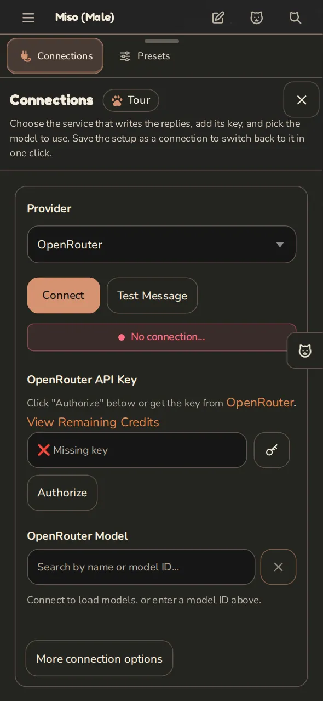
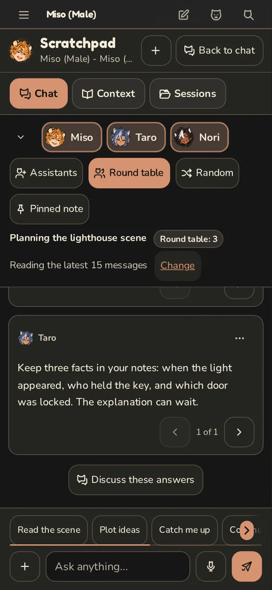

<!-- Translated from README.md at commit 31d628fa (Neconyan 1.5.5). Keep the structure in step with the English README. -->

# Neconyan~

A versão mais recente é a [1.5.5](https://github.com/platberlitz/Neconyan/releases/tag/v1.5.5).

**Leia no seu idioma:** [English](../README.md) · [Deutsch](readme-de_de.md) · [Español](readme-es_es.md) · [Français](readme-fr_fr.md) · [Italiano](readme-it_it.md) · [Nederlands](readme-nl_nl.md) · [Íslenska](readme-is_is.md) · [Türkçe](readme-tr_tr.md) · [Русский](readme-ru_ru.md) · [Українська](readme-uk_ua.md) · [العربية](readme-ar_sa.md) · [ไทย](readme-th_th.md) · [Tiếng Việt](readme-vi_vn.md) · [日本語](readme-ja_jp.md) · [한국어](readme-ko_kr.md) · [简体中文](readme-zh_cn.md) · [繁體中文](readme-zh_tw.md)

Esta tradução pode ficar desatualizada. O [README em inglês](../README.md) é o atual.

<p align="center">
  
</p>

Olá, entre e fique à vontade! O Neconyan é o meu fork com tema de gatos do [SillyTavern](https://github.com/SillyTavern/SillyTavern) e do [SillyBunny](https://github.com/SillyBunnyTeam/SillyBunny), para conversar e fazer roleplay com personagens de IA, no computador ou no telemóvel. Criei-o porque queria um frontend aconchegante, que funcionasse mesmo bem no telemóvel e que tivesse um gato em quase todas as páginas. A chave de API ou o modelo local ficam por sua conta; a aplicação não inclui acesso a modelos nem créditos.

**[Transferir o Neconyan](https://github.com/platberlitz/Neconyan/releases/latest)** · **[Ler o manual](https://platberlitz.github.io/neconyan-docs/)** · **[Pedir ajuda](https://platberlitz.github.io/neconyan-docs/help/troubleshooting/)**

> Todo o código aqui presente foi gerado por LLM ou escrito com a ajuda de LLM. Todos os prompts e agentes que vêm com o Neconyan foram feitos por pessoas.

## O que há aqui dentro?

<p align="center">
  
</p>

- **Quatro formas de conversar:** o Roleplay clássico, a Conversa ao estilo de uma aplicação de mensagens, um feed social chamado Meower e o Modo história para prosa contínua. Escolha a que mais lhe apetecer.
- **Um layout pensado para telemóveis**, com controlos identificados por texto, uma barra de chat em baixo e um menu deslizante. Nada de semicerrar os olhos para botões minúsculos de computador num ecrã pequeno.
- **[Modo simples](#modo-simples)**, para quando só quer fazer roleplay sem um cockpit inteiro de botões. Falo mais sobre ele lá em baixo, porque gosto mesmo muito do resultado.
- O **Mewmory** lembra-se dos acontecimentos e das personagens da história, para que o seu parceiro não se esqueça do que importa. Os **Agentes** podem manter rastreadores, verificar uma resposta ou escrever uma Nota do companion à parte.
- O **Catelier** ajuda a escrever cartões de personagem e lorebooks. Os **Cadernos** mantêm as suas notas à mão, e o **Scratchpad** dá-lhe um chat à parte para conversar sobre ideias.
- **Miso, Taro e Nori** são os assistentes da casa. Ajudam a encontrar coisas e, com a sua autorização, podem fazer as edições suportadas.
- A **Sincronização** passa dados selecionados entre instalações separadas com ficheiros encriptados, WebDAV, Gists secretos do GitHub ou emparelhamento direto. As transferências só correm quando o pedir.
- **Temas, cores de destaque e gatos.** Bastantes gatos. Pode escondê-los, embora eu não imagine porque haveria de querer.

Os seus cartões de personagem, chats, lorebooks e presets usam formatos familiares do SillyTavern, por isso vêm consigo. Não há telemetria. Algumas funcionalidades e extensões do upstream comportam-se de outra maneira aqui; eu só trago as partes que me interessam. A [lista de ferramentas incluídas](../docs/neconyan-native-tools.md) dá crédito aos projetos que vêm com o Neconyan.

## Modo simples

<p align="center">
  
</p>

Coisas de utilizador avançado não são consigo? Não lhe apetece andar às voltas com montes de botões só para fazer roleplay e divertir-se? Então tenho mesmo o modo certo para si!

O **Modo simples** é o Neconyan para quem só quer fazer RP. Fica com tudo o que faz do Neconyan o *Neconyan*: os gatos, o layout pensado para o telemóvel, Miso, Taro e Nori, a Memória a acompanhar a sua história e os seus Agentes a trabalhar nos bastidores. O que desaparece é a confusão: samplers, formatação de prompts, contadores de tokens, menus de extensões e todos os outros botõezinhos em que quase ninguém mexe.

E agora a melhor parte: nada é apagado nem desativado. Cada controlo escondido fica guardado, não vai para o lixo, e volta logo no momento em que o quiser.

### Mais fácil não podia ser

Na sua primeiríssima visita, a Nori faz uma única pergunta: **Want to keep things simple?** Carregue em **Yes, keep it simple** e uma visita guiada em três passos leva-o a ligar um modelo, conhecer uma personagem e dizer olá. E pronto. A configuração é só isto.

Já usa o layout completo? Ative-o quando quiser em **Configurações → Aparência → Modo simples**.

<table><tr>
  <td width="72%"></td>
  <td width="28%"></td>
</tr></table>

### O seu chat em primeiro plano

O chat e a caixa de mensagem ficam com o espaço todo, e a barra lateral mantém uma lista curta das páginas que vai mesmo abrir: Personagens, Conexões, Agentes, Lorebooks, Cadernos, Scratchpad, Galeria, Presets, Persona e Cores de diálogo. Ainda por cima, ganha três botões muito práticos:

- **Find characters** procura cartões novos. Escolha um e o respetivo chat abre logo, pronto a usar.
- **Memória** abre **Story so far**, com um só interruptor, um botão **Summarise now** e o resumo mais recente do seu chat.
- **Updates** procura uma versão nova e instala-a sem sair do Modo simples.

<table><tr>
  <td width="72%"></td>
  <td width="28%"></td>
</tr></table>

### Ligar-se sem trabalhos de casa

As Conexões mostram só o fornecedor, a sua chave, o modelo, **Conectar** e **Mensagem de teste**. Tudo o resto espera por trás de **More connection options**, para o dia em que lhe der a curiosidade.

<table><tr>
  <td width="72%"></td>
  <td width="28%"></td>
</tr></table>

### Mudou de ideias? Não há problema

Carregue em **Mostrar todos os recursos** na barra lateral, ou desative-o em **Configurações → Aparência**, e cada botão volta exatamente para onde o deixou. Os seus chats, personagens, lore e Agentes nem dão por nada.

[O Modo simples no manual](https://platberlitz.github.io/neconyan-docs/workspace/#keep-the-sidebar-simple)

## Espreite

<p align="center">
  
</p>

Aqui fica o resto da visita! Tirei estas capturas de ecrã do computador e do telemóvel a 17 de novembro de 2026, com chats e notas de demonstração, os assistentes incluídos, as cores predefinidas do Calico Dark e a **Visibilidade do plano de fundo a 0%**.

### Início

Escolha uma personagem, ligue um modelo ou diga olá a um dos assistentes. Os gatos vão ficar radiantes por vê-lo.

<table><tr>
  <td width="72%"></td>
  <td width="28%"></td>
</tr></table>

### Roleplay

Escreva uma cena, experimente outra resposta ou retome um chat antigo exatamente onde o deixou.

<table><tr>
  <td width="72%"></td>
  <td width="28%"></td>
</tr></table>

### Catelier

Trabalhe num rascunho de personagem, peça ajuda com a escrita e reveja as alterações antes de as guardar na sua biblioteca.

<table><tr>
  <td width="72%"></td>
  <td width="28%"></td>
</tr></table>

### Agentes

Escolha um ajudante, decida quando é executado e dê-lhe uma conexão. Eu começaria por um só, em vez de ativar metade da biblioteca de uma vez.

<table><tr>
  <td width="72%"></td>
  <td width="28%"></td>
</tr></table>

### Proofreader pós-geração

O Proofreader verifica uma resposta depois de ela chegar. Pode arranjar a prosa e a formatação sem pedir ao modelo principal que volte a escrever a cena. Abra **Alterações do agente** para comparar a edição e desfazê-la se preferir o original.

<table><tr>
  <td width="72%"></td>
  <td width="28%"></td>
</tr></table>

Este exemplo encenado corre o fluxo de trabalho real dos Agentes com uma resposta de exemplo fixa. Na utilização normal, o modelo que ligou escreve as edições, e cada passagem pode custar mais um pedido. [Agentes e Companions no manual](https://platberlitz.github.io/neconyan-docs/helpers/agents/).

<details>
<summary><b>Mais capturas de ecrã: Conversa, Meower, Modo história, Cadernos, Scratchpad e Sincronização</b></summary>

### Conversa

Mande mensagens às suas personagens, crie chats de grupo e deixe-as ficar ocupadas ou offline, tal e qual amigos a sério.

<table><tr>
  <td width="72%"></td>
  <td width="28%"></td>
</tr></table>

### Meower

Um feed social onde as suas personagens publicam, respondem e fazem sondagens. Aquilo fica um caos, do melhor tipo.

<table><tr>
  <td width="72%"></td>
  <td width="28%"></td>
</tr></table>

### Modo história

Leia o seu chat como prosa contínua, como um livro escrito a quatro mãos.

<table><tr>
  <td width="72%"></td>
  <td width="28%"></td>
</tr></table>

### Cadernos

Guarde planos de cenas, lugares e diários de sessão ao lado dos seus chats.

<table><tr>
  <td width="72%"></td>
  <td width="28%"></td>
</tr></table>

### Scratchpad

Converse sobre a história com um assistente ou com uma mesa-redonda de personagens, sem que a discussão deles vá parar ao chat principal.

<table><tr>
  <td width="72%"></td>
  <td width="28%"></td>
</tr></table>

### Sincronização

Mova bibliotecas selecionadas entre instalações separadas. Escolha ficheiros encriptados, WebDAV, um Gist secreto do GitHub ou emparelhamento direto; as transferências começam quando o pedir. [Configuração e recuperação no manual](https://platberlitz.github.io/neconyan-docs/help/device-sync/).

<table><tr>
  <td width="72%"></td>
  <td width="28%"></td>
</tr></table>

</details>

## Começar

<p align="center">
  
</p>

Pronto para experimentar? Escolha o dispositivo que preferir.

### Num computador

1. Transfira o ficheiro que termina em **-source.zip** a partir da [versão mais recente](https://github.com/platberlitz/Neconyan/releases/latest). Descompacte-o primeiro; no Windows, clique com o botão direito do rato e escolha **Extrair Tudo**.
2. Abra a pasta. Execute **Start.bat** no Windows, **Start.command** no macOS ou **bash start.sh** num terminal no Linux.
3. Dê alguns minutos ao primeiro arranque para instalar o que for preciso. Mantenha a janela do terminal aberta enquanto usa o Neconyan.
4. O navegador deve abrir sozinho. Se não abrir, vá a **http://127.0.0.1:4433/**.
5. Abra **Conexões**, escolha o fornecedor e o modelo e introduza a sua chave de API ou o endereço do modelo local. Depois abra uma personagem ou um assistente no Início, e está a andar!

Da próxima vez, execute o mesmo iniciador. Para parar o Neconyan, carregue em **Ctrl+C** no respetivo terminal.

Prefere o Git? Clone o repositório e use depois o mesmo iniciador:

```sh
git clone https://github.com/platberlitz/Neconyan.git
```

[Configuração no computador e problemas comuns no arranque](https://platberlitz.github.io/neconyan-docs/start/computer/)

### Aplicação Android

Transfira o **-android-arm64.apk** a partir da [versão mais recente](https://github.com/platberlitz/Neconyan/releases/latest) e abra-o. Autorize a instalação a partir do navegador, se o Android perguntar. É preciso **Android 11 ou mais recente**, **Android System WebView 124 ou mais recente** e cerca de **2 GiB** livres.

A aplicação corre no próprio telemóvel, sem Termux nem computador. Dê tempo à primeira abertura para descompactar e depois configure as **Conexões**. Instale as atualizações por cima da aplicação existente para manter os seus chats.

[Configuração do Android](https://platberlitz.github.io/neconyan-docs/start/android/) · [Instruções de compilação](../android/README.md)

### Aplicação para iPhone

Transfira o **-ios-unsigned.ipa** a partir da [versão mais recente](https://github.com/platberlitz/Neconyan/releases/latest) e instale-o depois com uma ferramenta de sideload como o [iloader](https://github.com/nab138/iloader). É preciso o **iOS 17 ou mais recente**. A aplicação guarda o servidor e os chats no telemóvel; não está na App Store.

Uma conta Apple gratuita obriga a voltar a assinar a aplicação de sete em sete dias e permite três aplicações com sideload. Atualize com a mesma conta Apple, por cima da aplicação existente. **Apagar a aplicação apaga os seus dados**, por isso exporte primeiro uma cópia de segurança.

[Configuração do iPhone e limites](../ios/README.md)

### Outras formas de usar o telemóvel

- **Android com Termux:** siga o [guia do Termux](https://platberlitz.github.io/neconyan-docs/start/android/#prefer-termux) se preferir um terminal ou tiver um telemóvel mais antigo.
- **Usar a instalação de um computador:** siga o [guia para a mesma rede Wi-Fi](https://platberlitz.github.io/neconyan-docs/start/phone/). Os dois dispositivos usam os mesmos chats guardados; deixe o computador a funcionar.

## Atualizações, cópias de segurança e mudança dos seus chats

Abra **Servidor → Atualizações e reinicialização → Buscar atualizações**. As instalações com Git e as instalações suportadas a partir do ZIP de código-fonte oferecem **Atualizar e reiniciar**. No Android, aparece **Update APK** e é-lhe pedido que aprove a instalação. No Modo simples, o botão **Updates** na barra lateral leva-o ao mesmo sítio. As cópias ZIP mais antigas sem atualizador precisam de uma [mudança manual para a pasta mais recente](https://platberlitz.github.io/neconyan-docs/help/backups/#update-a-zip-installation).

As instalações com Git também verificam se há atualizações ao arrancar. As alterações que tenha feito aos ficheiros da própria aplicação podem impedir uma atualização automática; os seus chats e definições não contam.

Vem do SillyTavern ou do SillyBunny? Seja bem-vindo! **Faça primeiro uma cópia de segurança**, dê ao Neconyan uma pasta de dados só dele e siga depois o guia [Importar os seus dados](https://platberlitz.github.io/neconyan-docs/start/imports/). Verifique as suas personagens e os seus chats antes de apagar seja o que for. Algumas extensões podem precisar de ajustes.

[Cópias de segurança e restauro](https://platberlitz.github.io/neconyan-docs/help/backups/) · [Mover dados entre dispositivos](../docs/data-portability.md)

## Precisa de ajuda?

Eu começaria pelo [manual](https://platberlitz.github.io/neconyan-docs/) ou perguntaria a Miso, Taro ou Nori no Início; estão sempre prontos a ajudar. Ainda assim, podem enganar-se, por isso confirme os conselhos deles antes de fazer uma alteração que não possa desfazer.

Se não encontrar uma definição, experimente **Pesquisar** na barra lateral. Em caso de erro, use o [guia de resolução de problemas](https://platberlitz.github.io/neconyan-docs/help/troubleshooting/) ou [abra uma issue](https://github.com/platberlitz/Neconyan/issues) com o que estava a fazer e o erro que apareceu.

## Créditos

<p align="center">
  
</p>

O Neconyan assenta no trabalho de todas as pessoas por trás do SillyTavern e do SillyBunny; nada disto existiria sem elas. A [lista de ferramentas incluídas](../docs/neconyan-native-tools.md) dá crédito aos respetivos autores originais.

Feito com carinho por [Platberlitz](https://github.com/platberlitz). Licenciado sob a [GNU AGPL v3](../LICENSE). Mantenha os avisos e as licenças se o redistribuir.

Um agradecimento especial a **El Topo**, o meu principal ajudante e colaborador. Agradeço muito todo o trabalho que dedicou ao Neconyan.

Divirta-se e dê um olá aos gatos por mim!
