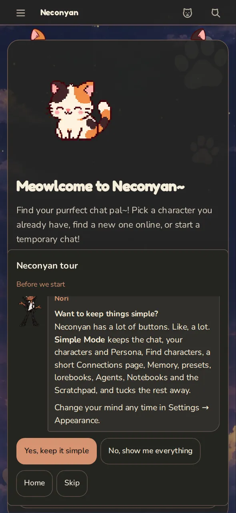
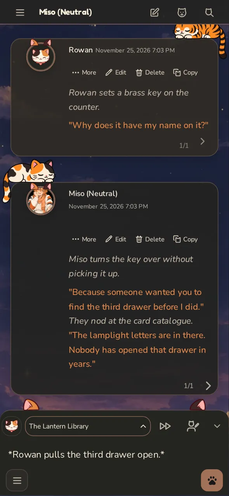
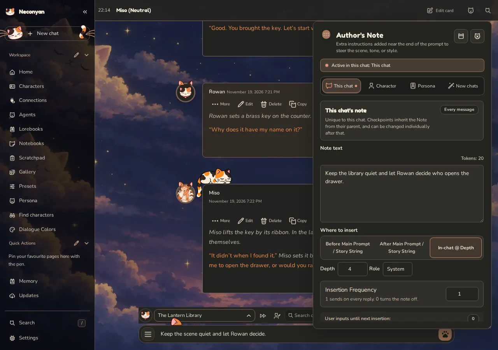
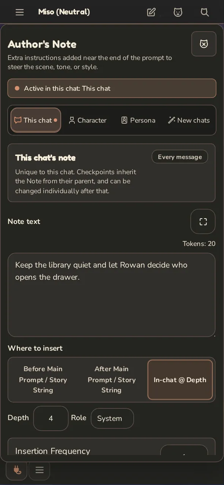
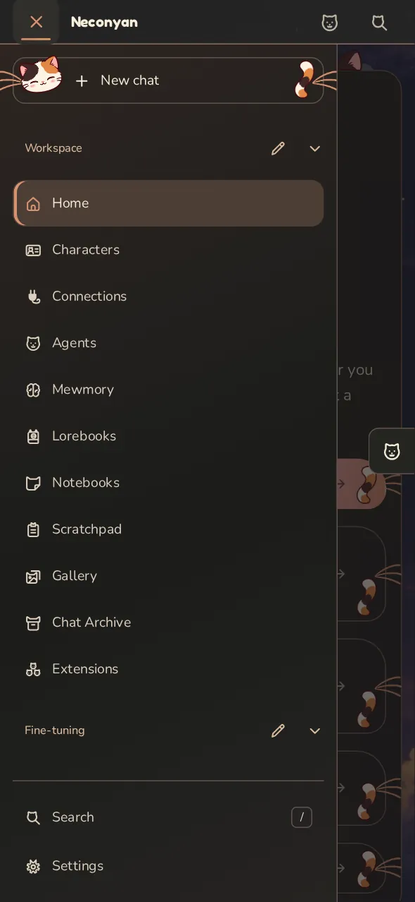
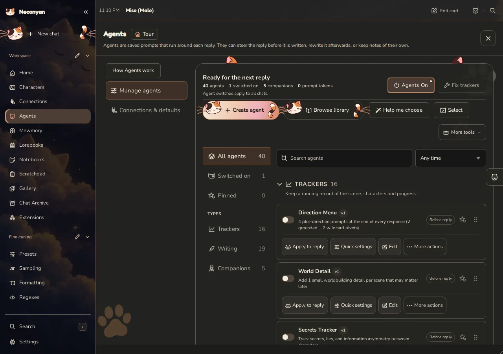
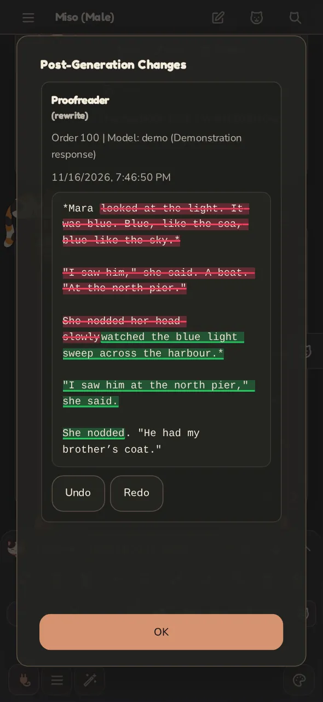
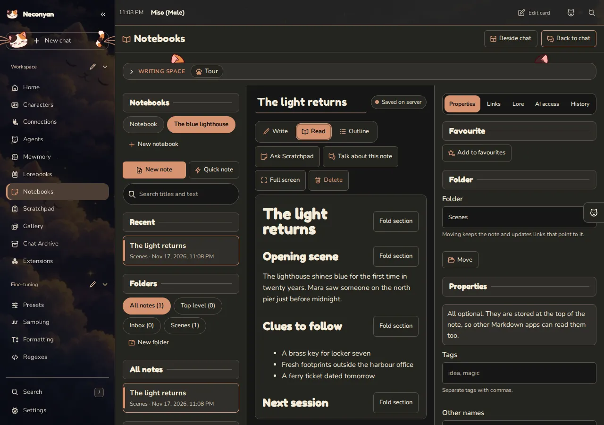

<!-- Translated from README.md at commit 600c4a26 (Neconyan 1.5.7). Keep the structure in step with the English README. -->

# Neconyan~

Son sürüm [1.5.7](https://github.com/platberlitz/Neconyan/releases/tag/v1.5.7).

**Kendi dilinizde okuyun:** [English](../README.md) · [Deutsch](readme-de_de.md) · [Español](readme-es_es.md) · [Français](readme-fr_fr.md) · [Italiano](readme-it_it.md) · [Nederlands](readme-nl_nl.md) · [Português](readme-pt_pt.md) · [Íslenska](readme-is_is.md) · [Русский](readme-ru_ru.md) · [Українська](readme-uk_ua.md) · [العربية](readme-ar_sa.md) · [ไทย](readme-th_th.md) · [Tiếng Việt](readme-vi_vn.md) · [日本語](readme-ja_jp.md) · [한국어](readme-ko_kr.md) · [简体中文](readme-zh_cn.md) · [繁體中文](readme-zh_tw.md)

Bu çeviri güncel olmayabilir. Güncel olan [İngilizce README](../README.md) dosyasıdır.

<p align="center">
  
</p>

Merhaba, hoş geldiniz! Neconyan, yapay zeka karakterleriyle bilgisayarda ya da telefonda sohbet etmek ve rol yapmak için [SillyTavern](https://github.com/SillyTavern/SillyTavern) ile [SillyBunny](https://github.com/SillyBunnyTeam/SillyBunny) projelerinden türettiğim kedi temalı bir fork. Kullanımı rahat, telefonda düzgün çalışan ve neredeyse her sayfasında bir kedi bulunan bir ön yüz istediğim için yaptım. API anahtarınızı ya da yerel modelinizi kendiniz sağlarsınız; uygulama model erişimi veya kredi içermez.

**[Neconyan'ı indirin](https://github.com/platberlitz/Neconyan/releases/latest)** · **[El kitabını okuyun](https://platberlitz.github.io/neconyan-docs/)** · **[Yardım alın](https://platberlitz.github.io/neconyan-docs/help/troubleshooting/)**

> Buradaki kodun tamamı LLM tarafından üretildi ya da LLM yardımıyla yazıldı. Neconyan ile gelen her prompt ve ajan insan yapımıdır.

## Burada neler var?

<p align="center">
  
</p>

- **Dört sohbet biçimi:** klasik Rol Yapma, mesajlaşma uygulaması tarzında Konuşma, Meower adlı bir sosyal zaman çizelgesi ve kesintisiz düzyazı için Hikâye Modu. Ruh hâlinize hangisi uyuyorsa onu seçin.
- **Telefonlar için tasarlanmış bir düzen**; etiketli kontroller, altta bir sohbet çubuğu ve kayarak açılan bir menü içerir. Küçük ekranda minik masaüstü düğmelerine gözlerinizi kısarak bakmanız gerekmez.
- **[Basit Mod](#basit-mod)**, bir pilot kabini dolusu düğme olmadan yalnızca rol yapmak istediğiniz zamanlar için. Ondan aşağıda daha ayrıntılı söz edeceğim, çünkü onunla çok gurur duyuyorum.
- **Mewmory** hikâyedeki olayları ve karakterleri hatırlar; böylece partneriniz önemli ayrıntıları unutmaz. **Ajanlar** izleyicileri güncel tutabilir, bir yanıtı kontrol edebilir ya da ayrı bir Yoldaş notu yazabilir.
- **Catelier** karakter kartları ve lorebook yazmanıza yardım eder. **Not Defterleri** notlarınızı elinizin altında tutar, **Karalama Defteri** ise fikirlerinizi enine boyuna konuşmanız için ayrı bir sohbet sunar.
- **Miso, Taro ve Nori** evin yerleşik asistanlarıdır. Aradığınızı bulmanıza yardım ederler ve izin verirseniz desteklenen düzenlemeleri yapabilirler.
- **Cihaz eşitleme**, seçili verileri ayrı kurulumlar arasında şifreli dosyalar, WebDAV, gizli GitHub Gist'leri ya da doğrudan eşleştirme ile taşır. Aktarımlar siz istediğinizde yapılır.
- **Temalar, vurgu renkleri ve kediler.** Hatırı sayılır miktarda kedi. Onları gizleyebilirsiniz, ama bunu neden isteyesiniz, aklım almıyor.

Karakter kartlarınız, sohbetleriniz, lorebook'larınız ve ön ayarlarınız tanıdık SillyTavern biçimlerini kullanır; yani sizinle birlikte gelirler. Telemetri yoktur. Kaynak projelerdeki bazı özellikler ve eklentiler burada farklı davranır; yalnızca istediğim kısımları buraya aktarıyorum. [Dahil edilen araçlar listesi](../docs/neconyan-native-tools.md), Neconyan ile birlikte gelen projelerin hakkını teslim eder.

## Basit Mod

<p align="center">
  
</p>

İleri düzey kullanıcı işleri size göre değil mi? Yalnızca rol yapıp keyifli vakit geçirmek için bir yığın düğmeyle boğuşmak istemiyor musunuz? Öyleyse tam size göre bir modum var!

**Basit Mod**, yalnızca RP yapmak isteyenler için Neconyan'dır. Neconyan'ı *Neconyan* yapan her şey sizinle kalır: kediler, telefona uygun düzen, Miso, Taro ve Nori, hikâyenizi takip eden Bellek ve arka planda çalışmayı sürdüren Ajanlarınız. Ortadan kalkan yalnızca kalabalık: sampler'ler, prompt biçimlendirme, token sayaçları, eklenti menüleri ve çoğu insanın hiç dokunmadığı diğer tüm düğmeler.

Ve işin en güzel yanı: hiçbir şey silinmez ya da kapatılmaz. Gizlenen hiçbir kontrol atılmaz; hepsi bir kenara kaldırılır ve istediğiniz anda hemen geri gelir.

### Bundan kolayı olamaz

İlk ziyaretinizde Nori tek bir soru sorar: **İşleri sade tutmak ister misin?** **Evet, sade tutun** düğmesine basın; üç adımlı bir tur size bir modeli bağlamayı, bir karakterle tanışmayı ve ona merhaba demeyi gösterir. Hepsi bu. Kurulumun tamamı bu kadar.

Zaten tam düzeni mi kullanıyorsunuz? İstediğiniz zaman **Ayarlar → Görünüm → Basit Mod** yolundan açın.

<table><tr>
  <td width="72%"></td>
  <td width="28%"></td>
</tr></table>

### Sohbetiniz ön planda

Sohbet ve mesaj kutusu geniş yer kaplar; kenar çubuğunda ise gerçekten açacağınız sayfaların kısa bir listesi durur: Karakterler, Bağlantılar, Ajanlar, Lorebook'lar, Not Defterleri, Karalama Defteri, Galeri, Ön Ayarlar, Persona ve Diyalog Renkleri. Bunlara ek olarak üç kullanışlı düğme gelir:

- **Karakter bulun** düğmesi yeni kartlar arar. Birini seçin, sohbeti hemen açılır; kullanıma hazırdır.
- **Bellek** düğmesi **Şimdiye kadarki öykü** bölümünü açar; içinde tek bir anahtar, bir **Şimdi özetle** düğmesi ve sohbetinizin son özeti bulunur.
- **Güncellemeler** düğmesi yeni bir sürüm olup olmadığına bakar ve Basit Mod'dan çıkmadan kurar.

Guided Generations'ta etkinse **Yönlendirilen Yanıt Değiştir** ve **Yönlendirilen Benim Yerime Yaz**, sohbet çubuğunu daraltsanız bile **Sohbeti değiştir** düğmesinin yanında durur. İlki özgün yanıtı korur ve alternatif bir yanıt üretir. İkincisi bir sonraki mesajınızı göndermeden taslak olarak yazar.

<table><tr>
  <td width="72%"></td>
  <td width="28%"></td>
</tr></table>

**Sohbet araçları → Yazar Notu**, Basit Mod'dan çıkmadan düzenleyiciyi açar. Dört sekmenin hepsi telefonda da bulunur.

<details>
<summary>Yazar Notu'na ve daha kısa telefon menüsüne bakın</summary>

<table><tr>
  <td width="72%"></td>
  <td width="28%"></td>
</tr></table>


</details>

### Uğraşmadan bağlanın

Bağlantılar yalnızca sağlayıcıyı, anahtarınızı, modeli, **Bağlan** ve **Test Mesajı** öğelerini gösterir. Geri kalan her şey, merak ettiğiniz gün için **Diğer bağlantı seçenekleri** arkasında bekler.

<table><tr>
  <td width="72%"></td>
  <td width="28%"></td>
</tr></table>

### Fikrinizi mi değiştirdiniz? Sorun değil

Kenar çubuğundaki **Tüm özellikleri göster** düğmesine basın ya da Basit Mod'u **Ayarlar → Görünüm** bölümünden kapatın; her düğme bıraktığınız yere geri gelir. Sohbetleriniz, karakterleriniz, lore'unuz ve Ajanlarınız bunun farkına bile varmaz.

[El kitabında Basit Mod](https://platberlitz.github.io/neconyan-docs/workspace/#keep-the-sidebar-simple)

## Göz atın

<p align="center">
  
</p>

Bu masaüstü ve telefon ekran görüntülerini, paketle gelen asistanlarla demo sohbetleri ve notları, varsayılan Calico Dark renklerini ve opak panelleri kullanarak aldım.

### Ana sayfa

Bir karakter seçin, bir model bağlayın ya da bir asistana merhaba deyin. Kediler sizi gördüğüne çok sevinecek.

<table><tr>
  <td width="72%"></td>
  <td width="28%"></td>
</tr></table>

<details>
<summary>Telefondaki Çalışma Alanı menüsüne bakın</summary>



</details>

### Rol Yapma

Bir sahne yazın, başka bir yanıt deneyin ya da eski bir sohbeti bıraktığınız yerden sürdürün.

<table><tr>
  <td width="72%"></td>
  <td width="28%"></td>
</tr></table>

### Catelier

Bir karakter taslağı üzerinde çalışın, yazma konusunda yardım isteyin ve kitaplığınıza kaydetmeden önce değişiklikleri inceleyin.

<table><tr>
  <td width="72%"></td>
  <td width="28%"></td>
</tr></table>

### Ajanlar

Bir yardımcı seçin, ne zaman çalışacağına karar verin ve ona bir bağlantı verin. Ben olsam kitaplığın yarısını bir seferde açmak yerine tek biriyle başlardım.

<table><tr>
  <td width="72%"></td>
  <td width="28%"></td>
</tr></table>

### Üretim sonrası Düzeltmen

Düzeltmen, bir yanıt geldikten sonra onu kontrol eder. Ana modelden sahneyi yeniden yazmasını istemeden düzyazıyı ve biçimlendirmeyi düzeltebilir. Düzenlemeyi karşılaştırmak ve özgün hâlini tercih ederseniz geri almak için **Ajan değişiklikleri** bölümünü açın.

<table><tr>
  <td width="72%"></td>
  <td width="28%"></td>
</tr></table>

Bu kurgulanmış örnek, sabit bir örnek yanıtla gerçek Ajan iş akışını çalıştırır. Normal kullanımda düzenlemeleri bağlı modeliniz yazar ve her tur bir istek daha gerektirebilir. [El kitabında Ajanlar ve Yoldaşlar](https://platberlitz.github.io/neconyan-docs/helpers/agents/).

<details>
<summary><b>Daha fazla ekran görüntüsü: Konuşma, Meower, Hikâye Modu, Not Defterleri, Karalama Defteri ve Cihaz eşitleme</b></summary>

### Konuşma

Karakterlerinize mesaj atın, grup sohbetleri kurun ve tıpkı gerçek arkadaşlar gibi meşgul ya da çevrimdışı olmalarına izin verin.

<table><tr>
  <td width="72%"></td>
  <td width="28%"></td>
</tr></table>

### Meower

Karakterlerinizin gönderi paylaştığı, yanıt verdiği ve anket açtığı sosyal bir zaman çizelgesi. İçerisi bazen tam bir kaosa dönüşüyor, ama en güzelinden.

<table><tr>
  <td width="72%"></td>
  <td width="28%"></td>
</tr></table>

### Hikâye Modu

Sohbetinizi birlikte yazdığınız bir kitap gibi, kesintisiz düzyazı olarak okuyun.

<table><tr>
  <td width="72%"></td>
  <td width="28%"></td>
</tr></table>

### Not Defterleri

Sahne planlarını, mekânları ve oturum günlüklerini sohbetlerinizin yanında tutun. Telefonda, nota daha çok yer kalsın diye klasörleri **Not defteri seçenekleri** bölümünün altına, biçimlendirmeyi de **Not araçları** bölümünün altına yerleştirdim.

<table><tr>
  <td width="72%"></td>
  <td width="28%"></td>
</tr></table>

### Karalama Defteri

Hikâyeyi bir asistanla ya da karakterlerin yer aldığı bir yuvarlak masada konuşun; konuşulanlar ana sohbete eklenmez.

<table><tr>
  <td width="72%"></td>
  <td width="28%"></td>
</tr></table>

### Cihaz eşitleme

Seçili kitaplıkları ayrı kurulumlar arasında taşıyın. Şifreli dosyaları, WebDAV'i, gizli bir GitHub Gist'ini ya da doğrudan eşleştirmeyi seçin; aktarımlar siz istediğinizde başlar. [El kitabında yapılandırma ve kurtarma](https://platberlitz.github.io/neconyan-docs/help/device-sync/).

<table><tr>
  <td width="72%"></td>
  <td width="28%"></td>
</tr></table>

</details>

## Başlarken

<p align="center">
  
</p>

Denemeye hazır mısınız? Kullanmak istediğiniz cihazı seçin.

### Bilgisayarda

1. **-source.zip** ile biten dosyayı [son sürümden](https://github.com/platberlitz/Neconyan/releases/latest) indirin. Önce zip dosyasını ayıklayın; Windows'ta sağ tıklayıp **Tümünü ayıkla** seçeneğini seçin.
2. Klasörü açın. Windows'ta **Start.bat**, macOS'ta **Start.command** dosyasını çalıştırın; Linux'ta ise bir terminalde **bash start.sh** komutunu çalıştırın.
3. İlk başlatmada gereken her şeyin kurulması için birkaç dakika bekleyin. Neconyan'ı kullanırken terminal penceresini açık tutun.
4. Tarayıcınız kendiliğinden açılmalı. Açılmazsa **http://127.0.0.1:4433/** adresine gidin.
5. **Bağlantılar** sayfasını açın, sağlayıcınızı ve modelinizi seçin, API anahtarınızı ya da yerel modelinizin adresini girin. Ardından Ana sayfada bir karakter ya da asistan açın, hazırsınız!

Bir dahaki sefere aynı başlatıcıyı çalıştırın. Neconyan'ı durdurmak için terminalinde **Ctrl+C** tuşlarına basın.

Git mi tercih edersiniz? Depoyu klonlayın, ardından aynı başlatıcıyı kullanın:

```sh
git clone https://github.com/platberlitz/Neconyan.git
```

[Bilgisayar kurulumu ve sık görülen başlatma sorunları](https://platberlitz.github.io/neconyan-docs/start/computer/)

### Android uygulaması

**-android-arm64.apk** dosyasını [son sürümden](https://github.com/platberlitz/Neconyan/releases/latest) indirin ve açın. Android isterse tarayıcınızdan yüklemeye izin verin. **Android 11 veya üstü**, **Android System WebView 124 veya üstü** ve yaklaşık **2 GiB** boş alan gerekir.

Uygulama doğrudan telefonda çalışır; Termux'a ya da bilgisayara gerek yoktur. İlk açılışta dosyaların ayıklanmasını bekleyin, ardından **Bağlantılar** bölümünü ayarlayın. Sohbetlerinizi korumak için güncellemeleri mevcut uygulamanın üzerine yükleyin.

[Android kurulumu](https://platberlitz.github.io/neconyan-docs/start/android/) · [Derleme talimatları](../android/README.md)

### iPhone uygulaması

**-ios-unsigned.ipa** dosyasını [son sürümden](https://github.com/platberlitz/Neconyan/releases/latest) indirin, ardından [iloader](https://github.com/nab138/iloader) gibi bir sideload aracıyla yükleyin. **iOS 17 veya üstü** gerekir. Uygulama, sunucusunu ve sohbetlerinizi telefonda tutar; App Store'da değildir.

Ücretsiz bir Apple hesabıyla uygulamayı yedi günde bir yeniden imzalamanız gerekir ve en fazla üç sideload uygulamasına izin verilir. Güncellemeyi aynı Apple hesabıyla mevcut uygulamanın üzerine yükleyin. **Uygulamayı silmek verilerini de siler**; bu yüzden önce bir yedek dışa aktarın.

[iPhone kurulumu ve sınırları](../ios/README.md)

### Telefonunuzu kullanmanın diğer yolları

- **Termux ile Android:** terminali tercih ediyorsanız ya da eski bir telefonunuz varsa [Termux kılavuzunu](https://platberlitz.github.io/neconyan-docs/start/android/#prefer-termux) izleyin.
- **Bir bilgisayardaki kurulumu kullanın:** [aynı Wi-Fi ağında kullanım kılavuzunu](https://platberlitz.github.io/neconyan-docs/start/phone/) izleyin. İki cihaz da aynı kayıtlı sohbetleri kullanır; bilgisayarı açık tutun.

## Güncellemeler, yedekler ve sohbetlerinizi taşıma

**Sunucu → Güncellemeler ve yeniden başlatma → Güncellemeleri denetle** yolunu izleyin. Git ve desteklenen kaynak ZIP kurulumları **Güncelle ve yeniden başlat** seçeneğini sunar. Android **APK'yı güncelle** seçeneğini sunar ve yüklemeyi onaylamanızı ister. Basit Mod'da kenar çubuğundaki **Güncellemeler** düğmesi sizi aynı yere götürür. Güncelleyicisi olmayan eski ZIP kopyaları, [yeni klasöre elle taşınmayı](https://platberlitz.github.io/neconyan-docs/help/backups/#update-a-zip-installation) gerektirir.

Git kurulumları başlatıldıklarında da güncellemeleri denetler. Uygulamanın kendi dosyalarında yaptığınız değişiklikler otomatik güncellemeyi durdurabilir; sohbetleriniz ve ayarlarınız buna dahil değildir.

SillyTavern ya da SillyBunny'den mi geliyorsunuz? Hoş geldiniz! **Önce yedek alın**, Neconyan'a kendi veri klasörünü verin, ardından [Verilerinizi içe aktarın](https://platberlitz.github.io/neconyan-docs/start/imports/) kılavuzunu izleyin. Herhangi bir şeyi silmeden önce karakterlerinizi ve sohbetlerinizi kontrol edin. Bazı eklentilerde düzenleme yapmanız gerekebilir.

[Yedekler ve geri yükleme](https://platberlitz.github.io/neconyan-docs/help/backups/) · [Verileri cihazlar arasında taşıma](../docs/data-portability.md)

## Yardıma mı ihtiyacınız var?

Ben olsam önce [el kitabına](https://platberlitz.github.io/neconyan-docs/) bakardım ya da Ana sayfada Miso'ya, Taro'ya veya Nori'ye sorardım; yardım etmekten her zaman memnun olurlar. Yine de yanılabilirler, bu yüzden geri alamayacağınız bir değişiklik yapmadan önce tavsiyelerini kontrol edin.

Bulamadığınız ayarlar için kenar çubuğundaki **Ara** öğesini deneyin. Hatalar için [sorun giderme kılavuzunu](https://platberlitz.github.io/neconyan-docs/help/troubleshooting/) kullanın ya da ne yaptığınızı ve görünen hatayı belirterek [bir sorun bildirin](https://github.com/platberlitz/Neconyan/issues).

## Emeği geçenler

<p align="center">
  
</p>

Neconyan, SillyTavern ve SillyBunny'nin arkasındaki herkesin emeği üzerine kuruludur; onlar olmasaydı bunların hiçbiri var olmazdı. [Dahil edilen araçlar listesi](../docs/neconyan-native-tools.md) özgün yazarlarının hakkını teslim eder.

[Platberlitz](https://github.com/platberlitz) tarafından sevgiyle yapıldı. [GNU AGPL v3](../LICENSE) ile lisanslıdır. Yeniden dağıtırsanız bildirimleri ve lisansları koruyun.

Baş yardımcım ve projeye en çok katkıda bulunan **El Topo**'ya özel teşekkürler. Neconyan'a verdiğiniz tüm emek için gerçekten minnettarım.

İyi eğlenceler, kedilere de benden selam söyleyin!
