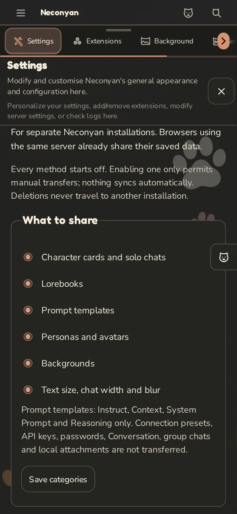

<!-- Translated from README.md at commit 31d628fa (Neconyan 1.5.5). Keep the structure in step with the English README. -->

# Neconyan~

Остання версія: [1.5.5](https://github.com/platberlitz/Neconyan/releases/tag/v1.5.5).

**Читай своєю мовою:** [English](../README.md) · [Deutsch](readme-de_de.md) · [Español](readme-es_es.md) · [Français](readme-fr_fr.md) · [Italiano](readme-it_it.md) · [Nederlands](readme-nl_nl.md) · [Português](readme-pt_pt.md) · [Íslenska](readme-is_is.md) · [Русский](readme-ru_ru.md) · [العربية](readme-ar_sa.md) · [ไทย](readme-th_th.md) · [Tiếng Việt](readme-vi_vn.md) · [日本語](readme-ja_jp.md) · [한국어](readme-ko_kr.md) · [简体中文](readme-zh_cn.md) · [繁體中文](readme-zh_tw.md)

Цей переклад може відставати. Актуальним є [англійський README](../README.md).

<p align="center">
  
</p>

Привіт, заходь! Neconyan — це мій котячий форк [SillyTavern](https://github.com/SillyTavern/SillyTavern) і [SillyBunny](https://github.com/SillyBunnyTeam/SillyBunny) для спілкування та рольових ігор з ШІ-персонажами на комп'ютері чи на телефоні. Мені хотілося фронтенду, яким затишно користуватися, який нормально працює на телефоні й має кота майже на кожній сторінці. Так і з'явився Neconyan. Модель потрібна своя: API-ключ або локальна модель; доступу до моделей чи кредитів у застосунку немає.

**[Завантажити Neconyan](https://github.com/platberlitz/Neconyan/releases/latest)** · **[Прочитати посібник](https://platberlitz.github.io/neconyan-docs/)** · **[Отримати допомогу](https://platberlitz.github.io/neconyan-docs/help/troubleshooting/)**

> Увесь код тут згенеровано LLM або написано за її допомогою. Кожен промпт і кожен агент, що постачаються з Neconyan, створила людина.

## Що тут є?

<p align="center">
  
</p>

- **Чотири способи спілкуватися:** класична «Рольова гра», «Розмова» у стилі месенджера, соціальна стрічка Meower і «Режим історії» для суцільної прози. Обирай те, що пасує до настрою.
- **Інтерфейс, створений для телефонів**, з підписаними елементами керування, нижньою панеллю чату й висувним меню. Більше ніяких крихітних кнопок із комп'ютерної версії на маленькому екрані.
- **[Простий режим](#простий-режим)** для тих, хто просто хоче рольової гри без цілої кабіни пілота з кнопками. Про нього трохи нижче, бо я ним дуже пишаюся.
- **Mewmory** запам'ятовує події історії та персонажів, тож твій співрозмовник не забуде важливого. **Агенти** можуть вести трекери, перевіряти відповідь або писати окрему «Супровідну нотатку».
- **Catelier** допомагає писати картки персонажів і лорбуки. **Блокноти** тримають твої нотатки під рукою, а **Scratchpad** дає окремий чат, щоб обговорити ідеї.
- **Miso, Taro і Nori** працюють тут асистентами. Вони допомагають знаходити потрібне й за твого дозволу можуть вносити підтримувані зміни.
- **Синхронізація між пристроями** переносить вибрані дані між окремими встановленнями за допомогою зашифрованих файлів, WebDAV, секретних GitHub Gist або прямого сполучення. Перенесення запускаються, лише коли ти про це просиш.
- **Теми, акцентні кольори й коти.** Котів чимало. Їх можна приховати, хоча я не уявляю, навіщо тобі це.

Твої картки персонажів, чати, лорбуки й пресети використовують знайомі формати SillyTavern, тож усе це переїде разом із тобою. Телеметрії немає. Деякі функції та розширення з оригінального проєкту тут поводяться інакше; я переношу лише те, що хочу. [Список вбудованих інструментів](../docs/neconyan-native-tools.md) віддає належне проєктам, що постачаються з Neconyan.

## Простий режим

<p align="center">
  
</p>

Не любиш усі ці штуки для просунутих користувачів? Не хочеш продиратися крізь гору кнопок, щоб просто пограти й гарно провести час? О, а в мене якраз є режим саме для тебе!

**Простий режим** перетворює Neconyan на застосунок для тих, хто просто хоче рольової гри. Ти зберігаєш усе, що робить Neconyan *Neconyan*: котів, зручний для телефона інтерфейс, Miso, Taro і Nori, Пам'ять, що стежить за твоєю історією, і твоїх Агентів, які й далі працюють у фоні. Зникає лише мотлох: семплери, форматування промптів, лічильники токенів, меню розширень і всі інші перемикачі, яких більшість людей ніколи не торкається.

А тепер найкраще: нічого не видаляється й не вимикається. Кожен прихований елемент керування просто сховано, а не викинуто, і він одразу повертається, щойно він тобі знадобиться.

### Простіше не буває

Під час твого найпершого візиту Nori ставить одне запитання: **Want to keep things simple?** Натисни **Yes, keep it simple**, і тур із трьох кроків проведе тебе через під'єднання моделі, знайомство з персонажем і перше привітання. І все. Оце й усе налаштування.

Уже користуєшся повним інтерфейсом? Увімкни режим будь-коли в **Налаштування → Вигляд → Простий режим**.

<table><tr>
  <td width="72%"></td>
  <td width="28%"></td>
</tr></table>

### Твій чат у центрі уваги

Чат і поле введення отримують увесь простір, а бічна панель лишає короткий список сторінок, які ти справді відкриватимеш: Персонажі, З'єднання, Агенти, Лорбуки, Блокноти, Scratchpad, Галерея, Пресети, Персона й Кольори діалогів. А на додачу є три зручні кнопки:

- **Find characters** шукає нові картки. Обери одну, і її чат одразу відкриється, усе готово.
- **Пам'ять** відкриває **Story so far** з одним перемикачем, кнопкою **Summarise now** і найсвіжішим підсумком твого чату.
- **Updates** перевіряє, чи вийшла нова версія, і встановлює її, не виходячи з Простого режиму.

<table><tr>
  <td width="72%"></td>
  <td width="28%"></td>
</tr></table>

### Під'єднання без домашнього завдання

На сторінці «З'єднання» є лише провайдер, твій ключ, модель, **Підключитися** і **Тестове повідомлення**. Усе інше чекає за **More connection options**, на той день, коли тобі стане цікаво.

<table><tr>
  <td width="72%"></td>
  <td width="28%"></td>
</tr></table>

### Передумалося? Без проблем

Натисни **Показати всі функції** на бічній панелі або вимкни режим у **Налаштування → Вигляд**, і кожна кнопка повернеться саме на своє місце. Твої чати, персонажі, лор і Агенти нічого навіть не помітять.

[Простий режим у посібнику](https://platberlitz.github.io/neconyan-docs/workspace/#keep-the-sidebar-simple)

## Зазирни досередини

<p align="center">
  
</p>

А ось і решта екскурсії! Ці скриншоти для комп'ютера й телефона знято 17 листопада 2026 року; використано демо-чати та нотатки з вбудованими асистентами, стандартні кольори Calico Dark і **Видимість фону на 0%**.

### Головна

Обери персонажа, під'єднай модель або привітайся з асистентом. Коти страшенно зрадіють тобі.

<table><tr>
  <td width="72%"></td>
  <td width="28%"></td>
</tr></table>

### Рольова гра

Напиши сцену, спробуй іншу відповідь або продовж старий чат саме з того місця, де ви зупинилися.

<table><tr>
  <td width="72%"></td>
  <td width="28%"></td>
</tr></table>

### Catelier

Працюй над чернеткою персонажа, проси допомоги з текстом і переглядай зміни, перш ніж зберегти їх у своїй бібліотеці.

<table><tr>
  <td width="72%"></td>
  <td width="28%"></td>
</tr></table>

### Агенти

Обери помічника, визнач, коли він запускається, і дай йому з'єднання. Раджу почати з одного помічника, а не вмикати одразу пів бібліотеки.

<table><tr>
  <td width="72%"></td>
  <td width="28%"></td>
</tr></table>

### Proofreader після генерації

Proofreader перевіряє відповідь після того, як вона надійшла. Він може причесати прозу та форматування, не просячи основну модель знову писати сцену. Відкрий **Зміни агента**, щоб порівняти правку з оригіналом і скасувати її, якщо тобі більше до вподоби оригінал.

<table><tr>
  <td width="72%"></td>
  <td width="28%"></td>
</tr></table>

Цей показовий приклад запускає справжній робочий процес агентів із фіксованою зразковою відповіддю. У звичайному користуванні правки пише твоя підключена модель, а кожен прохід може коштувати ще одного запиту. [Агенти та супутники в посібнику](https://platberlitz.github.io/neconyan-docs/helpers/agents/).

<details>
<summary><b>Ще скриншоти: «Розмова», Meower, «Режим історії», «Блокноти», Scratchpad і «Синхронізація між пристроями»</b></summary>

### Розмова

Листуйся з персонажами, створюй групові чати й дозволяй їм бути зайнятими або офлайн, зовсім як справжні друзі.

<table><tr>
  <td width="72%"></td>
  <td width="28%"></td>
</tr></table>

### Meower

Соціальна стрічка, де твої персонажі публікують пости, відповідають і влаштовують опитування. Там буває хаотично, але в найкращому сенсі.

<table><tr>
  <td width="72%"></td>
  <td width="28%"></td>
</tr></table>

### Режим історії

Читай свій чат як суцільну прозу, ніби книжку, яку ви написали разом.

<table><tr>
  <td width="72%"></td>
  <td width="28%"></td>
</tr></table>

### Блокноти

Тримай плани сцен, локації та журнали сесій поруч зі своїми чатами.

<table><tr>
  <td width="72%"></td>
  <td width="28%"></td>
</tr></table>

### Scratchpad

Обговорюй історію з асистентом або за круглим столом із персонажами, а їхня дискусія не потрапить в основний чат.

<table><tr>
  <td width="72%"></td>
  <td width="28%"></td>
</tr></table>

### Синхронізація між пристроями

Переноси вибрані бібліотеки між окремими встановленнями. Обери зашифровані файли, WebDAV, секретний GitHub Gist або пряме сполучення; перенесення починається, коли ти про це просиш. [Налаштування й відновлення в посібнику](https://platberlitz.github.io/neconyan-docs/help/device-sync/).

<table><tr>
  <td width="72%"></td>
  <td width="28%"></td>
</tr></table>

</details>

## Початок роботи

<p align="center">
  
</p>

Хочеш спробувати? Обери пристрій, на якому хочеш користуватися Neconyan.

### На комп'ютері

1. Завантаж із [останнього релізу](https://github.com/platberlitz/Neconyan/releases/latest) файл, назва якого закінчується на **-source.zip**. Спершу розпакуй його; у Windows клацни файл правою кнопкою й вибери **Видобути все**.
2. Відкрий папку. Запусти **Start.bat** у Windows, **Start.command** у macOS або **bash start.sh** у терміналі в Linux.
3. Дай першому запуску кілька хвилин, щоб встановити все потрібне. Не закривай вікно терміналу, поки користуєшся Neconyan.
4. Браузер має відкритися сам. Якщо ні, перейди на **http://127.0.0.1:4433/**.
5. Відкрий **З'єднання**, обери провайдера й модель та введи свій API-ключ або адресу локальної моделі. Потім відкрий на «Головній» персонажа чи асистента, і вперед!

Наступного разу запусти той самий лаунчер. Щоб зупинити Neconyan, натисни **Ctrl+C** у його терміналі.

Хочеш через Git? Склонуй репозиторій, а потім скористайся тим самим лаунчером:

```sh
git clone https://github.com/platberlitz/Neconyan.git
```

[Налаштування на комп'ютері та типові проблеми із запуском](https://platberlitz.github.io/neconyan-docs/start/computer/)

### Застосунок для Android

Завантаж **-android-arm64.apk** з [останнього релізу](https://github.com/platberlitz/Neconyan/releases/latest) і відкрий його. Якщо Android попросить, дозволь встановлення з браузера. Тобі потрібен **Android 11 або новіший**, **Android System WebView 124 або новіший** і близько **2 GiB** вільного місця.

Застосунок працює просто на самому телефоні, без Termux і комп'ютера. Дай першому відкриттю час на розпакування, а потім налаштуй **З'єднання**. Щоб зберегти чати, встановлюй оновлення поверх наявного застосунку.

[Налаштування Android](https://platberlitz.github.io/neconyan-docs/start/android/) · [Інструкції зі збирання](../android/README.md)

### Застосунок для iPhone

Завантаж **-ios-unsigned.ipa** з [останнього релізу](https://github.com/platberlitz/Neconyan/releases/latest), а потім встанови його через інструмент для сайдлоадингу, як-от [iloader](https://github.com/nab138/iloader). Тобі потрібна **iOS 17 або новіша**. Сервер і чати застосунку лишаються на телефоні; в App Store його немає.

З безкоштовним обліковим записом Apple застосунок потрібно підписувати заново кожні сім днів, а сайдлоадити можна лише три застосунки. Встановлюй оновлення поверх наявного застосунку, використовуючи той самий обліковий запис Apple. **Якщо видалити застосунок, його дані зникнуть**, тож спершу експортуй резервну копію.

[Налаштування iPhone та обмеження](../ios/README.md)

### Інші способи користуватися телефоном

- **Android із Termux:** скористайся [посібником із Termux](https://platberlitz.github.io/neconyan-docs/start/android/#prefer-termux), якщо тобі більше до вподоби термінал або в тебе старіший телефон.
- **Через встановлення на комп'ютері:** дотримуйся [посібника для однієї мережі Wi-Fi](https://platberlitz.github.io/neconyan-docs/start/phone/). Обидва пристрої працюють з одними й тими самими збереженими чатами; залиш комп'ютер увімкненим.

## Оновлення, резервні копії та перенесення чатів

Відкрий **Сервер → Оновлення та перезапуск → Перевірити наявність оновлень**. Для встановлень через Git і підтримуваних встановлень із ZIP-архіву вихідного коду є **Оновити та перезапустити**. На Android є **Update APK**, і система попросить підтвердити встановлення. У Простому режимі кнопка **Updates** на бічній панелі веде туди ж. Старіші ZIP-копії без засобу оновлення потребують [ручного перенесення в новішу папку](https://platberlitz.github.io/neconyan-docs/help/backups/#update-a-zip-installation).

Встановлення через Git також перевіряють наявність оновлень під час запуску. Зміни у власних файлах застосунку, зроблені тобою, можуть зупинити автоматичне оновлення; твої чати й налаштування не враховуються.

Переходиш із SillyTavern або SillyBunny? Ласкаво просимо! **Спершу зроби резервну копію**, дай Neconyan окрему папку даних, а тоді дотримуйся інструкції [Імпорт твоїх даних](https://platberlitz.github.io/neconyan-docs/start/imports/). Перш ніж щось видаляти, перевір своїх персонажів і чати. Деякі розширення, можливо, доведеться підправити.

[Резервні копії та відновлення](https://platberlitz.github.io/neconyan-docs/help/backups/) · [Перенесення даних між пристроями](../docs/data-portability.md)

## Потрібна допомога?

Раджу почати з [посібника](https://platberlitz.github.io/neconyan-docs/) або спитати Miso, Taro чи Nori на «Головній»; вони завжди раді допомогти. Утім, вони можуть помилятися, тож перевіряй їхні поради, перш ніж робити зміну, яку не можна скасувати.

Якщо не знаходиш потрібного налаштування, спробуй **Пошук** на бічній панелі. Якщо виникла помилка, скористайся [посібником з усунення проблем](https://platberlitz.github.io/neconyan-docs/help/troubleshooting/) або [створи issue](https://github.com/platberlitz/Neconyan/issues), додавши опис своїх дій і текст помилки.

## Подяки

<p align="center">
  
</p>

Neconyan тримається на праці всіх, хто стоїть за SillyTavern і SillyBunny; без них нічого цього не було б. [Список вбудованих інструментів](../docs/neconyan-native-tools.md) називає їхніх першоавторів.

Зроблено з любов'ю: [Platberlitz](https://github.com/platberlitz). Поширюється за ліцензією [GNU AGPL v3](../LICENSE). Якщо поширюєш Neconyan далі, залиш усі повідомлення й ліцензії на місці.

Особлива подяка **El Topo**, моєму головному помічнику й дописувачу. Я дуже ціную всю працю, вкладену тобою в Neconyan.

Гарної гри, і передавай котам привіт від мене!
