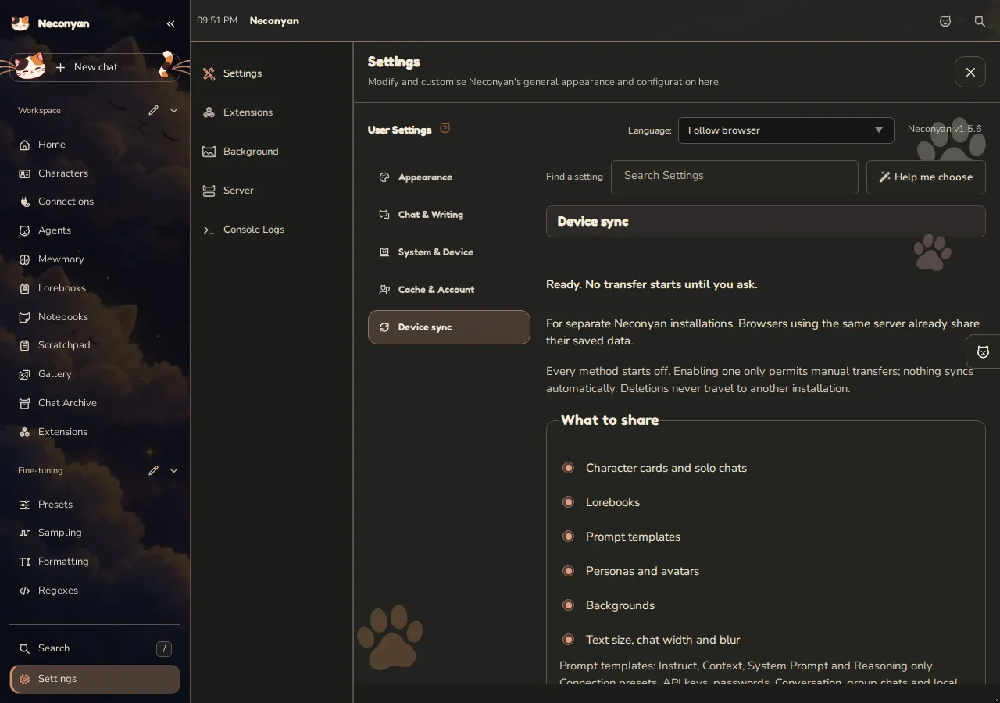

<!-- Translated from README.md at commit 31d628fa (Neconyan 1.5.5). Keep the structure in step with the English README. -->

# Neconyan~

Bản phát hành mới nhất là [1.5.5](https://github.com/platberlitz/Neconyan/releases/tag/v1.5.5).

**Đọc bằng ngôn ngữ của bạn:** [English](../README.md) · [Deutsch](readme-de_de.md) · [Español](readme-es_es.md) · [Français](readme-fr_fr.md) · [Italiano](readme-it_it.md) · [Nederlands](readme-nl_nl.md) · [Português](readme-pt_pt.md) · [Íslenska](readme-is_is.md) · [Русский](readme-ru_ru.md) · [Українська](readme-uk_ua.md) · [العربية](readme-ar_sa.md) · [ไทย](readme-th_th.md) · [日本語](readme-ja_jp.md) · [한국어](readme-ko_kr.md) · [简体中文](readme-zh_cn.md) · [繁體中文](readme-zh_tw.md)

Bản dịch này có thể cập nhật chậm hơn. [README tiếng Anh](../README.md) là bản mới nhất.

<p align="center">
  
</p>

Chào bạn, mời vào! Neconyan là bản fork mang chủ đề mèo mà mình tách ra từ [SillyTavern](https://github.com/SillyTavern/SillyTavern) và [SillyBunny](https://github.com/SillyBunnyTeam/SillyBunny), dùng để trò chuyện và nhập vai với nhân vật AI trên máy tính hoặc trên điện thoại. Mình làm ra nó vì muốn có một frontend dùng thật ấm cúng, chạy ngon lành trên điện thoại và gần như trang nào cũng có mèo. Khóa API hay mô hình cục bộ thì bạn tự lo; ứng dụng không đi kèm quyền truy cập mô hình hay credit nào.

**[Tải Neconyan](https://github.com/platberlitz/Neconyan/releases/latest)** · **[Đọc cẩm nang](https://platberlitz.github.io/neconyan-docs/)** · **[Nhờ trợ giúp](https://platberlitz.github.io/neconyan-docs/help/troubleshooting/)**

> Toàn bộ mã nguồn ở đây đều do LLM viết hoặc viết với sự hỗ trợ của LLM. Mọi prompt và tác nhân đi kèm Neconyan đều do con người làm ra.

## Bên trong có gì?

<p align="center">
  
</p>

- **Bốn cách trò chuyện:** Nhập vai kiểu cổ điển, Hội thoại kiểu ứng dụng nhắn tin, một bảng tin mạng xã hội tên là Meower, và Chế độ câu chuyện cho văn xuôi liền mạch. Tâm trạng thế nào thì chọn kiểu đó.
- **Bố cục được làm riêng cho điện thoại**, với các nút điều khiển có ghi nhãn, thanh trò chuyện ở dưới cùng và một menu trượt. Không còn phải nheo mắt bấm mấy cái nút máy tính tí hon trên màn hình nhỏ nữa.
- **[Chế độ đơn giản](#chế-độ-đơn-giản)**, dành cho lúc bạn chỉ muốn nhập vai mà không phải đối mặt với cả buồng lái đầy nút. Mình sẽ kể kỹ hơn ở bên dưới, vì mình tự hào về nó lắm.
- **Mewmory** ghi nhớ các diễn biến và nhân vật trong câu chuyện, để bạn diễn của bạn không quên những chi tiết quan trọng. **Tác nhân** có thể duy trì các trình theo dõi, kiểm tra một câu trả lời hoặc viết một Ghi chú đồng hành riêng.
- **Catelier** giúp bạn viết thẻ nhân vật và lorebook. **Sổ ghi chép** giữ ghi chú của bạn ngay trong tầm tay, còn **Scratchpad** cho bạn một khung trò chuyện riêng để bàn bạc ý tưởng.
- **Miso, Taro và Nori** là các trợ lý thường trú ở đây. Họ giúp bạn tìm những thứ bạn cần và có thể thực hiện những chỉnh sửa được hỗ trợ nếu bạn cho phép.
- **Đồng bộ thiết bị** chuyển dữ liệu đã chọn giữa các bản cài đặt riêng biệt bằng tệp mã hóa, WebDAV, GitHub Gist bí mật hoặc ghép nối trực tiếp. Việc truyền chỉ chạy khi bạn yêu cầu.
- **Chủ đề, màu nhấn và mèo.** Khá nhiều mèo. Bạn có thể ẩn chúng đi, dù mình không tưởng tượng nổi vì sao bạn lại muốn thế.

Thẻ nhân vật, cuộc trò chuyện, lorebook và preset của bạn dùng các định dạng quen thuộc của SillyTavern, nên bạn cứ thế mang chúng theo. Không có telemetry. Một số tính năng và tiện ích mở rộng của bản gốc hoạt động khác ở đây; mình chỉ lấy về những phần mình muốn. [Danh sách công cụ đi kèm](../docs/neconyan-native-tools.md) ghi công các dự án đi kèm Neconyan.

## Chế độ đơn giản

<p align="center">
  
</p>

Không mê mấy thứ dành cho dân chuyên? Chẳng muốn lội qua cả núi nút bấm chỉ để nhập vai và vui vẻ một chút? Ối chà, mình có ngay chế độ dành cho bạn đây!

**Chế độ đơn giản** là Neconyan dành cho những ai chỉ muốn RP. Bạn vẫn giữ mọi thứ làm nên chất *Neconyan*: lũ mèo, bố cục thân thiện với điện thoại, Miso, Taro và Nori, Bộ nhớ theo dõi câu chuyện của bạn, và các Tác nhân vẫn miệt mài làm việc ở phía sau. Thứ biến mất là sự bừa bộn: sampler, định dạng prompt, bộ đếm token, menu tiện ích mở rộng và tất cả những núm vặn khác mà hầu hết mọi người chẳng bao giờ đụng tới.

Và đây là phần tuyệt nhất: không có gì bị xóa hay bị tắt cả. Mọi nút điều khiển bị ẩn chỉ được cất gọn đi chứ không bị vứt bỏ, và quay lại ngay khi bạn cần.

### Bắt đầu dễ không tưởng

Ngay lần đầu bạn ghé thăm, Nori sẽ hỏi đúng một câu: **Want to keep things simple?** Nhấn **Yes, keep it simple**, và một chuyến tham quan ba bước sẽ dẫn bạn qua việc kết nối mô hình, làm quen một nhân vật và gửi lời chào. Thế thôi. Thiết lập chỉ có vậy.

Đang dùng bố cục đầy đủ rồi? Bật nó bất cứ lúc nào trong **Cài đặt → Giao diện → Chế độ đơn giản**.

<table><tr>
  <td width="72%"></td>
  <td width="28%"></td>
</tr></table>

### Cuộc trò chuyện của bạn là trung tâm

Khung trò chuyện và ô soạn tin được nhường hết chỗ, còn thanh bên chỉ giữ một danh sách ngắn những trang bạn thật sự sẽ mở: Nhân vật, Kết nối, Tác nhân, Lorebook, Sổ ghi chép, Scratchpad, Thư viện, Preset, Persona và Màu hội thoại. Thêm vào đó, bạn có ba nút tiện lợi:

- **Find characters** tìm thẻ nhân vật mới. Chọn một thẻ là cuộc trò chuyện của nó mở ra ngay, sẵn sàng để bắt đầu.
- **Bộ nhớ** mở **Story so far**, với một công tắc, một nút **Summarise now** và bản tóm tắt mới nhất của cuộc trò chuyện.
- **Updates** kiểm tra phiên bản mới và cài đặt nó mà không cần rời Chế độ đơn giản.

<table><tr>
  <td width="72%"></td>
  <td width="28%"></td>
</tr></table>

### Kết nối mà không cần làm bài tập

Trang Kết nối chỉ hiện nhà cung cấp, khóa của bạn, mô hình, **Kết nối** và **Test tin nhắn**. Mọi thứ khác nằm chờ sau **More connection options**, cho ngày nào đó bạn tò mò.

<table><tr>
  <td width="72%"></td>
  <td width="28%"></td>
</tr></table>

### Đổi ý rồi? Không sao cả

Nhấn **Hiển thị tất cả tính năng** ở thanh bên, hoặc tắt nó trong **Cài đặt → Giao diện**, và mọi nút sẽ quay về đúng chỗ bạn để lại. Các cuộc trò chuyện, nhân vật, lore và Tác nhân của bạn chẳng hề hay biết gì.

[Chế độ đơn giản trong cẩm nang](https://platberlitz.github.io/neconyan-docs/workspace/#keep-the-sidebar-simple)

## Xem qua một chút

<p align="center">
  
</p>

Còn đây là phần còn lại của chuyến tham quan! Mình chụp các ảnh màn hình trên máy tính và điện thoại này vào ngày 17 tháng 11 năm 2026, dùng các cuộc trò chuyện và ghi chú demo cùng với các trợ lý đi kèm, màu Calico Dark mặc định và **Hiển thị nền ở mức 0%**.

### Trang chủ

Chọn một nhân vật, kết nối mô hình hoặc chào một trợ lý. Lũ mèo sẽ mừng rỡ lắm khi gặp bạn.

<table><tr>
  <td width="72%"></td>
  <td width="28%"></td>
</tr></table>

### Nhập vai

Viết một cảnh truyện, thử một câu trả lời khác hoặc tiếp tục một cuộc trò chuyện cũ ngay từ chỗ bạn dừng lại.

<table><tr>
  <td width="72%"></td>
  <td width="28%"></td>
</tr></table>

### Catelier

Soạn bản nháp nhân vật, nhờ hỗ trợ viết lách và xem lại các thay đổi trước khi lưu vào thư viện của bạn.

<table><tr>
  <td width="72%"></td>
  <td width="28%"></td>
</tr></table>

### Tác nhân

Chọn một trình trợ giúp, quyết định khi nào nó chạy và cho nó một kết nối. Nếu là mình, mình sẽ bắt đầu với một cái thôi chứ không bật cả nửa thư viện cùng lúc.

<table><tr>
  <td width="72%"></td>
  <td width="28%"></td>
</tr></table>

### Proofreader sau khi tạo phản hồi

Proofreader kiểm tra một câu trả lời sau khi nó xuất hiện. Nó có thể chỉnh lại văn xuôi và định dạng mà không cần bắt mô hình chính viết lại cảnh truyện. Mở **Thay đổi agent** để so sánh bản chỉnh sửa và hoàn tác nếu bạn thích bản gốc hơn.

<table><tr>
  <td width="72%"></td>
  <td width="28%"></td>
</tr></table>

Ví dụ dàn dựng này chạy quy trình Tác nhân thật với một phản hồi mẫu cố định. Khi dùng bình thường, mô hình đã kết nối của bạn sẽ viết các chỉnh sửa, và mỗi lượt có thể tốn thêm một yêu cầu. [Tác nhân và Đồng hành trong cẩm nang](https://platberlitz.github.io/neconyan-docs/helpers/agents/).

<details>
<summary><b>Thêm ảnh chụp màn hình: Hội thoại, Meower, Chế độ câu chuyện, Sổ ghi chép, Scratchpad và Đồng bộ thiết bị</b></summary>

### Hội thoại

Nhắn tin với nhân vật của bạn, tạo trò chuyện nhóm và để họ có lúc bận hoặc ngoại tuyến, y như bạn bè ngoài đời.

<table><tr>
  <td width="72%"></td>
  <td width="28%"></td>
</tr></table>

### Meower

Một bảng tin mạng xã hội nơi các nhân vật của bạn đăng bài, trả lời và mở bình chọn. Trong đó loạn cả lên, theo kiểu vui nhất có thể.

<table><tr>
  <td width="72%"></td>
  <td width="28%"></td>
</tr></table>

### Chế độ câu chuyện

Đọc cuộc trò chuyện của bạn như văn xuôi liền mạch, giống một cuốn sách hai bên cùng nhau viết.

<table><tr>
  <td width="72%"></td>
  <td width="28%"></td>
</tr></table>

### Sổ ghi chép

Giữ kế hoạch cảnh truyện, địa điểm và nhật ký mỗi buổi chơi ngay cạnh các cuộc trò chuyện của bạn.

<table><tr>
  <td width="72%"></td>
  <td width="28%"></td>
</tr></table>

### Scratchpad

Bàn về câu chuyện với một trợ lý hoặc cả một bàn tròn gồm các nhân vật, mà không đưa cuộc thảo luận của họ vào cuộc trò chuyện chính.

<table><tr>
  <td width="72%"></td>
  <td width="28%"></td>
</tr></table>

### Đồng bộ thiết bị

Chuyển các thư viện đã chọn giữa các bản cài đặt riêng biệt. Chọn tệp mã hóa, WebDAV, một GitHub Gist bí mật hoặc ghép nối trực tiếp; việc truyền chỉ bắt đầu khi bạn yêu cầu. [Thiết lập và khôi phục trong cẩm nang](https://platberlitz.github.io/neconyan-docs/help/device-sync/).

<table><tr>
  <td width="72%"></td>
  <td width="28%"></td>
</tr></table>

</details>

## Bắt đầu

<p align="center">
  
</p>

Sẵn sàng thử chưa? Chọn thiết bị bạn muốn dùng nhé.

### Trên máy tính

1. Tải tệp có đuôi **-source.zip** từ [bản phát hành mới nhất](https://github.com/platberlitz/Neconyan/releases/latest). Hãy giải nén nó trước; trên Windows, nhấp chuột phải và chọn **Extract All**.
2. Mở thư mục. Chạy **Start.bat** trên Windows, **Start.command** trên macOS, hoặc **bash start.sh** trong terminal trên Linux.
3. Hãy cho lần khởi động đầu tiên vài phút để cài những thứ cần thiết. Giữ cửa sổ terminal luôn mở trong lúc bạn dùng Neconyan.
4. Trình duyệt của bạn sẽ tự mở ra. Nếu không, hãy truy cập **http://127.0.0.1:4433/**.
5. Mở **Kết nối**, chọn nhà cung cấp và mô hình, rồi nhập khóa API hoặc địa chỉ của mô hình cục bộ. Sau đó, hãy mở một nhân vật hoặc một trợ lý ở Trang chủ, thế là xong, lên đường thôi!

Lần sau, bạn chỉ cần chạy lại đúng trình khởi động đó. Để dừng Neconyan, nhấn **Ctrl+C** trong terminal của nó.

Bạn thích dùng Git hơn? Hãy clone repository, rồi dùng cùng trình khởi động đó:

```sh
git clone https://github.com/platberlitz/Neconyan.git
```

[Cài đặt trên máy tính và các sự cố khởi động thường gặp](https://platberlitz.github.io/neconyan-docs/start/computer/)

### Ứng dụng Android

Tải tệp **-android-arm64.apk** từ [bản phát hành mới nhất](https://github.com/platberlitz/Neconyan/releases/latest) rồi mở nó. Nếu Android hỏi, hãy cho phép trình duyệt của bạn cài đặt ứng dụng. Bạn cần **Android 11 trở lên**, **Android System WebView 124 trở lên** và còn trống khoảng **2 GiB**.

Ứng dụng chạy ngay trên chính chiếc điện thoại, không cần Termux hay máy tính. Hãy để lần mở đầu tiên có thời gian giải nén, rồi thiết lập **Kết nối**. Hãy cài bản cập nhật đè lên ứng dụng hiện có để giữ lại các cuộc trò chuyện của bạn.

[Cài đặt Android](https://platberlitz.github.io/neconyan-docs/start/android/) · [Hướng dẫn build](../android/README.md)

### Ứng dụng iPhone

Tải tệp **-ios-unsigned.ipa** từ [bản phát hành mới nhất](https://github.com/platberlitz/Neconyan/releases/latest), rồi cài nó bằng một công cụ sideload như [iloader](https://github.com/nab138/iloader). Bạn cần **iOS 17 trở lên**. Ứng dụng giữ máy chủ và các cuộc trò chuyện của nó ngay trên điện thoại; nó không có trên App Store.

Với tài khoản Apple miễn phí, ứng dụng phải được ký lại sau mỗi bảy ngày và bạn chỉ được sideload ba ứng dụng. Hãy cài bản cập nhật đè lên ứng dụng hiện có bằng cùng một tài khoản Apple. **Xóa ứng dụng là xóa luôn dữ liệu của nó**, nên hãy xuất một bản sao lưu trước.

[Cài đặt iPhone và các giới hạn](../ios/README.md)

### Những cách khác để dùng trên điện thoại

- **Android qua Termux:** hãy làm theo [hướng dẫn Termux](https://platberlitz.github.io/neconyan-docs/start/android/#prefer-termux) nếu bạn thích dùng terminal hoặc có điện thoại đời cũ.
- **Dùng bản cài trên máy tính:** hãy làm theo [hướng dẫn cùng mạng Wi-Fi](https://platberlitz.github.io/neconyan-docs/start/phone/). Cả hai thiết bị dùng chung các cuộc trò chuyện đã lưu; hãy để máy tính luôn chạy.

## Cập nhật, sao lưu và chuyển các cuộc trò chuyện

Mở **Máy chủ → Cập nhật & Khởi động lại → Kiểm tra cập nhật**. Bản cài bằng Git và bản cài từ ZIP mã nguồn được hỗ trợ sẽ có **Cập nhật & Khởi động lại**. Android có **Update APK** và sẽ yêu cầu bạn xác nhận việc cài đặt. Ở Chế độ đơn giản, nút **Updates** trên thanh bên cũng đưa bạn đến đúng chỗ đó. Các bản ZIP cũ không có trình cập nhật cần [chuyển thủ công sang thư mục mới hơn](https://platberlitz.github.io/neconyan-docs/help/backups/#update-a-zip-installation).

Bản cài bằng Git cũng tự kiểm tra cập nhật khi khởi động. Những thay đổi bạn đã làm với các tệp của chính ứng dụng có thể khiến việc cập nhật tự động bị dừng; các cuộc trò chuyện và cài đặt của bạn thì không tính.

Bạn chuyển từ SillyTavern hoặc SillyBunny sang? Chào mừng bạn! **Hãy sao lưu trước**, cho Neconyan một thư mục dữ liệu riêng, rồi làm theo [Nhập dữ liệu của bạn](https://platberlitz.github.io/neconyan-docs/start/imports/). Hãy kiểm tra nhân vật và các cuộc trò chuyện của bạn trước khi xóa bất cứ thứ gì. Một số tiện ích mở rộng có thể cần chỉnh sửa.

[Sao lưu và khôi phục](https://platberlitz.github.io/neconyan-docs/help/backups/) · [Chuyển dữ liệu giữa các thiết bị](../docs/data-portability.md)

## Cần giúp một tay?

Nếu là mình, mình sẽ bắt đầu từ [cẩm nang](https://platberlitz.github.io/neconyan-docs/), hoặc hỏi Miso, Taro hay Nori ở Trang chủ; họ lúc nào cũng sẵn lòng giúp đỡ. Có điều họ vẫn có thể nhầm lẫn, nên hãy kiểm tra lời khuyên của họ trước khi thực hiện một thay đổi mà bạn không thể hoàn tác.

Nếu không thấy một cài đặt nào đó, hãy thử **Tìm kiếm** ở thanh bên. Nếu gặp lỗi, hãy xem [hướng dẫn khắc phục sự cố](https://platberlitz.github.io/neconyan-docs/help/troubleshooting/) hoặc [mở một issue](https://github.com/platberlitz/Neconyan/issues) kèm theo việc bạn đang làm và lỗi được hiển thị.

## Ghi công

<p align="center">
  
</p>

Neconyan được xây dựng trên công sức của tất cả những người đứng sau SillyTavern và SillyBunny; không có họ thì sẽ không có những thứ này. [Danh sách công cụ đi kèm](../docs/neconyan-native-tools.md) ghi công các tác giả gốc của chúng.

Được làm ra bằng cả tấm lòng bởi [Platberlitz](https://github.com/platberlitz). Phát hành theo giấy phép [GNU AGPL v3](../LICENSE). Nếu bạn phân phối lại, hãy giữ nguyên các thông báo và giấy phép.

Đặc biệt cảm ơn **El Topo**, người trợ giúp chính và cộng tác viên của mình. Mình thật sự trân trọng mọi công sức bạn đã bỏ ra cho Neconyan.

Chúc bạn vui vẻ, và gửi lời chào lũ mèo giúp mình nhé!
