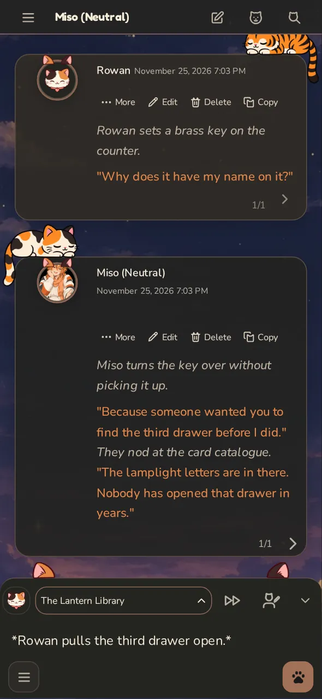
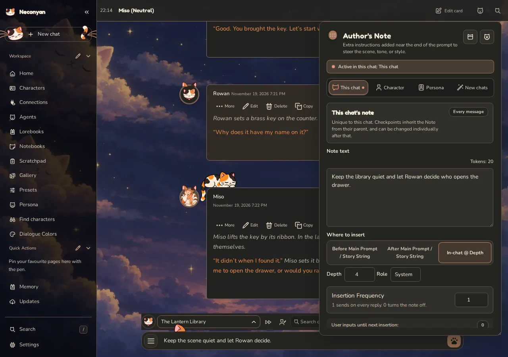
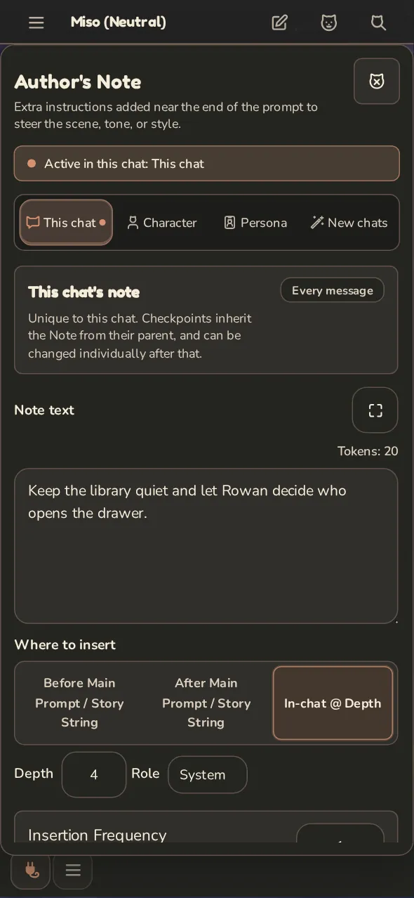
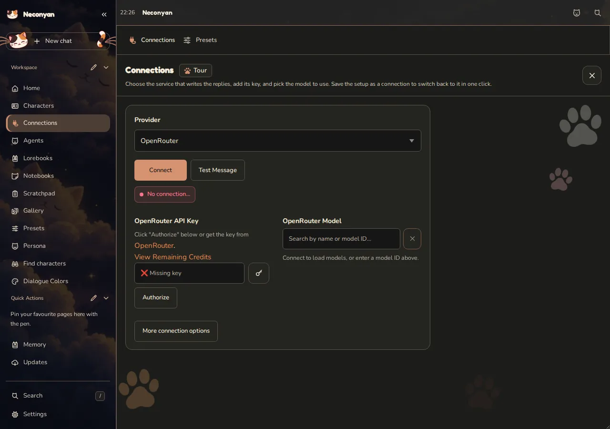
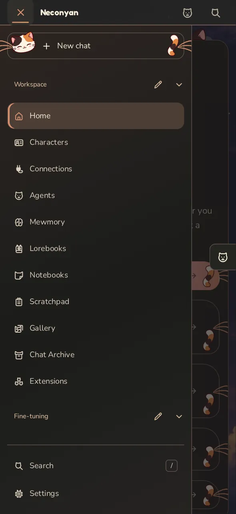

<!-- This file mirrors the root README so GitHub renders the correct project homepage copy. -->

# Neconyan~

The latest version is [1.5.7](https://github.com/platberlitz/Neconyan/releases/tag/v1.5.7).

**Read in your language:** [Deutsch](readme-de_de.md) · [Español](readme-es_es.md) · [Français](readme-fr_fr.md) · [Italiano](readme-it_it.md) · [Nederlands](readme-nl_nl.md) · [Português](readme-pt_pt.md) · [Íslenska](readme-is_is.md) · [Türkçe](readme-tr_tr.md) · [Русский](readme-ru_ru.md) · [Українська](readme-uk_ua.md) · [العربية](readme-ar_sa.md) · [ไทย](readme-th_th.md) · [Tiếng Việt](readme-vi_vn.md) · [日本語](readme-ja_jp.md) · [한국어](readme-ko_kr.md) · [简体中文](readme-zh_cn.md) · [繁體中文](readme-zh_tw.md)

Translations may lag behind. This English README is current.

<p align="center">
  
</p>

Hi, welcome in! Neconyan is my cat-themed fork of [SillyTavern](https://github.com/SillyTavern/SillyTavern) and [SillyBunny](https://github.com/SillyBunnyTeam/SillyBunny) for chatting and roleplaying with AI characters, on a computer or on your phone. I made it because I wanted a frontend that's cosy to use, works properly on a phone and has a cat on nearly every page. Bring your own API key or local model; the app doesn't include model access or credits.

**[Download Neconyan](https://github.com/platberlitz/Neconyan/releases/latest)** · **[Read the handbook](https://platberlitz.github.io/neconyan-docs/)** · **[Get help](https://platberlitz.github.io/neconyan-docs/help/troubleshooting/)**

> All the code here is LLM-generated or LLM-assisted. Every prompt and agent that ships with Neconyan is human-made.

## What's in here?

<p align="center">
  
</p>

- **Four ways to chat:** classic Roleplay, messenger-style Conversation, a social feed called Meower, and Story Mode for continuous prose. Pick whichever suits the mood.
- **A layout made for phones**, with labelled controls, a bottom chat bar and a sliding menu. No squinting at tiny desktop buttons on a small screen.
- **[Simple Mode](#simple-mode)**, for when you just want to roleplay without a cockpit's worth of buttons. More on that one below, because I'm very proud of it.
- **Mewmory** remembers story events and characters, so your partner doesn't forget the important bits. **Agents** can keep trackers, check a reply or write a separate Companion note.
- **Catelier** helps you write character cards and lorebooks. **Notebooks** keeps your notes nearby, and **Scratchpad** gives you a separate chat to talk through ideas.
- **Miso, Taro and Nori** are the resident assistants. They help you find things and can make supported edits with your permission.
- **Device sync** moves selected data between separate installations with encrypted files, WebDAV, secret GitHub Gists or direct pairing. Transfers run when you ask for them.
- **Themes, accents and cats.** Quite a lot of cats. You can hide them, though I can't imagine why you'd want to.

Your character cards, chats, lorebooks and presets use familiar SillyTavern formats, so they come along with you. There's no telemetry. Some upstream features and extensions behave differently here; I only bring across the bits I want. The [included tools list](../docs/neconyan-native-tools.md) credits the projects bundled with Neconyan.

## Simple Mode

<p align="center">
  
</p>

Not into power-user stuff? Don't fancy wading through tons of buttons just to roleplay and have a good time? Boy, have I got the mode for you!

**Simple Mode** is Neconyan for people who just want to RP. You keep everything that makes Neconyan *Neconyan*: the cats, the phone-friendly layout, Miso, Taro and Nori, Memory keeping track of your story, and your Agents carrying on in the background. What goes away is the clutter: samplers, prompt formatting, token counters, extension menus and all the other knobs most people never touch.

And here's the best part: nothing is deleted or switched off. Every hidden control is tucked away, not thrown away, and comes straight back the moment you want it.

### Getting it couldn't be easier

On your very first visit, Nori asks one question: **Want to keep things simple?** Press **Yes, keep it simple** and a three-step tour takes you through connecting a model, meeting a character and saying hello. That's it. That's the whole setup.

Already using the full layout? Turn it on any time in **Settings → Appearance → Simple Mode**.

<table><tr>
  <td width="72%"></td>
  <td width="28%"></td>
</tr></table>

### Your chat, front and centre

The chat and the composer get the room, and the sidebar keeps a short list of pages you'll actually open: Characters, Connections, Agents, Lorebooks, Notebooks, Scratchpad, Gallery, Presets, Persona and Dialogue Colors. On top of that you get three handy buttons:

- **Find characters** searches for new cards. Pick one and its chat opens straight away, ready to go.
- **Memory** opens **Story so far**, with one switch, a **Summarise now** button and the latest summary of your chat.
- **Updates** checks for a new version and installs it without leaving Simple Mode.

When enabled in Guided Generations, **Guided Swipe** and **Guided Impersonate** sit next to **Switch chat**, even when you collapse the chat bar. The first keeps your original reply and makes an alternative. The second drafts your next message without sending it.

<table><tr>
  <td width="72%"></td>
  <td width="28%"></td>
</tr></table>

**Chat tools → Author's Note** opens the editor without leaving Simple Mode. All four tabs are there on a phone as well.

<details>
<summary>See Author's Note and the shorter phone menu</summary>

<table><tr>
  <td width="72%"></td>
  <td width="28%"></td>
</tr></table>


</details>

### Connecting without the homework

Connections shows just the provider, your key, the model, **Connect** and **Test Message**. Everything else waits behind **More connection options**, for the day you're curious.

<table><tr>
  <td width="72%"></td>
  <td width="28%"></td>
</tr></table>

### Changed your mind? No problem

Press **Show all features** in the sidebar, or turn it off in **Settings → Appearance**, and every button comes right back where you left it. Your chats, characters, lore and Agents don't notice a thing.

[Simple Mode in the handbook](https://platberlitz.github.io/neconyan-docs/workspace/#keep-the-sidebar-simple)

## Have a look

<p align="center">
  
</p>

I captured these desktop and phone screenshots using demo chats and notes with the bundled assistants, the default Calico Dark colours and opaque panels.

### Home

Pick a character, connect a model or say hi to an assistant. The cats will be thrilled to see you.

<table><tr>
  <td width="72%"></td>
  <td width="28%"></td>
</tr></table>

<details>
<summary>See the workspace menu on a phone</summary>



</details>

### Roleplay

Write a scene, try another reply or pick up an old chat right where you left it.

<table><tr>
  <td width="72%"></td>
  <td width="28%"></td>
</tr></table>

### Catelier

Work on a character draft, ask for writing help and review changes before saving to your library.

<table><tr>
  <td width="72%"></td>
  <td width="28%"></td>
</tr></table>

### Agents

Pick a helper, decide when it runs and give it a connection. I'd start with one rather than turning on half the library at once.

<table><tr>
  <td width="72%"></td>
  <td width="28%"></td>
</tr></table>

### Post-gen Proofreader

Proofreader checks a reply after it arrives. It can tidy prose and formatting without asking the main model to write the scene again. Open **Agent changes** to compare the edit and undo it if you prefer the original.

<table><tr>
  <td width="72%"></td>
  <td width="28%"></td>
</tr></table>

This staged example runs the real Agent workflow with a fixed sample response. Your connected model writes the edits in normal use, and each pass can cost another request. [Agents and Companions in the handbook](https://platberlitz.github.io/neconyan-docs/helpers/agents/).

<details>
<summary><b>More screenshots: Conversation, Meower, Story Mode, Notebooks, Scratchpad and Device sync</b></summary>

### Conversation

Text your characters, make group chats and let them be busy or offline, just like real friends.

<table><tr>
  <td width="72%"></td>
  <td width="28%"></td>
</tr></table>

### Meower

A social feed where your characters post, reply and run polls. It gets chaotic in there, in the best way.

<table><tr>
  <td width="72%"></td>
  <td width="28%"></td>
</tr></table>

### Story Mode

Read your chat as continuous prose, like a book you wrote together.

<table><tr>
  <td width="72%"></td>
  <td width="28%"></td>
</tr></table>

### Notebooks

Keep scene plans, places and session journals next to your chats. On a phone, I tucked folders under **Notebook options** and formatting under **Note tools** so the note has more room.

<table><tr>
  <td width="72%"></td>
  <td width="28%"></td>
</tr></table>

### Scratchpad

Talk the story over with an assistant or a round table of characters, without adding their discussion to the main chat.

<table><tr>
  <td width="72%"></td>
  <td width="28%"></td>
</tr></table>

### Device sync

Move selected libraries between separate installations. Choose encrypted files, WebDAV, a secret GitHub Gist or direct pairing; transfers start when you ask. [Setup and recovery in the handbook](https://platberlitz.github.io/neconyan-docs/help/device-sync/).

<table><tr>
  <td width="72%"></td>
  <td width="28%"></td>
</tr></table>

</details>

## Get started

<p align="center">
  
</p>

Ready to give it a go? Pick whichever device you'd like to use.

### On a computer

1. Download the file ending in **-source.zip** from the [latest release](https://github.com/platberlitz/Neconyan/releases/latest). Unzip it first; on Windows, right-click and choose **Extract All**.
2. Open the folder. Run **Start.bat** on Windows, **Start.command** on macOS, or **bash start.sh** in a terminal on Linux.
3. Give the first start a few minutes to install what it needs. Keep the terminal window open while you use Neconyan.
4. Your browser should open automatically. Otherwise, go to **http://127.0.0.1:4433/**.
5. Open **Connections**, choose your provider and model, and enter your API key or local model's address. Then open a character or an assistant on Home, and you're off!

Next time, run the same launcher. To stop Neconyan, press **Ctrl+C** in its terminal.

Prefer Git? Clone the repository, then use the same launcher:

```sh
git clone https://github.com/platberlitz/Neconyan.git
```

[Computer setup and common startup problems](https://platberlitz.github.io/neconyan-docs/start/computer/)

### Android app

Download the **-android-arm64.apk** from the [latest release](https://github.com/platberlitz/Neconyan/releases/latest) and open it. Allow installation from your browser if Android asks. You need **Android 11 or newer**, **Android System WebView 124 or newer**, and about **2 GiB** free.

The app runs on the phone itself, without Termux or a computer. Give its first opening time to unpack, then set up **Connections**. Install updates over the existing app to keep your chats.

[Android setup](https://platberlitz.github.io/neconyan-docs/start/android/) · [Build instructions](../android/README.md)

### iPhone app

Download the **-ios-unsigned.ipa** from the [latest release](https://github.com/platberlitz/Neconyan/releases/latest), then install it with a sideloading tool such as [iloader](https://github.com/nab138/iloader). You need **iOS 17 or newer**. The app keeps its server and chats on the phone; it isn't on the App Store.

A free Apple account needs to re-sign the app every seven days and permits three sideloaded apps. Update over the existing app with the same Apple account. **Deleting the app deletes its data**, so export a backup first.

[iPhone setup and limits](../ios/README.md)

### Other ways to use your phone

- **Android with Termux:** follow the [Termux guide](https://platberlitz.github.io/neconyan-docs/start/android/#prefer-termux) if you prefer a terminal or have an older phone.
- **Use a computer's installation:** follow the [same-Wi-Fi guide](https://platberlitz.github.io/neconyan-docs/start/phone/). Both devices use the same saved chats; keep the computer running.

## Updates, backups and moving your chats

Open **Server → Updates & Restart → Check for updates**. Git and supported source ZIP installs offer **Update & Restart**. Android offers **Update APK** and asks you to approve installation. In Simple Mode, the **Updates** button in the sidebar takes you to the same place. Older ZIP copies without an updater need a [manual move to the newer folder](https://platberlitz.github.io/neconyan-docs/help/backups/#update-a-zip-installation).

Git installs also check for updates when launched. Changes you've made to the app's own files can stop an automatic update; your chats and settings don't count.

Coming from SillyTavern or SillyBunny? Welcome! **Back up first**, give Neconyan its own data folder, then follow [Import your data](https://platberlitz.github.io/neconyan-docs/start/imports/). Check your characters and chats before deleting anything. Some extensions may need adjusting.

[Backups and restoring](https://platberlitz.github.io/neconyan-docs/help/backups/) · [Moving data between devices](../docs/data-portability.md)

## Need a hand?

I'd start with the [handbook](https://platberlitz.github.io/neconyan-docs/), or ask Miso, Taro or Nori on Home; they're always happy to help. They can get things wrong, though, so check their advice before making a change you can't undo.

For missing settings, try **Search** in the sidebar. For errors, use the [troubleshooting guide](https://platberlitz.github.io/neconyan-docs/help/troubleshooting/) or [report an issue](https://github.com/platberlitz/Neconyan/issues) with what you were doing and the error shown.

## Credits

<p align="center">
  
</p>

Neconyan is built on the work of everyone behind SillyTavern and SillyBunny; none of this would exist without them. The [included tools list](../docs/neconyan-native-tools.md) credits their original authors.

Made with love by [Platberlitz](https://github.com/platberlitz). Licensed under [GNU AGPL v3](../LICENSE). Keep the notices and licences if you redistribute it.

Special thanks to **El Topo**, my primary helper and contributor. I really appreciate all the work you've put into Neconyan.

Have fun, and say hi to the cats for me!
